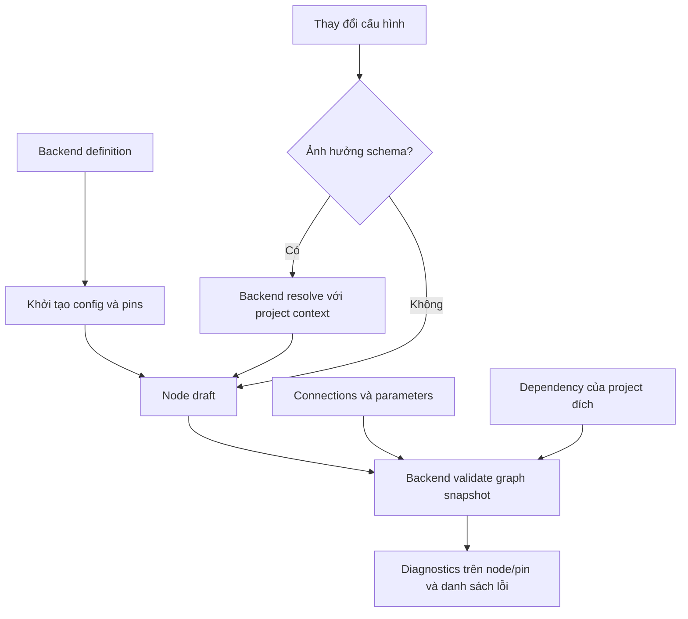

# Node Lifecycle: Khởi tạo, Resolve và Validation từ Backend

Ngày: 22/10/2026 (Cập nhật 23/10/2026). Trạng thái: **R1 + R2 đã hoàn tất; R3 + R4 là lộ trình tiếp theo**.

Kế thừa checkpoint Phase B `d87a08d` trong [Node Strategy & Field Adapters](2026-10-22-node-strategy-and-field-adapters.md). Tài liệu này ghi nhận mental model và lộ trình; R1 và R2 đã được triển khai và kiểm chứng tự động.

## 1. Mục tiêu và nguồn chân lý

Backend sở hữu định nghĩa node, cách tính schema pin và quy tắc kiểm tra hợp lệ. Frontend quản lý draft, hiển thị kết quả và thao tác người dùng. Dùng cùng quy tắc backend cho authoring, kiểm tra sau import và preflight trước Run.

| Thành phần | Sở hữu dữ liệu / trách nhiệm |
| --- | --- |
| Definition | Config mặc định, pins khởi tạo, capabilities, isDynamic; dự kiến khai báo cấu hình nào ảnh hưởng schema |
| Node instance | refId/kind, config người dùng, resolved inputs/outputs, vị trí và thông tin file |
| Resolve | Tính schema input/output từ definition + config + context project; không thực thi tool |
| Graph validation | Kiểm tra config, connections, parameters và dependency trong môi trường hiện tại |
| Canvas | Render schema instance, hiển thị diagnostics theo node/pin; không tự suy đoán tên tool |

Palette cung cấp definition dùng chung, không ghi đè pins instance khi refetch. Capabilities/isDynamic không quay lại Graph DTO. Kết quả valid/invalid là dữ liệu suy ra, không thêm cột DB để lưu cờ này.

## 2. Mental model và luồng đích

### Khởi tạo và thay đổi schema

- Backend định nghĩa trạng thái ban đầu hợp lệ hoặc chưa đầy đủ của từng tool. Frontend không tự mặc định Resource hoặc tự thêm pin theo tên tool.
- Phân biệt input cấu hình schema (StructType, template, danh sách dynamic pins) và input dữ liệu runtime (Target, giá trị chuỗi...). Không phải mọi thay đổi giá trị đều cần resolve.
- Định hướng: backend khai báo các config key ảnh hưởng schema. Tên field/interface cụ thể phải chốt trong phase contract, không tạo một framework luật tổng quát.
- Resolver trả schema đầy đủ; frontend nhận biết thay đổi cả type/cardinality/structType/metadata/default/required, không chỉ số pin và ID.
- Không nối pins từ struct catalogue để thay thế kết quả resolver. Catalogue phục vụ chọn loại và preview.
- Dây có pin đã biến mất được xử lý theo hướng input/output. Dây còn tồn tại nhưng không tương thích kiểu phải được graph validator chỉ rõ; không tự xóa mọi dây khi đổi config.
- Resolve thất bại hoặc chưa hoàn tất không đồng nghĩa schema rỗng hợp lệ. Giữ trạng thái hiển thị có thể giải thích, không xóa pins/edges hàng loạt vì lỗi request.

### Ví dụ BreakStruct

1. Có ô cấu hình Struct Type cố định do backend định nghĩa.
2. Chọn Runner: resolve trả Target kiểu EntityRef/Runner và outputs của Runner.
3. Target có thể nối dây hoặc chọn instance nếu loại đó có API/control hỗ trợ. Có schema struct không tự bảo đảm có instance selector.
4. Đổi sang Resource: resolve schema mới, kiểm tra Target cũ có còn hợp lệ. Cách báo lỗi hoặc clear giá trị phụ thuộc cần chốt trong phase contract; không âm thầm giữ Runner ID như Resource ID.
5. Định hướng UX đang cân nhắc: node mới chưa chọn type hiện cảnh báo. Hiện backend vẫn mặc định Resource; chưa quyết định thay đổi mặc định này trong code.

### Validation và trạng thái hiển thị

- Backend kết luận từ graph snapshot: node configs + edges + pipeline parameters + definitions + dependency context.
- Pin bắt buộc có connection hợp lệ không bị báo thiếu chỉ vì config trống. Dữ liệu được cấp qua pipeline input/runtime cần phân biệt với cấu hình thiếu khi authoring.
- Không gọi ExecuteAsync để kiểm tra. Các điều kiện chỉ biết lúc chạy tiếp tục được kiểm tra runtime.
- Đề xuất diagnostic gồm code ổn định, severity, message, nodeId/pinId/edgeId khi có, và ảnh hưởng đến khả năng chạy. Issue toàn graph không bắt buộc có nodeId.
- Warning/error là trạng thái dùng chung phủ lên view hiện tại, không tạo view thay thế làm mất pins. Inspector/list issues cho biết nguyên nhân và điều hướng tới node/pin.
- UI phân biệt chưa kiểm tra, đang kiểm tra, kết quả hiện hành và kết quả cũ. Khi draft đổi không tiếp tục hiển thị kết quả cũ như xác nhận hợp lệ.
- Endpoint validate hiện chỉ đọc graph đã lưu. Kiểm tra draft phải nhận snapshot hoặc đợi save hoàn tất; không đánh dấu draft hiện tại hợp lệ bằng kết quả của DB cũ. Quyết định cơ chế cụ thể ở phase validation.

### Export/import

- Phân biệt có thể lưu/chia sẻ với có thể chạy. Pipeline template có thể cố ý chưa gán Runner/Resource.
- Import kiểm tra package integrity riêng; sau mapping ID/dependency, chạy graph validation trong project đích.
- Các lỗi cần định vị: missing definition, script/file chưa gắn, struct/content type chưa map, entity tham chiếu không tồn tại, pin bắt buộc chưa có nguồn, kết nối sai kiểu.
- Không tin cờ valid được export từ môi trường nguồn. Không lưu diagnostics trong bundle như kết luận cuối cùng cho project đích.
- Đề xuất: cho lưu draft/template chưa đủ điều kiện chạy và hiện checklist sửa; điều kiện chặn import/export cần chốt riêng, không thay đổi âm thầm.

## 3. Hiện trạng đã kiểm tra

- Phase B có definition cache/provider, router, visibility menu; Graph DTO đã bỏ Capabilities. Checkpoint có automated tests pass, chưa nghiệm thu UI.
- ResolveToolPins hiện nhận ToolId, ConfigValues, ProjectId; trả Inputs/Outputs. Endpoint tạo PinResolutionContext với project. Frontend resolver chưa truyền projectId, cần rà soát khi nối dynamic project structs.
- ResolveToolPins chưa trả diagnostics hay normalized config. Không giả định các contract đích ở phần 2 đã tồn tại.
- ValidatePipeline hiện đọc graph trong DB, gọi BuildExecPlan, trả IsValid/CycleNodeIds/UnresolvedPins. Cần mở rộng/tái sử dụng nền này, không dựng validator frontend song song.
- Draft còn nhánh BreakStruct/MakeStruct gọi getStructPins thiếu catalogue: nhận [], hiện không ghi đè pins; đây là code chết cần xóa, không phải lỗi ghi đè đã tái hiện.
- Inspector còn fallback tên tool cho StructSelector. Collection actions còn ngoại lệ Separator; AppendString hiện chỉ có A/B. Protected pins vẫn có thể là thành viên DynamicPins; không dùng protectedPinIds như danh sách loại khỏi schema.
- Resolver frontend hiện chỉ so ID/số lượng để cập nhật schema. Chưa xử lý đầy đủ thay đổi type với cùng ID.

## 4. Lộ trình và nghiệm thu

### R1 — Khép phần B còn sót (✅ Đã hoàn tất 23/10/2026)

- Đã chuyển `NodeConfigInspector` sang dựa hoàn toàn vào `definition.capabilities.inspectorMode === "StructSelector"`, đồng thời bổ sung `Capabilities` cho `CastToStructTool` và `MakeMapTool`.
- Đã xóa toàn bộ hàm chết `getStructPins` trong `usePipelineDraftState.ts`, `useCanvasConnectionRules.ts`, `structPins.ts` và xóa hook thừa `useDynamicPins.ts`.
- Đã bỏ ngoại lệ cứng `p.id !== "Separator"` trong `useCollectionPinActions.ts`.
- `useNodePinResolver` đã truyền `projectId` từ `usePipelineFormScope()`, so sánh đầy đủ schema pin bằng `arePinListsEqual` (nhận diện đổi `structType`/`cardinality` trên cùng `id`) và dọn orphan edges tách biệt theo chiều `validInputPinIds` / `validOutputPinIds`.

### R2 — Chốt contract khởi tạo và resolve (✅ Đã hoàn tất 23/10/2026)

- Đã chọn **Phương án A (Unselected Struct State)**: `BreakStruct`, `MakeStruct`, `CastToStruct` mới kéo ra chưa chọn `StructType` (`""`), chỉ hiển thị input `StructType` và cảnh báo `"Select a Struct Type in Inspector"`.
- Khi đổi `StructType` sang loại khác, `applyNodeConfigUpdate` tự động xóa `Target` và các field cấu hình phụ thuộc của struct cũ, đồng thời dọn dây nối vào `Target`.
- Đã bổ sung `SchemaConfigKeys` vào `NodeCapabilities` trên Backend cho toàn bộ dynamic tools (`BreakStruct`, `MakeStruct`, `CastToStruct`, `FormatString`, `MakeArray`, `AppendString`, `MakeMap`, `GetByPath`, `BreakContentItem`, `GetVariable`, `SetVariable`).
- `useNodePinResolver` chỉ theo dõi chữ ký `buildSchemaConfigSignature(configValues, schemaConfigKeys)` và áp dụng **Debounce 300ms** kèm `AbortController` (`signal`), giúp chỉnh sửa dữ liệu runtime (`Target`, `Item_1`...) không gọi `/resolve-pins` dư thừa.

### R3 — Backend diagnostics và UI cảnh báo

- Tái sử dụng planner/validator hiện có; tách quy tắc dùng chung để authoring và preflight không mâu thuẫn.
- Chốt validation input là snapshot draft hay graph đã save, diagnostic DTO, severity và điều kiện chặn Run.
- Dùng cùng rule kiểm tra required/config/connection và tool-specific constraints; không truy cập chéo DbContext, dependency được tra qua API module hiện có.
- Test required input wired/unwired, runtime parameter, missing dependency, schema mismatch, cycle; kết quả cũ không ghi đè trạng thái draft mới.

### R4 — Áp dụng vào import/export

- Sau import/remapping chạy validation trong project đích; hiển thị issue theo node/pin mới.
- Chốt lỗi package nào chặn import, thiếu cấu hình nào cho phép import thành draft và giới hạn export template.
- Test thiếu script/file/entity/struct, mapping thành công, sửa cấu hình rồi hết lỗi; không mang trạng thái valid từ nguồn sang đích.

Phase C Field Adapter đi sau R1 và hợp đồng liên quan của R2: chọn control theo pin contract, không quyết định schema. R3/R4 là scope mới, không coi đã được phép implement chỉ vì tài liệu được cập nhật. Autosave gate/request ordering phải có thiết kế riêng khi mở scope đồng bộ; chưa thêm concurrency/persistence machinery.

## 5. Các quyết định còn mở trước implementation

- BreakStruct mới mặc định Resource hay bắt buộc chọn type?
- Schema change tự clear Target không tương thích hay giữ và báo lỗi để người dùng xử lý?
- Contract đánh dấu schema-affecting config keys và context pipeline parameters cho resolver.
- Tần suất/điểm gọi validation; snapshot draft hay save-then-validate; cách nhận biết kết quả cũ bằng dữ liệu có sẵn trước khi thêm revision mới.
- Severity và quy tắc chặn Run/import/export; giới hạn kiểm tra dependency và runtime-only conditions.
- AppendString giữ hay ẩn khỏi menu là quyết định sản phẩm riêng; không xóa tool khi đang có graph dùng nó.
