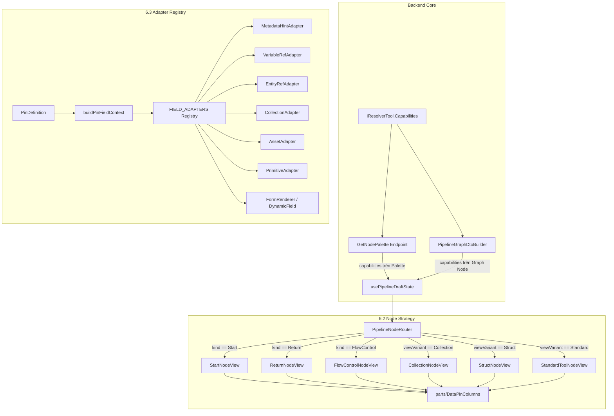

# Kế hoạch Kỹ thuật: Node View Strategy (6.2) & Field Adapter Registry (6.3)

## Điều chỉnh Phase B — 22/10/2026 (ưu tiên hơn mô tả cũ bên dưới)

**Trạng thái: B0/B1 đã triển khai và qua kiểm tra tự động; chờ nghiệm thu UI.** Mô tả A/B cũ bên dưới là lịch sử, không còn là hướng dẫn implementation hiện hành.

Kết quả 22/10/2026: Pipeline tests 177 pass, 4 skipped; frontend definition/menu tests 3 pass; typecheck và production build pass. API đã được chạy tạm ở Development để Orval generate client rồi dừng. Chưa kiểm tra UI F5, thêm/xóa pin, đổi struct, retry và cập nhật definition trên trình duyệt. Phase C chưa thực hiện.

Canvas dùng NodeDefinitionsProvider và query cache theo project; menu lọc visibility/executor ở client. Graph DTO đã bỏ Capabilities. Instance inputs/outputs lấy từ graph/resolver, không chép pins mặc định palette khi refetch. Router chọn view theo kind/definition; resolver chỉ gọi tại router. DataPinColumns giữ file Unbound; Standard giữ Missing Script/Missing Definition.

**Checkpoint review:** Chưa khép kín nguyên tắc backend-authoritative pins: usePipelineDraftState vẫn có nhánh BreakStruct khi load và xử lý StructType của BreakStruct/MakeStruct. Inspector còn fallback tên tool cho StructSelector; collection actions còn tên Separator. Phase C xử lý field mapping/entity controls, không tự giải quyết ba nhánh này. Cần một phần hoàn thiện pin/inspector riêng trước nghiệm thu toàn bộ Phase B; chưa có xác nhận UI.

**Làm rõ sau rà soát:** Các nhánh draft gọi `getStructPins(structType)` không truyền catalogue nên hiện trả rỗng và không có tác dụng; không phải đang ghi đè pins bằng schema frontend. Resolver còn so sánh số lượng/ID pins thay vì toàn bộ schema và cần xử lý edge theo đúng chiều input/output.

**Lộ trình tiếp nối:** [Node Resolution & Validation Lifecycle](2026-10-22-node-resolution-and-validation-lifecycle.md) tách R1 khép kín phần B, R2 chuẩn hóa khởi tạo/resolve, R3 diagnostics backend + Canvas, R4 tái sử dụng cho import/export. Đây là định hướng chưa triển khai, không mở rộng ngầm Phase C hoặc ghi nhận các kiểm thử tương lai như đã hoàn tất.

### B0. Một nguồn định nghĩa node dùng chung

- `capabilities` và `isDynamic` thuộc định nghĩa node. Backend registry là nguồn chân lý; frontend dùng một query cache theo project cho router, inspector và menu.
- Điều chỉnh GetNodePalette trả đầy đủ định nghĩa được phép đọc trong project: built-in, custom nodes và subpipelines. HiddenToolKeys trở thành metadata `isVisibleInPalette`; tool bị ẩn vẫn có định nghĩa để render graph cũ. Giữ kiểm tra quyền backend.
- Bỏ lọc executor phía endpoint. Menu lọc client theo visibility và các quy tắc executor/macro hiện hành; không fetch lại mỗi lần mở menu hoặc đổi stage.
- Query cache theo project, staleTime Infinity, không refetch khi focus; invalidate khi publish/update/delete custom node hoặc thay đổi định nghĩa/parameters subpipeline. Đổi project phải đọc đúng cache project mới.
- Dùng Definition Map trong provider chung; lookup theo source/kind và refId, đối chiếu cách lưu key/id hiện hành để tránh trùng giữa tool/custom/subpipeline. Không đổi refId đã lưu chỉ để phục vụ lookup.
- Fetch graph và definitions song song. Chỉ mount Canvas dùng draft state khi cả hai tải lần đầu thành công. Loading/error có UI và retry; dữ liệu rỗng thành công khác lỗi tải.
- Router và inspector đọc definition trực tiếp từ provider/query cache. Không dùng useEffect chép capabilities/isDynamic vào từng node. Refetch definitions cập nhật provider, không remount graph hay mất draft.
- Definition không tồn tại: hiện Missing Definition, giữ config/pins/edges; tắt resolver và thêm/xóa pin cho node đó. Start/Return được xử lý riêng theo kind.
- Gỡ Capabilities khỏi PipelineNodeGraphDto và builder sau khi chuyển consumer; không thêm IsDynamic vào graph. Graph giữ trạng thái instance gồm config, resolved pins, fileAssets và metadata. Không đổi save payload hay thêm migration.
- Generate API client bằng Orval, không sửa tay src/gen. Kiểm tra toàn bộ consumer capabilities/isDynamic, gồm thao tác thêm node, inspector và collection actions.

### B1. Hoàn thiện Node View Strategy

- PipelineNodeRouter chọn Start/Return/FlowControl theo kind; các tool chọn Collection/Struct/Standard theo definition.capabilities.viewVariant. Variant thiếu/không biết dùng Standard; thiếu definition có trạng thái riêng.
- Router sở hữu duy nhất useNodePinResolver; bật theo definition.isDynamic === true đối với tool. Bỏ lời gọi trong view con. FormatString dùng Standard nhưng vẫn resolve pin động.
- Đổi DynamicToolNodeView thành CollectionNodeView, ActionToolNodeView thành StandardToolNodeView; bỏ nhận diện theo tên tool/category và nhánh isBreakStruct trong Standard.
- Standard/Collection/Struct dùng useSplitPins theo PinKind. Start chỉ Exec Out, Return chỉ Exec In và data inputs; giữ FlowControl chuyên biệt. Struct chưa chọn hiển thị trạng thái chưa chọn, không mặc định Resource.
- DataPinColumns dùng chung, nhận fileAssets để giữ cảnh báo Unbound. Giữ Missing Script từ metadata instance. Nút thêm/xóa theo definition capabilities; protectedPinIds không fallback tên Items/A/B. Collection rỗng vẫn có nút thêm nếu được phép.
- Chuyển import types/helpers trực tiếp sang nodes/types.ts, bỏ re-export qua component cũ. Memo phải phản ánh props và provider, gồm fileAssets, metadata, executor và execution status/error. Dùng UI tokens hiện có.
- Thuật toán đặt tên pin, chống response resolve về sai thứ tự và autosave gate để riêng. Phase C và Parameters Panel chưa triển khai trong B.

### Nghiệm thu thiết kế sửa đổi

- Backend: hidden tools vẫn có definition, visibility đúng; custom/subpipeline đúng project; metadata đúng registry; graph không còn Capabilities.
- Frontend: menu giữ đúng lựa chọn từng stage; graph cũ chứa hidden tool vẫn render; identity không trùng giữa nguồn; lỗi tải có retry; đổi project không dùng definitions cũ.
- Cache: mở menu không fetch lại; publish/update làm invalidation; refetch không mất draft. Thiếu definition không xóa config hoặc dây.
- View: FormatString Standard vẫn resolve; không gọi resolver trùng; protected pins và nút thêm/xóa đúng sau F5; Start/Return đúng Exec; Missing Script/Unbound cập nhật đúng.
- Chạy backend tests liên quan, frontend typecheck và build; kiểm tra UI thêm/xóa pin, đổi struct, reload. Ghi rõ manual checks chưa chạy.
- Sau implementation cập nhật playbook Canvas và index theo thực tế. Không ghi thiết kế dự kiến thành hành vi đã hoàn thành.

---

Tài liệu này chi tiết hóa việc thực thi 2 mục Backlog **6.2** và **6.3** từ kế hoạch gốc [2026-10-22-refactor-pipeline-build-time-type-contract-and-struct-registry.md](file:///d:/FullStack/Automation/.agents/plans/2026-10-22-refactor-pipeline-build-time-type-contract-and-struct-registry.md), kết hợp phản hồi và kết luận từ đợt review.

Triết lý tối thượng: **No Backward Compatibility Debt** và **Backend C# là Single Source of Truth**.

---

## 1. Kết Luận Từ Review & Phản Hồi

1. **Về `Content` trong `AssignResourcesToContentTool`**:
   - Thống nhất: `Content` ở đây là một thực thể **Content Item** cụ thể (ví dụ: nhân vật "Jane", vật phẩm "Sword_01", vật liệu "M_Skin") mà các Resource 3D/Texture được gán vào.
   - Bổ sung `WellKnownStructTypes.ContentItem = "ContentItem"` (và alias `WellKnownStructTypes.Content = "ContentItem"`).
   - Chuẩn hóa chân `ContentId` của tool thành `StructType = WellKnownStructTypes.ContentItem`.
2. **Về `Return` Node**:
   - Đồng thuận 100%: `Return` node **không phải** là một Action Tool thực thi bởi Worker/Process. Nó là **Lifecycle Boundary Node (Graph Exit)** đối xứng hoàn toàn với `Start` (Graph Entry).
   - Thay vì để `Return` rơi vào `ActionToolNodeView` (bị gán nhầm Exec Out và badge Core tool), ta xây dựng **`ReturnNodeView.tsx`** chuyên biệt (Theme Rose/Crimson, chỉ có `Exec In`, không có `Exec Out`, hiển thị các chân Data Input tương ứng với giá trị đầu ra của Pipeline).
3. **Về `PipelineParametersPanel.tsx` (1002 dòng)**:
   - Thống nhất: **Không gộp vào plan này** để tránh phình to phạm vi (scope creep) và rủi ro ảnh hưởng luồng vẽ đồ thị.
   - Đưa vào mục **Backlog 6.6** riêng biệt bên dưới để tái cấu trúc độc lập sau khi hệ thống Adapter ở 6.3 đã vận hành ổn định.

---

## 2. Bản Đồ Kiến Trúc Đích



---

## 3. Các Giai Đoạn Triển Khai Chi Tiết

### Giai đoạn A: Gia cố Hợp đồng Backend & Persistence Capabilities (Tiên quyết) - [x] HOÀN TẤT

> **Mục tiêu**: Loại bỏ tận gốc các chuỗi gõ tay thường (`"resource"`, `"content"`, `"Workspace"`), gắn `Capabilities` vào DTO đồ thị để giải quyết bug **mất nút `[+]` sau khi reload trang**.

1. **Chuẩn hóa Hằng Số Struct Type**:
   - File: `Automation.Pipeline/Constants/WellKnownStructTypes.cs`
   - Bổ sung:
     ```csharp
     public const string Variable = "Variable";
     public const string ContentItem = "ContentItem";
     public const string Content = ContentItem; // Alias tương thích
     ```
2. **Tinh Gọn `PinDefinition`**:
   - File: `Domain/ValueObjects/PinDefinition.cs`
   - Loại bỏ hoàn toàn alias `EntityTarget`. Chỉ giữ lại `public string? StructType { get; init; } = null;`.
   - Cập nhật `ToolPinAttribute.cs` và `ToolModelBinder.cs` theo `StructType`.
3. **Cập nhật Toàn Bộ Server Tools**:
   - File: Các tools trong `Tools/Workspaces/` và `Tools/Variables/` (`UpdateResourceMetadataTool`, `SyncLocalChangeToRepositoryTool`, `GetResourceRelativePathsTool`, `GetResourceContentTool`, `GetRepositoryInfoTool`, `AssignResourcesToContentTool`, `SetVariableTool`, `GetVariableTool`).
   - Đổi toàn bộ `EntityTarget = "..."` sang `StructType = WellKnownStructTypes.*`.
   - `"Workspace"` $\rightarrow$ `WellKnownStructTypes.Repository`.
   - Bỏ các đoạn `Metadata = """{"type": "entity-select", ...}"""` dư thừa vì `StructType` đã là hợp đồng chuẩn mực.
4. **Tool Capabilities Cấp Tool Interface**:
   - File: `Automation.Pipeline/Tools/IResolverTool.cs`
     ```csharp
     NodeCapabilities? Capabilities => null;
     ```
   - Chuyển `NodeCapabilitiesDto` thành Value Object chuẩn: `Domain/ValueObjects/NodeCapabilities.cs`:
     ```csharp
     public record NodeCapabilities(
         bool CanAddPin = false,
         bool CanRemovePin = false,
         string? PinAddMode = null,         // Sequence | Alpha | Pair
         string? InspectorMode = null,      // Default | StructSelector | FormatTemplate
         string? RuleNotes = null,
         string ViewVariant = "Standard",   // Standard | Collection | Struct
         IReadOnlyList<string>? ProtectedPinIds = null
     );
     ```
   - Triển khai trong các tool tương ứng:
     - `MakeArrayTool`: `CanAddPin = true`, `CanRemovePin = true`, `PinAddMode = "Sequence"`, `ViewVariant = "Collection"`, `ProtectedPinIds = ["Items"]`.
     - `AppendStringTool`: `CanAddPin = true`, `CanRemovePin = true`, `PinAddMode = "Alpha"`, `ViewVariant = "Collection"`, `ProtectedPinIds = ["A", "B", "Separator"]`.
     - `BreakStructTool`: `ViewVariant = "Struct"`, `InspectorMode = "StructSelector"`.
     - `MakeStructTool`: `ViewVariant = "Struct"`, `InspectorMode = "StructSelector"`.
     - `FormatStringTool`: `InspectorMode = "FormatTemplate"`.
5. **Đồng Bộ Palette & Graph DTO Builder**:
   - File: `Features/Nodes/GetNodePalette.cs`:
     - Bỏ hàm `ResolveCapabilities` nội bộ, đọc trực tiếp `tool.Capabilities ?? (tool.IsDynamic ? NodeCapabilities.Dynamic : null)`.
     - Sửa bug palette SubPipeline: gán đúng `StructType = i.StructType`.
   - File: `Features/Pipelines/Services/PipelineGraphDtoBuilder.cs`:
     - Gắn `Capabilities` vào `PipelineNodeDto` dựa trên `toolRegistry.GetByKey(node.RefId)?.Capabilities`.
     - **Kết quả**: Khi người dùng F5 hoặc reload trang, node tải từ database vẫn giữ nguyên đầy đủ `Capabilities` $\rightarrow$ không bao giờ mất nút `[+]` và `[x]`.
6. **Scanner Tests Bảo Vệ**:
   - Thêm `PinContractScannerTests.cs` trong `Automation.Pipeline.Tests`:
     - Quét mọi tool trong `IToolRegistry`: nếu có chân `PrimitiveType == PinPrimitiveType.EntityRef`, bắt buộc `StructType` không được null/empty và phải ở định dạng PascalCase.
     - Xác nhận `ProtectedPinIds` nếu được khai báo thì các pin ID đó phải tồn tại trong danh sách `Inputs` mặc định của tool.

---

### Giai đoạn B: 6.2 - Node View Strategy & Symmetrical Boundary Nodes (Frontend) - [x] HOÀN TẤT

> **Mục tiêu**: Thay thế bộ router `CustomPipelineNode.tsx` bằng `PipelineNodeRouter.tsx` thuần túy, dùng chung layout cột pin `DataPinColumns`, và tạo `ReturnNodeView` chuẩn chỉ.

1. **Chạy `pnpm run gen:api`**:
   - Đồng bộ types mới: `viewVariant`, `protectedPinIds`, `NodeCapabilitiesDto`.
2. **Tạo Component Dùng Chung `nodes/parts/DataPinColumns.tsx`**:
   - Gom toàn bộ logic render 2 cột input/output đang bị lặp lại ở cả 4 node view:
     - Cột trái: Data inputs + `PinInputRow` + slot `renderInputExtras` (cho nút `[x]`) + slot `footer` (cho nút `[+ Add Pin]`).
     - Cột phải: Data outputs + `PinOutputRow`.
3. **Hook Tách Chân `nodes/hooks/useSplitPins.ts`**:
   - `useMemo` tách sẵn `{ execInputs, execOutputs, dataInputs, dataOutputs }` và `showExecIn` từ `inputs`/`outputs`.
4. **Xây Dựng `nodes/views/ReturnNodeView.tsx` (Graph Exit Node)**:
   - Icon: `CheckCircle2` hoặc `LogOut` (Theme Rose/Violet).
   - Badge: `Exit` / `Return`.
   - `ExecPinBar`: `showExecIn = true`, `execInLabel = "Complete"`, `execOutputs = []`, `execColor = "#f43f5e"`.
   - `DataPinColumns`: Hiển thị các data inputs (giá trị trả về của Pipeline).
5. **Xây Dựng `nodes/views/StructNodeView.tsx`**:
   - Chuyên biệt cho `BreakStruct` và `MakeStruct`.
   - Badge hiển thị tên struct (`nodeData.configValues?.["StructType"] || "Resource"`).
   - Theme Sky/Cyan chuyên biệt cho Struct operations.
6. **Cập nhật `nodes/views/CollectionNodeView.tsx`**:
   - Thay thế `DynamicToolNodeView.tsx`.
   - Nút xóa chân `[x]`: `canRemove = canRemovePin && !protectedPinIds.includes(pinId)`. Không còn bất kỳ magic string nào như `"A"`, `"B"`, `"Items"`.
7. **Cập nhật `nodes/views/StandardToolNodeView.tsx`**:
   - Thay thế `ActionToolNodeView.tsx`.
   - Loại bỏ nhánh `isBreakStruct` (đã chuyển sang StructNodeView).
   - Thuần túy hiển thị Action tools thông thường và script runner.
8. **Bộ Điều Phối Trung Tâm `nodes/PipelineNodeRouter.tsx`**:
   - Thay thế `CustomPipelineNode.tsx`:
     ```tsx
     const VIEW_BY_VARIANT: Record<string, ComponentType<NodeProps>> = {
       Collection: CollectionNodeView,
       Struct: StructNodeView,
       Standard: StandardToolNodeView,
     };

     export const PipelineNodeRouter = memo((props: NodeProps) => {
       const data = props.data as unknown as CustomPipelineNodeData;

       // Data resolver hook chạy ở router cấp cao nhất cho các dynamic nodes
       useNodePinResolver({
         nodeId: props.id,
         refId: data.refId,
         configValues: data.configValues,
         isDynamic: data.isDynamic,
       });

       if (data.kind === "Start") return <StartPipelineNodeView {...props} />;
       if (data.kind === "Return") return <ReturnNodeView {...props} />;
       if (data.kind === "FlowControl") return <FlowControlNodeView {...props} />;

       const View = VIEW_BY_VARIANT[data.capabilities?.viewVariant ?? "Standard"] ?? StandardToolNodeView;
       return <View {...props} />;
     }, arePipelineNodePropsEqual);
     ```
   - Xóa bỏ file `CustomPipelineNode.tsx`. Chuyển các import trong `PipelineCanvas.tsx`, `usePipelineDraftState.ts`, v.v. sang `PipelineNodeRouter` và `nodes/types.ts`.

---

### Giai đoạn C: 6.3 - Field Adapter Registry (Frontend) - [x] HOÀN TẤT (23/10/2026)

> **Mục tiêu**: Xóa sổ 509 dòng code spaghetti và toàn bộ logic phỏng đoán chuỗi (`includes("repo")`, `includes("workspace")`) trong `pinToFieldDefinition.ts`.

1. **Khởi Tạo Cấu Trúc Thư Mục `form-scope/field-adapters/`**:
   - `types.ts`, `normalizePinType.ts`, `buildPinFieldContext.ts`: Trích xuất context sạch, parse JSON metadata an toàn đúng 1 lần.
2. **Triển Khai Các Adapters Chuyên Biệt**:
   - `metadataHintAdapter.ts`: Xử lý metadata có chủ đích (`tag-tree-select`, `select` có options tĩnh).
   - `variableRefAdapter.ts`: Match khi `ctx.structType === "Variable"`. Trả về `pin:variableSelect`.
   - `entityRefAdapter.ts`: Match khi `ctx.primitive === "EntityRef"` hoặc có `structType`.
     - `ctx.structType === "Runner"` $\rightarrow$ `pin:runnerSelect`.
     - `ctx.structType === "Repository"` $\rightarrow$ `pin:repositorySelect`.
     - Các trường hợp còn lại (`Resource`, `ContentType`, `ContentItem`...) $\rightarrow$ `pin:entitySelect` kèm `entityTarget: ctx.structType` và `multiple: ctx.cardinality === "Array"`.
   - `collectionAdapter.ts`:
     - `ctx.cardinality === "Map"` $\rightarrow$ `key-value`.
     - `ctx.cardinality === "Array"` (với primitive types) $\rightarrow$ `tags`.
   - `assetAdapter.ts`: Match khi `ctx.primitive === "Asset"`. Trả về `pin:assetUpload`.
   - `primitiveAdapter.ts`: Match với `Boolean` (`switch`), `Number` (`number`), `Path` (`pin:path`), `String` (`text` hoặc `textarea` nếu multiline hint).
3. **Facade Siêu Mỏng `pinToFieldDefinition.ts` (54 dòng)**:
   - Gọi `buildPinFieldContext(pin, configValues)` $\rightarrow$ duyệt `FIELD_ADAPTERS.find(a => a.match(ctx))` $\rightarrow$ `adapter.create(ctx)`.
   - Xóa hoàn toàn: mảng `PIN_RULES`, hàm `resolveEntityTargetFromPin`, `knownTargets`, và mọi câu lệnh `idLower.includes(...)`.
4. **Làm Sạch & Tách Nhỏ Các Vệ Tinh**:
   - Tách `ResourceWorkstationSelect.tsx` (bộ chọn 2 bước cho Resource).
   - Rút gọn `EntityPinSelect.tsx` còn 172 dòng, so khớp trực tiếp PascalCase `target` và bổ sung hỗ trợ `ContentItem` qua `useLookupContentItems`.
   - Rút gọn `isVariablePin` trong `types.ts` chỉ kiểm tra `structType === "Variable"`.

---

## 4. Backlog 6.6: Tái Cấu Trúc `PipelineParametersPanel.tsx` (Tách Biệt Độc Lập)

> **Mục tiêu**: Tái cấu trúc file 1002 dòng của Parameters Panel theo tinh thần Single Responsibility sau khi Phase 6.2 & 6.3 hoàn tất và ổn định.

- **Vấn đề Hiện Tại**:
  - `PipelineParametersPanel.tsx` đang quản lý đồng thời: UI Sidebar đóng/mở, Tabs (Inputs/Outputs/Variables), Form tạo mới, Form chỉnh sửa, Drag-to-spawn capsule, và hàm tự chế `renderDefaultValueField` + `normalizeType` (dài hơn 150 dòng) duplicate logic với `pinToFieldDefinition`.
- **Định Hướng Kiến Trúc Tương Lai**:
  1. Sử dụng trực tiếp `pipelineInputToFieldDefinition` kết hợp với `FormRenderer` để render trường `defaultValue` (tái sử dụng 100% sàn Field Adapter Registry của 6.3, không viết lại switch-case chọn dropdown/combobox).
  2. Chia nhỏ thành 4 component:
     - `ParameterList.tsx`: Hiển thị danh sách items theo tab.
     - `ParameterRowItem.tsx`: Từng hàng tham số (drag handle, type badge, quick actions).
     - `ParameterEditorModal.tsx` / `Drawer`: Form thêm/sửa tham số.
     - `PipelineParametersPanel.tsx`: Container điều phối mỏng (~120 dòng).

---

## 5. Chiến Lược Kiểm Thử & Tiêu Chí Nghiệm Thu (Acceptance Criteria)

### 5.1. Kiểm Thử Tự Động
1. `dotnet test api/tests/Automation.Pipeline.Tests`:
   - Pass 100% test suite hiện tại.
   - Pass test mới `PinContractScannerTests` (bảo đảm mọi chân EntityRef có `StructType` chuẩn PascalCase).
   - Pass test `NoHardcodeHeuristicsScannerTests` (cấm các từ khóa phỏng đoán chuỗi xuất hiện trở lại ở Backend & Frontend).
2. `pnpm tsc -b` (Frontend):
   - Biên dịch 0 lỗi TypeScript (Exit Code 0).

### 5.2. Kiểm Thử Thủ Công Trên Giao Diện (Manual Verification)
1. **Trải nghiệm Reload Đồ Thị (F5 Persistence)**:
   - Kéo `MakeArray` hoặc `AppendString` ra Canvas $\rightarrow$ Bấm `[+ Add Pin]` $\rightarrow$ Nhấn **F5** tải lại trang.
   - **Kỳ vọng**: Node vẫn hiển thị đầy đủ các chân đã thêm, nút `[+ Add Pin]` vẫn hiện diện, các chân mặc định (`A`, `B`, `Items`) không có nút `[x]`, các chân thêm mới có nút `[x]`.
2. **Lifecycle Boundary Nodes (Start & Return)**:
   - Kiểm tra `StartNodeView`: Theme Xanh lục (Entry), chỉ có `Exec Out`.
   - Kiểm tra `ReturnNodeView`: Theme Rose (Exit), chỉ có `Exec In`, không có `Exec Out`.
3. **Struct Node Strategy**:
   - Kéo `BreakStruct` / `MakeStruct` ra Canvas: Badge đổi màu Sky hiển thị đúng tên Struct đã chọn trong Inspector.
4. **Form Controls & Run Pipeline**:
   - Mở Inspector của `AssignResourcesToContentTool`:
     - Chân `ContentType` hiển thị ContentType Select.
     - Chân `ContentId` hiển thị Content Select (ContentItem).
     - Chân `Resources` hiển thị Resource checklist đa chọn.
   - Bấm **Run Pipeline**: Modal mở lên mượt mà, chân `Resource` hiển thị bộ chọn 2 bước (Workstation Root $\rightarrow$ Draft Resource), không còn bất kỳ text input sai lệch nào.
