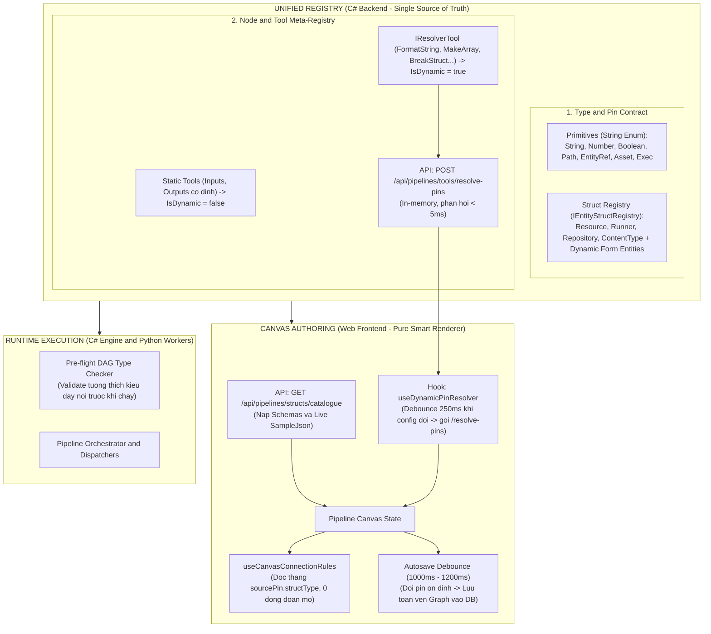

# Kế Hoạch Kỹ Thuật: Unified Node & Pin Registry, Chuẩn Hóa Type Contract & Tái Cấu Trúc Toàn Diện Build-Time

> **Ngày cập nhật**: 22/10/2026  
> **Trạng thái**: Đang thực hiện (In Progress - Phase 1 Backend hoàn thành 90%)  
> **Phạm vi**: Toàn diện Build-Time (Canvas Authoring, Dynamic Pin Resolution, Type Contract & Struct Registry)  
> **Chính sách cốt lõi**: **NO BACKWARD COMPATIBILITY DEBT** (Không giữ code chắp vá fallback legacy, chuẩn hóa sạch 100% từ gốc, C# Backend là Single Source of Truth duy nhất).

---

## 1. Bối Cảnh & Động Lực (Context & Motivation)

Hệ thống Canvas & Engine hiện đang gặp phải 5 nút thắt kiến trúc lớn:

1. **Thiếu Single Source of Truth (SSoT)**:
   - Backend đã có `IEntityStructRegistry` và các class định nghĩa struct C#, nhưng Frontend Canvas lại tự tạo file `structPins.ts` gõ tay thủ công các chân nối của Resource.
2. **Đoán mò chuỗi (Heuristic String Guessing)**:
   - Trong `useCanvasConnectionRules.ts:L160-L196`, khi cắm dây vào `BreakStruct`, code đi gom chuỗi `id`, `label`, `metadata` lại rồi dùng `includes("repo")`, `includes("resource")` để đoán mò kiểu struct.
3. **Phân mảnh logic Pin Động (Dynamic Pin Fragmentation)**:
   - Backend C# đã có sẵn "bộ não" tính toán Pin động trong interface `IResolverTool` (`FormatStringTool`, `MakeArrayTool`, `MakeMapTool`, `AppendStringTool`, `BreakStructTool`).
   - Nhưng Frontend Canvas không có API để hỏi, dẫn đến việc Frontend phải:
     - Hardcode tên tool trong `CustomPipelineNode.tsx`: `if (rawRefId === "makearray" || rawRefId === "formatstring" || ...)`.
     - Tự viết Regex JS `/\{([\w\-]+)\}/g` để bóc tách token trong `useDynamicPins.ts`.
     - Ép kiểu magic number: `primitiveType: 0 as any`.
4. **Magic Numbers Enum**:
   - `PinPrimitiveType` và `PinCardinality` serialize ra số nguyên (`0, 1, 2, 4`), khiến code Frontend đầy rẫy `type === "4"`, `cardinality === "1"`, dễ vỡ DB khi thêm enum mới.
5. **Autosave Debounce 600ms quá dồn dập**:
   - Khi Artist gõ text vào cấu hình hoặc thêm bớt pin động, độ trễ 600ms khiến Canvas gửi request lưu đồ thị lên PostgreSQL liên tục dồn dập trong khi dữ liệu chưa ổn định. Cần nâng lên **1000ms - 1200ms**.

---

## 2. Kiến Trúc Mục Tiêu: Unified Node & Pin Registry

---

## 3. Các Quyết Định Kỹ Thuật Dứt Khoát (No Backward Compatibility Debt)

1. **Khai tử 100% Heuristics & Chuỗi phỏng đoán**:
   - Xóa bỏ mọi hàm `includes(...)` hay `is "runner"`. Khi cắm dây vào `BreakStruct`, tra cứu chính xác theo `sourcePin.structType`.
2. **Khai tử các Struct cũ lỗi thời**:
   - Đã xóa sổ hoàn toàn 3 struct không còn dùng: `Inspection`, `TaggedAsset`, `Workspace`.
   - Hệ thống chỉ giữ lại 4 Core Built-in Structs: `Resource`, `Runner`, `Repository`, `ContentType` + các Struct do User tạo trong Dynamic Form.
3. **Chuẩn hóa String Enum tuần hoàn**:
   - `PinPrimitiveType`, `PinCardinality`, `PinKind`, `PipelineParameterKind` serialize ra chuỗi (`"String"`, `"Number"`, `"EntityRef"`).
4. **Backend-Authoritative Dynamic Pin Resolution**:
   - Frontend không tự tính toán pin động bằng JS. Mọi thay đổi cấu hình (`FormatString`, `MakeArray`, `BreakStruct`) đều gửi lên `POST /api/pipelines/tools/resolve-pins` để lấy danh sách Pin chuẩn xác.
5. **Tăng thời gian Autosave Debounce**:
   - Tăng từ `600ms` lên `1000ms` (hoặc `1200ms`) trong `usePipelineDraftState.ts` để tối ưu hóa lưu trữ và đem lại độ êm ái khi thao tác.

---

## 4. Kế Hoạch Triển Khai Chi Tiết

### Giai Đoạn 1: Backend Core Registry & Dynamic Resolution API (Đang thực hiện)

- [x] **1.1. Bộ Hằng Số Chuẩn `WellKnownStructTypes`**:
  - `Resource`, `Runner`, `Repository`, `ContentType`. Đã loại bỏ `Inspection`, `TaggedAsset`, `Workspace`.
- [x] **1.2. String Enum Converter & StructType Model**:
  - `JsonStringEnumConverter` cho toàn bộ các Enums.
  - Chuẩn hóa `StructType` trong `PinDefinition.cs` (có getter/setter tương thích `EntityTarget`).
- [x] **1.3. Bổ sung `SampleJson` & Cập nhật Definitions**:
  - `ResourceStructDefinition`, `RunnerStructDefinition`, `RepositoryStructDefinition`, `ContentTypeStructDefinition`.
  - Generator sinh `SampleJson` tự động cho `DynamicEntityStructDefinition.cs`.
- [x] **1.4. Endpoint `GetStructCatalogue`**:
  - Trả về `StructDefinitionDto` kèm `SampleJson` preview.
- [x] **1.5. Dọn Sạch Tools Core**:
  - `BreakStructTool` và `MakeStructTool` bỏ fallback alias.
- [ ] **1.6. Endpoint `ResolveToolPins` (`POST /api/pipelines/tools/resolve-pins`)**:
  - Request: `{ toolId: string, configValues: Dictionary<string, object?> }`.
  - Handler: Tra cứu `_toolRegistry.GetTool(toolId)`. Nếu là `IResolverTool resolver` $\rightarrow$ gọi `resolver.ResolvePins(configValues)` $\rightarrow$ trả về `{ inputs, outputs }`. Nếu là static tool $\rightarrow$ trả về `tool.Inputs`, `tool.Outputs`.
- [ ] **1.7. Bổ sung cờ `IsDynamic` vào Tool DTO / Catalogue**:
  - `isDynamic = tool is IResolverTool`.

---

### Giai Đoạn 2: Frontend Canvas - Pure Smart Renderer & Trừ Khử Hardcode

- [ ] **2.1. Nạp Struct Catalogue vào Canvas**:
  - Sử dụng hook `useGetStructCatalogue({ projectId })` để cung cấp catalogue vào Canvas Context.
- [ ] **2.2. Xóa Bỏ Hoàn Toàn Đoán Mò trong `useCanvasConnectionRules.ts`**:
  - Đọc trực tiếp `sourcePin.structType` $\rightarrow$ tra cứu trong catalogue $\rightarrow$ bung `structDef.outputPins`. Xóa bỏ 100% `includes("repo")`, `includes("resource")`.
- [ ] **2.3. Khai Tử File `structPins.ts`**:
  - Xóa bỏ mảng `BUILTIN_STRUCT_PINS` chép tay. Chuyển `getStructPins` thành hàm đọc từ catalogue.
- [ ] **2.4. Khai Tử Hardcode Tool Name trong `CustomPipelineNode.tsx`**:
  - Thay thế cụm `if (rawRefId === "makearray" || rawRefId === "formatstring" || ...)` bằng cờ `nodeData.isDynamic`.
- [ ] **2.5. Tái Cấu Trúc Hook Sinh Pin Động (`useDynamicPinResolver.ts`)**:
  - Thay thế `useDynamicPins.ts`.
  - Lắng nghe sự kiện đổi config của Node $\rightarrow$ Debounce 250ms $\rightarrow$ Gọi `POST /api/pipelines/tools/resolve-pins` $\rightarrow$ Cập nhật `node.data.inputs` & `node.data.outputs`.
  - Xóa sạch toàn bộ Regex `/\{([\w\-]+)\}/g` và gán `primitiveType: 0 as any`.
- [ ] **2.6. Tăng Thời Gian Graph Autosave Debounce**:
  - Nâng timeout từ `600ms` lên `1000ms` trong `usePipelineDraftState.ts`.
- [ ] **2.7. Đồng Bộ String Enum & Sample JSON Preview**:
  - Cập nhật `PipelineParametersPanel.tsx` sang String Enum.
  - Hiển thị khối xem trước `SampleJson` trên `NodeConfigInspector.tsx`.

---

### Giai Đoạn 3: Kiểm Thử Toàn Diện & Scanner Chống Tái Lập Hardcode

- [ ] **3.1. Unit Tests Backend**:
  - Kiểm tra `ResolveToolPins` với `FormatString` (sinh pin theo token `{name}_{lod}`), `BreakStruct` (sinh pin theo `Runner`), `MakeArray` (sinh `[0], [1]`).
  - Kiểm tra String Enum Serialization (`"EntityRef"` thay vì `4`).
- [ ] **3.2. Scanner Tests Quét Toàn Bộ Codebase (`NoHardcodeHeuristicsTests.cs`)**:
  - Quét thư mục Backend & Frontend: không còn chuỗi `is "runner"`, không còn `includes("resource")`, không còn regex phỏng đoán.
- [ ] **3.3. Kiểm Thử E2E Trên Trình Duyệt**:
  - Thử nghiệm nối dây `BreakStruct` với cả Built-in lẫn Dynamic Form Structs.
  - Thử nghiệm gõ format string trên Canvas xem pin tự sinh và lưu đồ thị ổn định.

---

## 5. Tiêu Chí Hoàn Thành (Definition of Done)

1. `dotnet test` toàn bộ solution pass 100% (bao gồm tests mới cho `ResolveToolPins`).
2. `pnpm tsc --noEmit` phía Frontend pass 0 lỗi.
3. Không còn bất kỳ file chép tay tĩnh nào (`structPins.ts` biến mất).
4. Mọi tool C# mới implements `IResolverTool` tự động hoạt động trên Canvas mà không cần sửa 1 dòng code web nào.
5. Thời gian debounce autosave 1000ms hoạt động êm ái, không còn hiện tượng spam DB.
