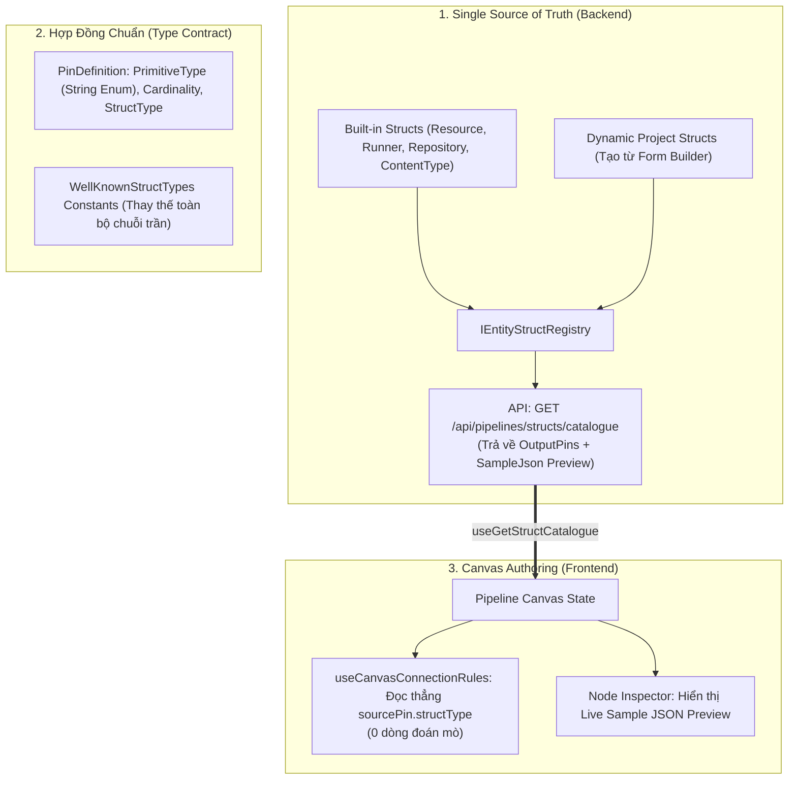

# Kế Hoạch Kỹ Thuật: Tái Cấu Trúc Toàn Diện Build-Time, Chuẩn Hóa Type Contract & Struct Registry

> **Ngày lập**: 22/10/2026  
> **Trạng thái**: Chờ duyệt (Ready for Implementation)  
> **Phạm vi**: Build-Time Architecture (Canvas Authoring, Schema Contract & Struct Registry)  
> **Chính sách**: **NO BACKWARD COMPATIBILITY DEBT** (Không giữ code chắp vá fallback legacy, chuẩn hóa sạch 100% từ gốc).

---

## 1. Bối Cảnh & Động Lực (Context & Motivation)

Hệ thống Canvas của Pipeline Engine hiện đang bị mắc 4 vấn đề kỹ thuật lớn:
1. **Thiếu Single Source of Truth**:
   - Backend đã có `IEntityStructRegistry` và các class định nghĩa struct C#, nhưng Frontend Canvas lại tự tạo file [structPins.ts](file:///d:/FullStack/Automation/web/src/features/pipelines/components/canvas/constants/structPins.ts) gõ tay 16 chân của Resource.
2. **Đoán mò chuỗi (Heuristic String Guessing)**:
   - Trong [useCanvasConnectionRules.ts:L160-L196](file:///d:/FullStack/Automation/web/src/features/pipelines/components/canvas/hooks/useCanvasConnectionRules.ts#L160-L196), khi cắm dây vào `BreakStruct`, code đi gom `id`, `label`, `metadata` lại rồi `includes("repo")`, `includes("resource")` để đoán kiểu struct.
3. **Magic Numbers Enum**:
   - `PinPrimitiveType` và `PinCardinality` serialize ra số nguyên (`0, 1, 2, 4`), khiến Frontend đầy rẫy `type === "4"`, `cardinality === "1"`, có rủi ro lệch DB khi chèn thêm Enum mới.
4. **Bỏ rơi Dynamic Structs**:
   - User thiết kế Struct mới bằng Dynamic Form Builder, Backend đã có sẵn bộ parser dịch sang Pin ([DynamicEntityStructDefinition.cs](file:///d:/FullStack/Automation/api/src/Modules/Pipeline/Automation.Pipeline/Engine/StructRegistry/Definitions/DynamicEntityStructDefinition.cs)) và API [GetStructCatalogue.cs](file:///d:/FullStack/Automation/api/src/Modules/Pipeline/Automation.Pipeline/Features/Pipelines/GetStructCatalogue.cs), nhưng Canvas lại không gọi API này!

---

## 2. Kiến Trúc Mục Tiêu (Target Architecture)



---

## 3. Các Lưu Ý Quan Trọng & Breaking Changes

1. **Không Tương Thích Ngược (Drop Legacy Fallback)**:
   - Dẹp bỏ toàn bộ các nhánh fallback đoán mò: `inputs.GetValueOrDefault("Target Entity") ?? inputs.GetValueOrDefault("target_entity") ?? inputs.GetValueOrDefault("Entity")`. Chỉ chấp nhận duy nhất `"Target"`.
   - Dẹp bỏ hoàn toàn mảng tĩnh `BUILTIN_STRUCT_PINS` chép tay bên Frontend.
2. **Enum String Serialization**:
   - Bổ sung `[JsonConverter(typeof(JsonStringEnumConverter))]` cho toàn bộ các enum `PinPrimitiveType`, `PinCardinality`, `PinKind`.
   - Toàn bộ JSON lưu trong DB cho Pipeline Graph và Parameters sẽ mang giá trị dạng chuỗi (`"EntityRef"`, `"String"`, `"Boolean"`...).
3. **Đồng Nhất Thuật Ngữ**:
   - Xóa bỏ thuộc tính `EntityTarget` trong `PinDefinition`, đổi thành **`StructType`** để đồng nhất 100% với `PipelineParameter` và DTO.

---

## 4. Kế Hoạch Triển Khai Chi Tiết (Phân Kỳ Từng Giai Đoạn)

### Giai Đoạn 1: Chuẩn Hóa Type Contract & Struct Registry Backend (`Automation.Pipeline`)

- [ ] **1.1. Thêm Bộ Hằng Số Chuẩn `WellKnownStructTypes`**:
  - Tạo file `Automation.Pipeline/Constants/WellKnownStructTypes.cs`:
    - `Resource = "Resource"`
    - `Runner = "Runner"`
    - `Repository = "Repository"`
    - `ContentType = "ContentType"`
    - `Workspace = "Workspace"`
    - `Inspection = "Inspection"`
- [ ] **1.2. Chuẩn hóa String Enum Converter & Model `PinDefinition`**:
  - Thêm `[JsonConverter(typeof(JsonStringEnumConverter))]` vào `PinPrimitiveType`, `PinCardinality`, `PinKind` trong `PinEnum.cs`.
  - Trong `PinDefinition.cs`: Đổi `string? EntityTarget` thành `string? StructType`.
- [ ] **1.3. Bổ sung `SampleJson` vào `IEntityStructDefinition`**:
  - Cập nhật interface `IEntityStructDefinition`: Thêm `object? SampleJson { get; }`.
  - Cập nhật các class Built-in: `ResourceStructDefinition`, `RunnerStructDefinition`, `RepositoryStructDefinition`, `ContentTypeStructDefinition` để cung cấp Sample JSON thực tế.
  - Cập nhật `DynamicEntityStructDefinition.cs`: Viết hàm generator tự động duyệt qua các field của Dynamic Form để đúc ra `SampleJson` (Number $\rightarrow$ 0, Switch $\rightarrow$ true, Path $\rightarrow$ "...", Map $\rightarrow$ `{ "key": "value" }`).
- [ ] **1.4. Nâng Cấp Endpoint `GetStructCatalogue`**:
  - Cập nhật `StructDefinitionDto`:
    ```csharp
    public record StructDefinitionDto(
        string StructType,
        string Label,
        IReadOnlyList<PinDefinition> OutputPins,
        object? SampleJson
    );
    ```
- [ ] **1.5. Dọn Sạch `BreakStructTool.cs` & `MakeStructTool.cs`**:
  - Xóa bỏ toàn bộ các chuỗi fallback alias (`Target Entity`, `target_entity`...). Chỉ dùng `inputs["Target"]`.
  - Đọc `StructType` thẳng từ Input Pin `Target` hoặc Config `StructType`.

---

### Giai Đoạn 2: Đồng Bộ Frontend Canvas Với Struct Registry (`web/`)

- [ ] **2.1. Nạp `useGetStructCatalogue` vào Canvas Scope**:
  - Kết nối hook `useGetStructCatalogue({ projectId })` vào `PipelineCanvas.tsx` / `PipelineFormScopeProvider`.
  - Truyền danh mục Struct Catalogue vào context của Canvas.
- [ ] **2.2. Xóa Bỏ Hoàn Toàn Đoán Mò trong `useCanvasConnectionRules.ts`**:
  - Xóa bỏ toàn bộ cụm `includes("repo")`, `includes("resource")`, `includes("workspace")`.
  - Khi cắm dây vào `BreakStruct`:
    - Đọc thẳng `sourcePin.structType`.
    - Tra cứu trong `structCatalogue.find(s => s.structType === sourcePin.structType)`.
    - Bung `structDef.outputPins` vào node `BreakStruct`.
- [ ] **2.3. Xóa Bỏ Mảng Tĩnh Chép Tay trong `structPins.ts`**:
  - Loại bỏ hoàn toàn `BUILTIN_STRUCT_PINS`.
  - Chuyển `getStructPins` thành hàm tra cứu trực tiếp từ Catalogue được trả về bởi API Backend.
- [ ] **2.4. Đồng Bộ Enum String trên Parameters Panel**:
  - Trong `PipelineParametersPanel.tsx`: Đổi `TYPE_OPTIONS` từ số `"0", "1", "2", "4"` sang String Enum `"String"`, `"Number"`, `"Boolean"`, `"Path"`, `"EntityRef"`, `"Asset"`.
  - Cập nhật kiểm tra type: `type === "EntityRef"`, `type === "Boolean"`.
- [ ] **2.5. Bổ Sung Mock / Sample JSON Preview vào Node Inspector**:
  - Trên `NodeConfigInspector.tsx`: Khi click vào node `BreakStruct` hoặc node có output dạng Struct, hiển thị một khối code xem trước `SampleJson` được trả về từ Backend.

---

### Giai Đoạn 3: Script Kiểm Tra Tự Động & Chống Hardcode (Zero Hardcode Verification)

- [ ] **3.1. Unit Tests Kiểm Tra Struct Registry & SampleJson**:
  - Test `EntityStructRegistryTests.cs`:
    - Đảm bảo Built-in Structs (`Resource`, `Runner`, `Repository`) trả về đầy đủ `OutputPins` và `SampleJson`.
    - Đảm bảo Dynamic Project Structs dịch đúng các loại field Form Builder sang `PinDefinition` và sinh đúng `SampleJson`.
- [ ] **3.2. Unit Tests Kiểm Tra String Enum Serialization**:
  - Test `UniversalDataPrimitivesTests.cs`:
    - Assert payload JSON của `PinDefinition` và `PipelineParameter` chứa chuỗi `"EntityRef"` thay vì số `4`.
- [ ] **3.3. Script Test Tự Động Quét Hardcode (Linter / Scanner Test)**:
  - Viết 1 test trong test suite (`NoHardcodeHeuristicsTests.cs`) quét toàn bộ mã nguồn của `Automation.Pipeline` và `web/src/features/pipelines`:
    - Đảm bảo không còn bất kỳ dòng code nào chứa `is "runner" or "agent"` hoặc `.Contains("runner")` trong file Engine.
    - Đảm bảo không còn `includes("resource")` hay `includes("repo")` trong các hook kết nối Canvas.

---

## 5. Tiêu Chí Hoàn Thành (Definition of Done)

1. **Build & Tests Pass 100%**:
   - `dotnet test` toàn bộ solution .NET pass 100%.
   - `pnpm tsc --noEmit` phía Frontend pass 0 error.
2. **Khảo nghiệm Canvas E2E**:
   - Kéo 1 Parameter kiểu `EntityRef` (Struct `Resource`) nối vào `BreakStruct` $\rightarrow$ Tự bung đúng 16 chân mà không có 1 dòng đoán mò nào.
   - Tạo 1 Dynamic Struct trong Form Builder (ví dụ `BakePreset` có trường `Resolution: number`, `EnableDenoise: boolean`) $\rightarrow$ Mở Canvas nối vào `BreakStruct` $\rightarrow$ Tự bung đúng 2 chân `Resolution` và `EnableDenoise`!
   - Inspector trên Canvas hiển thị Live Sample JSON Preview trực quan.
3. **Mã nguồn sạch sẽ**:
   - File `structPins.ts` không còn mảng chép tay tĩnh.
   - Không còn magic numbers `0, 2, 4` trong code UI Canvas.
