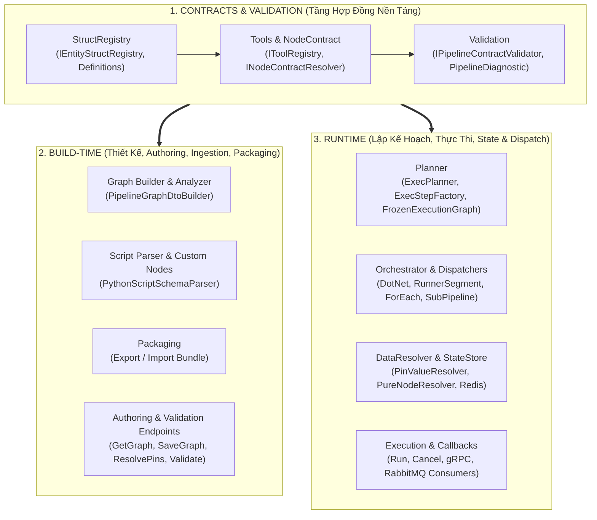

# Kiến Trúc 3 Phân Khu Pipeline: Contracts (Kèm Validation) → Build-Time & Runtime

> **Ngày lập:** 23/10/2026
> **Trạng thái:** Tài liệu Định hướng Kiến trúc & Đối chiếu Lộ trình (Master Architecture Blueprint)
> **Liên kết trước đó:** Kế thừa sau khi hoàn tất Phase 6.1, 6.2, R1, R2 và 6.3 ([2026-10-22-node-strategy-and-field-adapters.md](file:///d:/FullStack/Automation/.agents/plans/2026-10-22-node-strategy-and-field-adapters.md), [2026-10-22-node-resolution-and-validation-lifecycle.md](file:///d:/FullStack/Automation/.agents/plans/2026-10-22-node-resolution-and-validation-lifecycle.md)).

---

## 1. Vấn Đề Cốt Lõi Hiện Tại (Phát Hiện Từ CodeGraph Audit)

### 1.1. Bốn nơi tự phân giải Node/Pin theo 4 kiểu khác nhau (Lệch pha Build-Time vs Runtime)

Hiện tại trên Backend (`Automation.Pipeline`), chưa có một bộ phân giải hợp đồng Node (`INodeContractResolver`) duy nhất. Thay vào đó, có **4 nơi** tự tính toán `(Inputs, Outputs, Label, Executor, Kind)` của một `PipelineNode`:

1. **Khi tải đồ thị lên Canvas ([PipelineGraphDtoBuilder.cs](file:///d:/FullStack/Automation/api/src/Modules/Pipeline/Automation.Pipeline/Features/Pipelines/Services/PipelineGraphDtoBuilder.cs))**:
   - Với `Tool`: Có gọi `FlowPinHelper.WithExecPinsResolved(tool, configValues, ctx)`.
   - **Lỗi hợp đồng**: Ở nhánh `Start`, `Return`, và `SubPipeline`, code vẫn gán nhầm `Metadata = i.StructType` (dòng 110, 142, 166, 203, 218) thay vì `StructType = i.StructType`!
2. **Khi cấu hình Node trên Canvas ([ResolveToolPins.cs](file:///d:/FullStack/Automation/api/src/Modules/Pipeline/Automation.Pipeline/Features/Pipelines/ResolveToolPins.cs))**:
   - Chỉ phân giải riêng cho `IToolRegistry`.
3. **Khi Validate & Lập kế hoạch chạy Runtime ([ExecStepFactory.cs](file:///d:/FullStack/Automation/api/src/Modules/Pipeline/Automation.Pipeline/Engine/ExecPlanner/ExecStepFactory.cs))**:
   - **Lỗi lệch hợp đồng 1**: Ở dòng 78–79, `ExecStepFactory` chỉ đọc tĩnh `inputs = tool.Inputs; outputs = tool.Outputs;` chứ **không gọi `tool.ResolvePins(configValues, ctx)`**! Một node động (`FormatString`, `MakeArray`, `BreakStruct`...) khi xuống `ExecPlanner` bị mất sạch các chân động đã cấu hình!
   - **Lỗi lệch hợp đồng 2**: Với `Return` và `SubPipeline`, `ExecStepFactory` bỏ trống `inputs = []`, `outputs = []`! Ở nhánh `Start` cũng gán nhầm `Metadata = i.StructType`.
   - **Lỗi lệch hợp đồng 3**: Ở dòng 47 (`if (isPure) continue;`), `ExecStepFactory` bỏ qua toàn bộ các node `IsPure = true` (`BreakStruct`, `MakeStruct`, `FormatString`, `MakeArray`...). Hệ quả là [ExecPlanValidator.cs](file:///d:/FullStack/Automation/api/src/Modules/Pipeline/Automation.Pipeline/Engine/ExecPlanner/ExecPlanValidator.cs) **không bao giờ kiểm tra** các node Pure (ví dụ `BreakStruct` chưa chọn `StructType` hoặc chưa nối dây `Target`)!
4. **Khi Export Bundle ([ExportPipelineBundle.cs](file:///d:/FullStack/Automation/api/src/Modules/Pipeline/Automation.Pipeline/Features/Pipelines/ExportPipelineBundle.cs))**:
   - Tự viết lại một vòng lặp switch-case tương tự để lấy pins đóng gói.

### 1.2. Cấu trúc thư mục `Engine/` và `Features/Pipelines/` đang trộn lẫn Build-Time, Runtime và Contracts

- Trong `Engine/` hiện tại: `StructRegistry`, `Parsers` (Build-time), `Validators`, `ExecPlanner`, `Orchestrator`, `DataResolver`, `EntityStore` (Runtime) nằm chung một cấp.
- Trong `Features/Pipelines/`: 23 files vừa CRUD/Authoring, vừa Export/Import, vừa Validate, vừa Run/Cancel/AgentCallback nằm phẳng trong một thư mục.

---

## 2. Triết Lý & Mô Hình Kiến Trúc Đích (3 Phân Khu)

> **Nguyên lý cốt lõi:**
>
> - **Contracts & Validation** là tầng nền tảng độc lập, **không phụ thuộc Build-Time hay Runtime**.
> - **Validation** đi song sát với **Contracts**: chiếu một đồ thị (dù ở Canvas, trong gói Import/Export, hay trước khi Run) vào `INodeContractResolver` + `IEntityStructRegistry` để sinh ra danh sách `PipelineDiagnostic` (`Error` | `Warning`).
> - **Build-Time** và **Runtime** được tách bạch rõ ràng cả về trách nhiệm lẫn cấu trúc thư mục, và **cùng phụ thuộc vào tầng Contracts & Validation**.

---

## 3. Bản Đồ Đối Chiếu Tái Cấu Trúc Thư Mục (`Automation.Pipeline`)

| Phân khu đích       | Thư mục con đích                  | Các file chuyển về (Từ cấu trúc cũ)                                                                                                                                                                                                                                                             |
| :------------------ | :-------------------------------- | :---------------------------------------------------------------------------------------------------------------------------------------------------------------------------------------------------------------------------------------------------------------------------------------------- |
| **1. `Contracts/`** | `Contracts/StructRegistry/`       | `Engine/StructRegistry/*` (`IEntityStructRegistry`, `IEntityStructDefinition`, `Definitions/*`)                                                                                                                                                                                                 |
|                     | `Contracts/NodeContract/`         | **[NEW]** `INodeContractResolver.cs`, `PipelineNodeContractResolver.cs`, `ResolvedNodeContract.cs`                                                                                                                                                                                              |
|                     | `Contracts/Tools/`                | `Tools/*` (`IToolRegistry`, `IResolverTool`, `BaseResolverTool`, `ToolModelBinder`, các Built-in Tools)                                                                                                                                                                                         |
|                     | `Contracts/Validation/`           | **[NEW]** `IPipelineContractValidator.cs`, `PipelineContractValidator.cs`, `PipelineDiagnostic.cs` + `Engine/Validators/PipelineCycleValidator.cs` + `Engine/ExecPlanner/ExecPlanValidator.cs`                                                                                                  |
| **2. `BuildTime/`** | `BuildTime/Graph/`                | `Features/Pipelines/Services/PipelineGraphDtoBuilder.cs`, `Engine/Analysis/PipelineGraphAnalyzer.cs`                                                                                                                                                                                            |
|                     | `BuildTime/Parsers/`              | `Engine/Parsers/PythonScriptSchemaParser.cs`                                                                                                                                                                                                                                                    |
|                     | `BuildTime/Features/Authoring/`   | `GetPipelineGraph.cs`, `SavePipelineGraph.cs`, `ResolveToolPins.cs`, `GetNodePalette.cs`, `GetPinCatalogue.cs`, `GetStructCatalogue.cs`, `CreatePipeline.cs`, `UpdatePipeline.cs`, `UpdatePipelineTrigger.cs`, `DeletePipeline.cs`, `RestorePipeline.cs`, `PurgePipeline.cs`, `GetPipelines.cs` |
|                     | `BuildTime/Features/CustomNodes/` | `Features/Nodes/*` (`CreateCustomNode`, `UpdateCustomNode`, `DeleteCustomNode`, `BatchUpsertCustomNodes`, `AnalyzeCustomNodesBatch`, `ParseScript`, `ReconcilePipelineEdgesHandler`)                                                                                                            |
|                     | `BuildTime/Features/Packaging/`   | `ExportPipelineBundle.cs`, `ImportPipelinePackage.cs`, `ValidatePipelinePackage.cs`                                                                                                                                                                                                             |
|                     | `BuildTime/Features/Validation/`  | `ValidatePipeline.cs`                                                                                                                                                                                                                                                                           |
| **3. `Runtime/`**   | `Runtime/Planner/`                | `Engine/ExecPlanner/IExecPlanner.cs`, `ExecPlanner.cs`, `ExecStepFactory.cs`, `Engine/Models/FrozenExecutionGraph.cs`, `ExecPlan.cs`, `ExecSegment.cs`, `ExecStep.cs`                                                                                                                           |
|                     | `Runtime/Orchestrator/`           | `Engine/Orchestrator/*` (`PipelineOrchestrator.cs`, `Dispatchers/*`, `Enrichers/*`), `Engine/PipelineExecutionEngine.cs`                                                                                                                                                                        |
|                     | `Runtime/DataResolver/`           | `Engine/DataResolver/*` (`PinValueResolver.cs`, `PinTypeCoercer.cs`, `Resolvers/*`)                                                                                                                                                                                                             |
|                     | `Runtime/State/`                  | `Engine/EntityStore/*`, `Engine/IExecutionStateStore.cs`, `Engine/RedisKeyStrategy.cs`, `Engine/Messages/AgentContracts.cs`                                                                                                                                                                     |
|                     | `Runtime/Features/Execution/`     | `RunPipeline.cs`, `CancelPipelineExecution.cs`, `GetPipelineExecution.cs`, `GetPipelineExecutions.cs`, `GetNodeExecutions.cs`, `Features/Execution/ExecutionStateGrpcService.cs`, `Features/Pipelines/HandleAgentCallback/*`, `Features/Pipelines/EventBridge/*`                                |

---

## 4. Lộ Trình Thực Hiện Từng Khâu (Step-by-Step Roadmap)

Để đảm bảo an toàn tuyệt đối, không làm gãy git history và kiểm chứng tự động 100% ở từng bước, lộ trình được chia làm **3 Khâu (Phases)** rõ ràng:

### 🔥 Khâu 1 (Quan Trọng Nhất Hiện Tại): Xây dựng `INodeContractResolver` & `IPipelineContractValidator` (Hợp nhất Hợp đồng Node/Pin & Validation)

- **Mục tiêu**:
  1. Tạo `INodeContractResolver` (Single Source of Truth duy nhất phân giải mọi `PipelineNode` $\rightarrow$ `ResolvedNodeContract` gồm `Kind`, `Label`, `Category`, `Executor`, `Inputs`, `Outputs`, `IsPure`, `IsDynamic`, `IsMissingDefinition`, `MissingReason`).
  2. Sửa dứt điểm lỗi gán nhầm `Metadata = i.StructType` trên `Start`, `Return`, `SubPipeline` $\rightarrow$ chuẩn hóa thành `StructType = i.StructType`.
  3. Cho **cả 4 nơi** (`PipelineGraphDtoBuilder`, `ExecStepFactory`, `ExportPipelineBundle`, `ValidatePipeline`) gọi chung `INodeContractResolver` — chấm dứt hoàn toàn việc `ExecStepFactory` đọc tĩnh `tool.Inputs` hay bỏ sót `Return`/`SubPipeline`.
  4. Xây dựng `IPipelineContractValidator` đứng cạnh `INodeContractResolver`:
     - Kiểm tra **cả Action nodes lẫn Pure nodes (`BreakStruct`, `MakeStruct`, `FormatString`...)**.
     - Phát hiện đầy đủ các loại `PipelineDiagnostic` (`Severity: Error | Warning`, `Code`, `Message`, `NodeId`, `PinId`, `EdgeId`):
       - `MISSING_NODE_DEFINITION` (`Error`): Tool/CustomScript/SubPipeline không tồn tại.
       - `UNSELECTED_STRUCT_TYPE` (`Warning` ở Build-Time / `Error` khi Run): `BreakStruct`, `MakeStruct`, `CastToStruct` chưa chọn `StructType`.
       - `UNRESOLVED_REQUIRED_PIN` (`Warning` ở Build-Time nếu có thể cấp lúc Run / `Error` nếu không có nguồn): Pin `IsRequired` chưa nối dây, chưa có `configValue` và không có `defaultValue`.
       - `PIN_TYPE_MISMATCH` (`Error`): Dây nối giữa 2 chân lệch `PrimitiveType` hoặc lệch `StructType` (ví dụ nối `Runner` vào `Resource`).
       - `GRAPH_CYCLE_DETECTED` (`Error`): Chu trình lặp vô tận trên đồ thị.

### Khâu 2: Nối Diagnostics lên Giao diện Canvas & Luồng Export/Import (R3 UI + R4)

- Hiển thị huy hiệu Warning/Error trực quan trên từng Node/Pin trên Canvas và trong `NodeConfigInspector`.
- Áp dụng `IPipelineContractValidator` cho luồng kiểm tra sau Import Bundle vào Project đích.

### Khâu 3: Tái Cấu Trúc Vật Lý Thư Mục (`Contracts/`, `BuildTime/`, `Runtime/`) (✅ ĐÃ HOÀN TẤT 24/10/2026)

- Di chuyển toàn bộ các file theo đúng **Mục 3 (Bản Đồ Đối Chiếu Tái Cấu Trúc Thư Mục)** bằng `git mv` để bảo toàn git history.
- Cập nhật namespaces và usings chuẩn hóa cho cả 3 phân khu (`Automation.Pipeline.Contracts.*`, `Automation.Pipeline.BuildTime.*`, `Automation.Pipeline.Runtime.*`).
- Bổ sung `GlobalUsings.cs` chuẩn hóa cho `Automation.Pipeline` và `Automation.Pipeline.Tests`.
- Toàn bộ 191 unit tests của Pipeline, 46 tests Files, 20 tests DynamicForms và TypeScript Frontend pass 100%.
