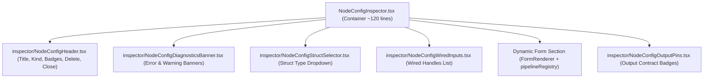
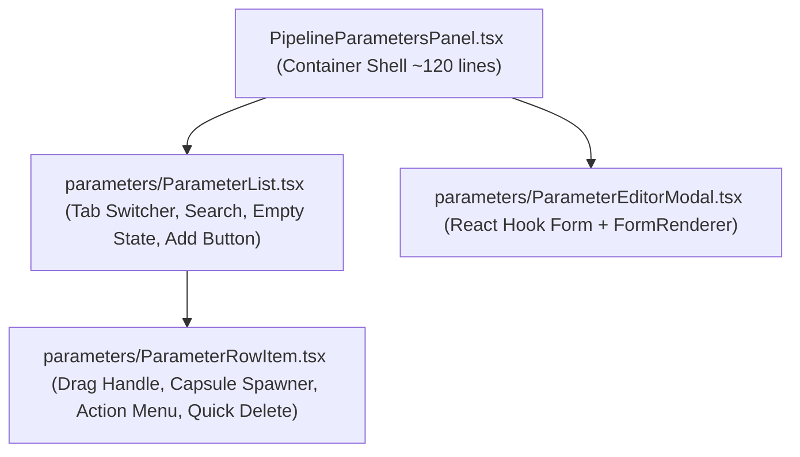

# Kế Hoạch Kỹ Thuật: Dọn Dẹp Inspector (BL-003) & Đại Phẫu Parameters Panel (BL-004)

> **Mã kế hoạch:** `PLAN-20261024-BL003-BL004`  
> **Hạng mục liên quan:** `BL-003` (Inspector Cleanup & Anti-Heuristics) + `BL-004` (Parameters Panel Refactoring & FormRenderer Integration)  
> **Trạng thái:** `Draft` (Chờ người dùng phê duyệt)  
> **Tài liệu tham chiếu:** [BACKLOG.md](file:///d:/FullStack/Automation/.agents/plans/BACKLOG.md), [ADR-004](file:///d:/FullStack/Automation/docs/adr/ADR-004-unified-node-contract-resolver.md), [ADR-005](file:///d:/FullStack/Automation/docs/adr/ADR-005-transient-graph-ingestion-and-structural-gate.md), [pipeline-canvas-sync.md](file:///d:/FullStack/Automation/.agents/playbooks/pipeline-canvas-sync.md)

---

## 1. Bối Cảnh & Vấn Đề Kỹ Thuật

Sau khi hoàn thành đợt tái cấu trúc nền tảng Backend 3 phân khu (`Contracts/`, `BuildTime/`, `Runtime/`) và gắn huy hiệu cảnh báo hợp đồng trực quan (`BL-001`), hai điểm nóng kỹ thuật lớn nhất ở tầng Frontend hiện nay là:

1. **`NodeConfigInspector.tsx` (470 dòng - `BL-003`)**:
   - Vẫn còn đoạn nhận diện Node Entry/Start bằng 12 chuỗi hardcode (`isPipelineInputNode`, dòng 68–80) thay vì dựa vào `capabilities.lifecycleBoundary === "Entry"` hoặc `data.kind === "Entry"`.
   - Nhận diện chân Exec bằng chuỗi lặp (`idLower === "exec_in"`, dòng 132–138).
   - Ôm đồm 5 khối UI khác nhau (Header, Diagnostics Banner, Struct Selector, Wired Inputs List, Dynamic Form, Output Badges).

2. **`PipelineParametersPanel.tsx` (935 dòng - `BL-004`)**:
   - **Tự phát minh lại hệ thống render form**: Thay vì sử dụng `ScopedFieldRegistry` và `FormRenderer`, panel này tự viết hàm `renderDefaultValueField` (~150 dòng) với hàng loạt câu lệnh `if/else` chọn `EntityPinSelect`, `Select`, `Input` thủ công.
   - **Bùng nổ State**: Duy trì 2 bộ state độc lập với 16 `useState` tách rời (`isCreating`, `name`, `type`, `cardinality`, `structType`, `defaultValue`... và bộ tương tự cho `editingKey`).
   - Vi phạm nguyên tắc Single Responsibility: gộp chung Sidebar drawer, Tab switching, List items, Drag-to-spawn capsule, và CRUD Modal trong cùng một file 935 dòng.

3. **Tính Tương Thích Dữ Liệu Cũ (Database Pipelines)**:
   - Trong quá trình phát triển, các Pipeline cũ trong Database (`pipeline."Pipelines"`, `PipelineNodes`, `PipelineEdges`) có thể chứa cấu trúc JSON cũ không còn khớp với các ràng buộc nghiêm ngặt mới (như `StructType` bắt buộc PascalCase, cấm pin mồ côi). Cần có quy trình dọn sạch an toàn (Backup $\rightarrow$ Truncate) trước khi kiểm thử diện rộng.

---

## 2. Mục Tiêu Kỹ Thuật & Phạm Vi Thay Đổi

### 2.1. Mục Tiêu
- **Database**: Thực hiện Backup toàn bộ DB PostgreSQL ra file `.sql` snapshot qua `.\scripts\backup-db.ps1`, sau đó làm sạch các bảng dữ liệu `pipeline` nếu người dùng yêu cầu.
- **BL-003**: Rút gọn `NodeConfigInspector.tsx` từ 470 dòng về container điều phối sạch sẽ (~120 dòng); loại bỏ 100% logic đoán chuỗi; mở rộng kiểm thử `NoHardcodeHeuristicsScannerTests.cs` để chặn tái phát.
- **BL-004**: Đại phẫu `PipelineParametersPanel.tsx` từ 935 dòng về ~120 dòng; chia nhỏ thành 4 component con có trách nhiệm rõ ràng; tích hợp `pipelineInputToFieldDefinition` + `FormRenderer` (`pipelineRegistry`) để render `defaultValue`.
- **An Toàn Kiến Trúc**: Không làm thay đổi giao diện ngoài hoặc API contract đối với `PipelineCanvas.tsx`. `pnpm typecheck` và `dotnet test` pass 100%.

---

## 3. Kiến Trúc & Thiết Kế Chi Tiết

### 3.1. Phân Rã `NodeConfigInspector.tsx` (BL-003)



- Thay thế đoạn kiểm tra chuỗi `isPipelineInputNode`:
  ```ts
  // CŨ (12 dòng kiểm tra chuỗi):
  const isPipelineInputNode = refIdLower === "pipelineinput" || refIdLower === "start" ...
  
  // MỚI: Dựa vào contract tường minh từ Backend
  const isLifecycleEntry = data.kind === "Entry" || data.refId === "Start" || definition?.capabilities?.lifecycleBoundary === "Entry";
  ```
- Kiểm tra chân Exec:
  ```ts
  // Dựa vào PinKind enum chuẩn hoặc visual
  const isExec = pin.kind === 1 || pin.kind === "Exec" || pin.id === "exec";
  ```

---

### 3.2. Phân Rã `PipelineParametersPanel.tsx` (BL-004)



#### Module 1: `parameters/ParameterRowItem.tsx` (~110 dòng)
- Nhận vào `param: PipelineParameterDto`, `activeTab: ParameterTab`.
- Hiển thị Type Badge màu (tận dụng hàm helper `getParameterBadgeInfo`).
- Kéo thả Capsule ra Canvas: Gọi `onSpawnCapsule`.
- Menu thao tác: Nút Set Variable (nếu là Variable), Nút Edit (`onEdit`), Nút Delete (`onDelete`).

#### Module 2: `parameters/ParameterList.tsx` (~130 dòng)
- Hiển thị danh sách items của tab hiện tại (`inputs`, `outputs`, `variables`).
- Thanh tìm kiếm nhanh tên parameter.
- Nút `+ Add Input / Output / Variable` mở `ParameterEditorModal`.
- Trạng thái trống (Empty State) với hướng dẫn rõ ràng.

#### Module 3: `parameters/ParameterEditorModal.tsx` (~180 dòng)
- Thay thế 16 `useState` bằng **1 React Hook Form**:
  ```ts
  interface ParameterFormValues {
    key: string;
    label: string;
    type: string;
    cardinality: string;
    structType: string;
    defaultValue: any;
    description: string;
    isRequired: boolean;
  }
  ```
- Dùng chung cho cả 2 chế độ: **Create** và **Edit**.
- **Render `defaultValue` bằng `FormRenderer`**:
  ```tsx
  const defaultValFieldDef = useMemo(() => {
    return pipelineInputToFieldDefinition({
      key: "defaultValue",
      label: `Default Value (${watchedType}${watchedCardinality === "Array" ? "[]" : ""})`,
      type: watchedType,
      cardinality: watchedCardinality,
      structType: watchedType === "EntityRef" ? watchedStructType : null,
      defaultValue: form.getValues("defaultValue"),
    });
  }, [watchedType, watchedCardinality, watchedStructType]);
  ```
  $\rightarrow$ Tái sử dụng 100% `pipelineRegistry` (`FormPinEntitySelect`, `FormPinRunnerSelect`, `FormPinRepositorySelect`, `FormPinAssetUpload`, switch, number, text), xóa sạch 150 dòng `renderDefaultValueField` tự chế!

#### Module 4: `PipelineParametersPanel.tsx` (~120 dòng)
- Container điều phối sidebar trượt ra/vào (`isOpen`, `onToggle`).
- Nhận props từ `PipelineCanvas.tsx` và chuyển giao cho `ParameterList` + `ParameterEditorModal`.

---

## 4. Các Giai Đoạn Triển Khai (Phased Execution)

### Phase 0: Sao Lưu & Dọn Dẹp Dữ Liệu Đồ Thị DB (Tùy Chọn / Khi Có Yêu Cầu)
- **Hành động 1**: Chạy `.\scripts\backup-db.ps1` để snapshot DB ra `backups/forgity_Forgity_<timestamp>.sql`.
- **Hành động 2**: Thực thi truncate dữ liệu cũ của pipeline:
  ```sql
  TRUNCATE TABLE pipeline."PipelineExecutions", pipeline."PipelineEdges", pipeline."PipelineNodes", pipeline."Pipelines" CASCADE;
  ```
- **Kiểm tra**: Kiểm tra số bản ghi trong bảng pipeline về 0, các schema khác (`identity`, `project`, `resource`, `storage`) giữ nguyên vẹn.

---

### Phase 1: BL-003 — Dọn Dẹp `NodeConfigInspector.tsx` & Bổ Sung Test
- **Bước 1.1**: Tách các sub-components trong `web/src/features/pipelines/components/canvas/inspector/`:
  - `NodeConfigHeader.tsx`
  - `NodeConfigWiredInputs.tsx`
  - `NodeConfigStructSelector.tsx`
  - `NodeConfigOutputPins.tsx`
- **Bước 1.2**: Refactor `NodeConfigInspector.tsx`:
  - Xóa mảng kiểm tra chuỗi `isPipelineInputNode` $\rightarrow$ dùng `isLifecycleEntry`.
  - Tích hợp các sub-components.
- **Bước 1.3**: Cập nhật `NoHardcodeHeuristicsScannerTests.cs`:
  - Thêm Fact kiểm tra `NodeConfigInspector.tsx` không được chứa danh sách chuỗi phỏng đoán entry node (`beginexecute`, `on resource created`...).
- **Kiểm tra**: Chạy `dotnet test` và `pnpm typecheck`.

---

### Phase 2: BL-004 — Đại Phẫu `PipelineParametersPanel.tsx`
- **Bước 2.1**: Tạo thư mục `web/src/features/pipelines/components/canvas/parameters/`:
  - Viết `ParameterRowItem.tsx`.
  - Viết `ParameterList.tsx`.
  - Viết `ParameterEditorModal.tsx` (tích hợp `pipelineInputToFieldDefinition` + `FormRenderer`).
- **Bước 2.2**: Tái cấu trúc `PipelineParametersPanel.tsx` thành container mỏng gọn.
- **Bước 2.3**: Kiểm tra lại tương tác trong `PipelineCanvas.tsx`:
  - Mở/đóng panel.
  - Chuyển tab Inputs / Outputs / Variables.
  - Thêm mới parameter với kiểu `String`, `Number`, `EntityRef` (Resource, Runner...).
  - Kéo thả Capsule ra canvas.
- **Kiểm tra**: Chạy `pnpm typecheck` và `pnpm build`.

---

### Phase 3: Nghiệm Thu Tổng Thể & Cập Nhật Tài Liệu
- **Bước 3.1**: Chạy toàn bộ test suites:
  - `dotnet test api/tests/Automation.Pipeline.Tests`
  - `pnpm --dir web run typecheck`
  - `pnpm --dir web run build`
- **Bước 3.2**: Cập nhật trạng thái `BL-003` và `BL-004` thành `Resolved` trong [BACKLOG.md](file:///d:/FullStack/Automation/.agents/plans/BACKLOG.md).
- **Bước 3.3**: Commit git với message rõ ràng chuẩn Conventional Commits.

