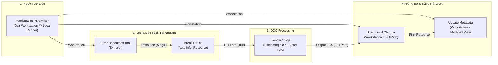

# Kế Hoạch Kỹ Thuật: Triển Khai BL-009 (Struct Workstation), BL-010 (Filter Resources Tool) & Tối Ưu Hóa Local Sync / Metadata Bằng Workstation

> **Mã kế hoạch**: `PL-2026-10-24-BL-009-BL-010`  
> **Trạng thái**: Chờ duyệt (Pending Approval)  
> **Mục tiêu**:
> 1. Xây dựng Struct `Workstation` (cặp Repository-Runner + Physical Mount Path `RootPath`).
> 2. Xây dựng Tool Node `FilterResourcesTool` trong Pipeline DAG (Dataflow filtering: Extension, Keyword, Tag).
> 3. Tối ưu hóa các Tools `SyncLocalChangeToRepositoryTool` và `UpdateResourceMetadataTool`: Nhận trực tiếp `Workstation`, chấp nhận cả `FullPath` (tự động phân giải về Relative Path thông qua `RootPath` của Workstation), loại bỏ các node trung gian cắt chuỗi path.

---

## 1. Bối Cảnh & Đột Phá Kiến Trúc (Architecture Breakthrough)

### 1.1. Bối cảnh thực tế
- Người dùng đang dựng pipeline **"Daz Character To Blender & Fbx"**:
  - `Break Struct` đã tự động nhận diện `Resource` và bung 16 chân pin dữ liệu (hoàn thành ở `BL-008`).
  - Giai đoạn cuối: Sau khi Blender export file `.fbx`, cần đồng bộ file này vào hệ thống (`Sync Local Change To Repository`) và cập nhật metadata (`Update Resource Metadata`).
- **Điểm nghẽn cũ**:
  1. **Thiếu nguồn cấp dữ liệu tự động (`BL-010`)**: Cần một node chuyên biệt tìm kiếm/lọc tài nguyên (`.duf`, `.fbx`) trong Repo để cắm vào `Break Struct`.
  2. **Rườm rà khi Sync và Update Metadata**:
     - `SyncLocalChangeToRepositoryTool` hiện tại bắt người dùng phải cắm riêng rẽ cả `Repository` VÀ `Runner`.
     - Đầu vào bắt buộc là `RelativePath`. Trong khi DCC Stage (Blender) vừa xuất ra đường dẫn tuyệt đối `FullPath` (VD: `D:/Assets/DazWorkstation/Export/hero.fbx`). Người dùng lại phải dùng thêm node trung gian để cắt chuỗi từ FullPath thành RelativePath!
     - `UpdateResourceMetadataTool` cũng chỉ nhận key là ID hoặc RelativePath, không chấp nhận FullPath.

### 1.2. Giải pháp tổng thể
1. **`BL-009` (Struct Workstation)**:
   - Đại diện cho liên kết **`RepositoryRunner`** (Cặp Repository + Runner cụ thể).
   - Mang sẵn: `WorkstationId`, `RepositoryId`, `RunnerId`, `RootPath` (đường dẫn mount vật lý), `RepositoryName`, `RunnerName`.
2. **`BL-010` (Filter Resources Tool Node)**:
   - Node lọc tài nguyên trong Workstation/Repo theo `Extension`, `Keyword`, `Tag`.
   - Xuất chân pin `Resource` (Entity Reference `Resource`) cắm thẳng vào `Break Struct` -> cấp `FullPath` cho Blender.
3. **Tối ưu hóa Sync & Metadata Tool (Workstation-First & FullPath-Aware)**:
   - `SyncLocalChangeToRepositoryTool`: Chấp nhận pin `Workstation` (thay vì bắt buộc cắm cả Repo lẫn Runner), chấp nhận mảng `Paths` là **`FullPath`** (tự động lấy `Path.GetRelativePath(Workstation.RootPath, fullPath)`).
   - `UpdateResourceMetadataTool`: Chấp nhận pin `Workstation`, key của `MetadataMap` chấp nhận cả **`FullPath`**.

---

## 2. Thiết Kế Luồng Dữ Liệu Hoàn Chỉnh (End-to-End Visual Dataflow)



*Nhìn vào sơ đồ: Toàn bộ pipeline vận hành mượt mà với duy nhất 1 tham số đầu vào `Workstation`, không cần bất kỳ node cắt gọt chuỗi (String Split/RelativePath) trung gian nào!*

---

## 3. Các Giai Đoạn Triển Khai (Implementation Phases)

### Phase 1: Struct `Workstation` & Pluggable Picker (`BL-009`)

- **1.1. Backend Struct Definition**:
  - [WellKnownStructTypes.cs](file:///d:/FullStack/Automation/api/src/Modules/Pipeline/Automation.Pipeline/Constants/WellKnownStructTypes.cs):
    Thêm `public const string Workstation = "Workstation";`.
  - Tạo `WorkstationStructDefinition.cs` kế thừa `IEntityStructDefinition`:
    - `StructType`: `"Workstation"`.
    - `OutputPins`:
      - `WorkstationId` (`EntityRef`, StructType: `Workstation`)
      - `RepositoryId` (`EntityRef`, StructType: `Repository`)
      - `RepositoryName` (`String`)
      - `RunnerId` (`EntityRef`, StructType: `Runner`)
      - `RunnerName` (`String`)
      - `RootPath` (`String` - Physical mount path trên Runner)
      - `IsRunnerActive` (`Boolean`)
    - `ResolveAsync(targetInput, context)`: Parse GUID (RepositoryRunnerId), gọi `IRepositoryApi.GetWorkstationByIdAsync` để nạp dữ liệu thật.
  - [EntityStructRegistry.cs](file:///d:/FullStack/Automation/api/src/Modules/Pipeline/Automation.Pipeline/Contracts/StructRegistry/IEntityStructRegistry.cs):
    Đăng ký `WorkstationStructDefinition` vào DI và danh mục definitions.

- **1.2. Mở rộng `IRepositoryApi`**:
  - Thêm phương thức `Task<Result<WorkstationRootDto>> GetWorkstationByIdAsync(Guid repositoryRunnerId, CancellationToken ct = default);` vào [IRepositoryApi.cs](file:///d:/FullStack/Automation/api/src/Modules/Repository/Automation.Repository.Contracts/IRepositoryApi.cs).
  - Cài đặt truy vấn trong `Automation.Repository/Infrastructure/RepositoryApi.cs` (query từ `db.RepositoryRunners`).

- **1.3. Frontend Workstation Picker**:
  - Tạo [WorkstationPicker.tsx](file:///d:/FullStack/Automation/web/src/features/pipelines/components/canvas/entity-pickers/pickers/WorkstationPicker.tsx) sử dụng `useProjectWorkstations` và `BaseCombobox`.
  - Đăng ký `Workstation: WorkstationPicker` vào [registry.ts](file:///d:/FullStack/Automation/web/src/features/pipelines/components/canvas/entity-pickers/registry.ts).

---

### Phase 2: Mở Rộng `IRepositoryApi.QueryResourcesAsync` (`BL-010`)

- **2.1. Hợp đồng tìm kiếm `ResourceQueryFilter`**:
  - Thêm DTO vào [Automation.Repository.Contracts](file:///d:/FullStack/Automation/api/src/Modules/Repository/Automation.Repository.Contracts/IRepositoryApi.cs):
    ```csharp
    public record ResourceQueryFilter(
        Guid? RepositoryId = null,
        Guid? RepositoryRunnerId = null,
        Guid? RunnerId = null,
        string? Extension = null,
        string? Keyword = null,
        IReadOnlyList<string>? TagPaths = null,
        int Limit = 100
    );
    ```
  - Thêm `Task<Result<IReadOnlyList<ResourceDto>>> QueryResourcesAsync(ResourceQueryFilter filter, CancellationToken ct = default);` vào `IRepositoryApi`.

- **2.2. Triển khai trong Module `Automation.Repository`**:
  - Query LINQ trên `db.ResourceItems` kèm `Versions` và `Locations.RepositoryRunner`.
  - Hỗ trợ lọc theo `Extension` (ví dụ `r.Extension == filter.Extension` hoặc case-insensitive so sánh đuôi).
  - Hỗ trợ lọc theo `Keyword` (ILike trên `DisplayName` hoặc `RelativePath`).
  - Tự động gắn kèm `FullLocalPath` = `Path.Combine(RepositoryRunner.RootPath, cleanRelativePath)`.

---

### Phase 3: Xây Dựng `FilterResourcesTool` & Nâng Cấp `SyncLocalChange` / `UpdateMetadata`

- **3.1. Tạo `FilterResourcesTool.cs`** tại `Contracts/Tools/Workspaces/`:
  - Inputs:
    - `Workstation`: `EntityRef`, StructType: `Workstation`, `IsRequired = false`.
    - `Repository`: `EntityRef`, StructType: `Repository`, `IsRequired = false`.
    - `Extension`: `String`, `DefaultValue = ""`.
    - `Keyword`: `String`, `DefaultValue = ""`.
    - `Limit`: `Number`, `DefaultValue = 100`.
  - Outputs:
    - `Resource`: `EntityRef`, StructType: `Resource`, Single.
    - `Resources`: `EntityRef`, StructType: `Resource`, Array.
    - `Count`: `Number`.
    - `FullPath`: `String`.
  - Tự động cache resources tìm được vào `IExecutionEntityStore`.

- **3.2. Nâng cấp [SyncLocalChangeToRepositoryTool.cs](file:///d:/FullStack/Automation/api/src/Modules/Pipeline/Automation.Pipeline/Contracts/Tools/Workspaces/SyncLocalChangeToRepositoryTool.cs)**:
  - Thêm chân cắm `Workstation` (`PinPrimitiveType.EntityRef`, `StructType = WellKnownStructTypes.Workstation`, `IsRequired = false`).
  - Nếu cắm `Workstation`: Tự động trích xuất `RepositoryId`, `RunnerId`, và `RootPath`!
  - Đổi tên chân `RelativePaths` thành `Paths` (vẫn hỗ trợ alias `RelativePaths` để tương thích ngược):
    - Tự động kiểm tra: Nếu đường dẫn bắt đầu bằng `RootPath` (FullPath tuyệt đối) -> dùng `Path.GetRelativePath(rootPath, p)` chuyển thành POSIX relative path chuẩn!
    - Nếu đã là relative path -> giữ nguyên.

- **3.3. Nâng cấp [UpdateResourceMetadataTool.cs](file:///d:/FullStack/Automation/api/src/Modules/Pipeline/Automation.Pipeline/Contracts/Tools/Workspaces/UpdateResourceMetadataTool.cs)**:
  - Thêm chân cắm `Workstation` (`PinPrimitiveType.EntityRef`, `StructType = WellKnownStructTypes.Workstation`, `IsRequired = false`).
  - Hỗ trợ `MetadataMap` có Key là **`FullPath`**: Tự động strip `Workstation.RootPath` về relative path để tìm đúng `ResourceVersionId`.

---

### Phase 4: Kiểm Thử Tự Động & Nghiệm Thu (Verification Gate)

- **4.1. Unit Tests**:
  - `WorkstationStructDefinitionTests`: Kiểm tra schema pins và phân giải dữ liệu từ Workstation ID.
  - `FilterResourcesToolTests`: Kiểm tra lọc tài nguyên theo extension `.fbx`/`.duf`.
  - `SyncLocalChangeToRepositoryToolTests`: Kiểm tra đồng bộ bằng Workstation + FullPath tuyệt đối.
  - `UpdateResourceMetadataToolTests`: Kiểm tra cập nhật metadata bằng Workstation + key FullPath.
- **4.2. Build & Smoke Test**:
  - `dotnet test api/tests/Automation.Pipeline.Tests`.
  - `pnpm --prefix web build`.
- **4.3. Cập nhật Tài liệu**:
  - Cập nhật [BACKLOG.md](file:///d:/FullStack/Automation/.agents/plans/BACKLOG.md).
  - Cập nhật [playbooks/pipeline-canvas-sync.md](file:///d:/FullStack/Automation/.agents/playbooks/pipeline-canvas-sync.md).
