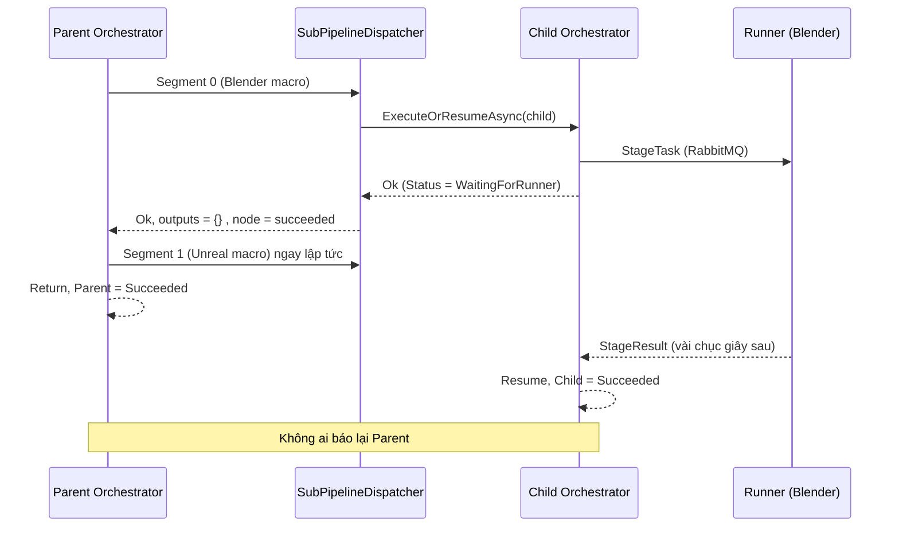
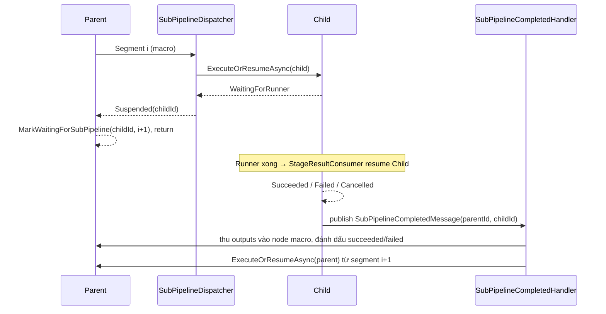

# Kế Hoạch Kỹ Thuật: Sub-Pipeline (Macro) Suspend / Resume Tuần Tự

- **Mã kế hoạch**: `BL-025`
- **Ngày lập**: 26/10/2026
- **Trạng thái**: `Draft / Chờ duyệt`
- **Phạm vi**: Backend `Automation.Pipeline` (Runtime Orchestrator, Dispatchers, Callback Handlers), Frontend mapping trạng thái (nhỏ).

---

## 1. Cách Macro Stage đang hoạt động / dispatch hiện tại

### 1.1. Build plan
- Macro Stage là một `Container` có executor `dotNet`, không có xử lý riêng trong [ExecPlanner.cs](file:///d:/FullStack/Automation/api/src/Modules/Pipeline/Automation.Pipeline/Runtime/Planner/ExecPlanner.cs).
- Khi trace chuỗi Exec trong container, mỗi node `Kind == SubPipeline` bị tách thành **một `ExecSegment` riêng** (`isSubPipeline: true`, [ExecPlanner.cs#L364-L392](file:///d:/FullStack/Automation/api/src/Modules/Pipeline/Automation.Pipeline/Runtime/Planner/ExecPlanner.cs#L364-L392)).
- Ví dụ pipeline `Daz Character To Unreal` → segments: `[0] SubPipeline Blender` → `[1] SubPipeline Unreal` → `[2] Return`.

### 1.2. Dispatch loop của Parent
[PipelineOrchestrator.ExecuteOrResumeAsync](file:///d:/FullStack/Automation/api/src/Modules/Pipeline/Automation.Pipeline/Runtime/Orchestrator/PipelineOrchestrator.cs#L270-L356) duyệt tuần tự từ `NextNodeIndex`:

| Loại segment | Xử lý | Sau khi dispatch |
| :--- | :--- | :--- |
| `dotNet` | Chạy in-process | Đi tiếp segment kế |
| Worker (blender/unreal/python) | `RunnerSegmentDispatcher` gửi RabbitMQ, `MarkWaitingForRunner(nextIndex)` | **`return` – suspend**, chờ `StageResultConsumer` gọi lại `ExecuteOrResumeAsync` |
| `IsSubPipeline` | `SubPipelineDispatcher.DispatchAsync` | Nếu không `Failed` → **đi tiếp ngay** |

### 1.3. SubPipelineDispatcher
[SubPipelineDispatcher.DispatchStepAsync](file:///d:/FullStack/Automation/api/src/Modules/Pipeline/Automation.Pipeline/Runtime/Orchestrator/Dispatchers/SubPipelineDispatcher.cs#L44-L209):
1. Resolve input pins của node macro → tạo `PipelineExecution` con (`ParentExecutionId`, `TriggeredByNodeId`).
2. Gọi **đồng bộ** `orchestrator.ExecuteOrResumeAsync(child)`.
3. Chỉ kiểm tra `IsFailed || Status == Failed`.
4. Lấy outputs từ snapshot / Return node của con → ghi vào node macro ở parent, đánh dấu `succeeded`.

### 1.4. Lỗ hổng (root cause)

- Child đang `WaitingForRunner` nhưng bị coi là xong → node macro xanh ngay, outputs `{}`, Unreal chạy song song với Blender.
- Khi child hoàn tất thật, [StageResultConsumer](file:///d:/FullStack/Automation/api/src/Modules/Pipeline/Automation.Pipeline/Runtime/Features/Execution/HandleAgentCallback/StageResultConsumer.cs) chỉ resume **child**; không có cơ chế báo ngược về parent.
- Hệ quả phụ: cancel parent không cascade xuống child; child fail/timeout không làm parent fail.

---

## 2. Thiết kế giải pháp

### 2.1. Nguyên tắc
Macro con có worker stage thì parent cũng phải **suspend như một worker segment**, và chỉ được resume bằng **callback hoàn tất của child**.

### 2.2. Trạng thái mới
- Thêm `ExecutionStatus.WaitingForSubPipeline` (giá trị mới, không đổi giá trị cũ).
- Domain method: `PipelineExecution.MarkWaitingForSubPipeline(Guid childExecutionId, int nextIndex, JsonDocument state)` – dùng `CurrentBatchId = childExecutionId.ToString()` làm khóa chống resume nhầm.

### 2.3. Luồng mới

### 2.4. Các thay đổi cụ thể

1. **`SubPipelineDispatcher`**
   - Trả về outcome rõ ràng: `Completed | Suspended(childId) | Failed(error)`.
   - Nếu child `WaitingForRunner` / `WaitingForSubPipeline` → `Suspended`, giữ node macro ở `running`.
   - Tách phần thu outputs thành `CompleteFromChildAsync(parent, childExecution)` dùng chung cho cả đường đồng bộ (child chỉ có dotNet) và đường callback.
2. **`PipelineOrchestrator`**
   - Nhánh `IsSubPipeline`: nếu `Suspended` → `MarkWaitingForSubPipeline(childId, segIdx + 1)`, save, `return Ok`.
   - Cho phép resume từ `WaitingForSubPipeline` (giống `WaitingForRunner` → `Resume()`).
   - Tại **mọi điểm kết thúc** (succeeded / failed / cancelled) gọi `ISubPipelineCompletionNotifier.NotifyIfChildAsync(execution)`.
3. **`ISubPipelineCompletionNotifier`** (mới)
   - Nếu `ParentExecutionId != null` → publish `SubPipelineCompletedMessage` qua Wolverine local queue (tránh gọi đệ quy sâu trong cùng `DbContext`).
   - Được gọi thêm ở các điểm kết thúc **nằm ngoài orchestrator**: nhánh fail của `StageResultConsumer`, `StageTimeoutHandler`, `CancelPipelineExecution`.
4. **`SubPipelineCompletedHandler`** (mới)
   - Guard idempotent: parent phải đang `WaitingForSubPipeline` **và** `CurrentBatchId == childId`; nếu không → bỏ qua (đường đồng bộ đã xử lý, hoặc message trùng).
   - Child `Succeeded` → `CompleteFromChildAsync` → `ExecuteOrResumeAsync(parent)`.
   - Child `Failed` / `Cancelled` → đánh dấu node macro failed, `MarkFailed` parent, broadcast SignalR, rồi tự notify tiếp lên ông (macro lồng nhau hoạt động đệ quy tự nhiên).
5. **Cancel cascade** – `CancelPipelineExecution`: nếu execution đang `WaitingForSubPipeline` → cancel luôn child (đệ quy), bao gồm kill subprocess trên Runner như hiện tại.
6. **Dọn đường chết** – `DotNetSegmentDispatcher` còn nhánh xử lý `SubPipeline` trong segment dotNet (planner luôn tách riêng nên không bao giờ chạm). Chuyển thành guard báo lỗi rõ ràng hoặc xóa.
7. **Frontend (nhỏ)**
   - Chạy `pnpm gen:api` để cập nhật enum.
   - [LiveExecutionDrawer.tsx](file:///d:/FullStack/Automation/web/src/features/pipelines/components/canvas/LiveExecutionDrawer.tsx#L79) và [usePipelineSignalR.ts](file:///d:/FullStack/Automation/web/src/features/pipelines/hooks/usePipelineSignalR.ts) coi `WaitingForSubPipeline` là trạng thái đang chạy.
   - Node macro hiển thị `running` cho tới khi nhận `succeeded`/`failed`.
8. **`GetNodeExecutions`** – coi `WaitingForSubPipeline` là live state (đọc Redis) giống `Running`/`WaitingForRunner`.

---

## 3. Lộ trình triển khai

| Phase | Nội dung | Review gate |
| :--- | :--- | :--- |
| **1** | Enum + domain method, `SubPipelineDispatcher` outcome, nhánh suspend trong orchestrator | Unit test: child có worker segment → parent `WaitingForSubPipeline`, segment kế **chưa** chạy |
| **2** | `ISubPipelineCompletionNotifier`, `SubPipelineCompletedMessage` + handler, hook vào orchestrator / `StageResultConsumer` / `StageTimeoutHandler` | Test: giả lập `StageResult` cho child → parent resume, node macro có outputs, segment Unreal mới dispatch; test message trùng bị bỏ qua |
| **3** | Fail / timeout / cancel propagation 2 chiều, macro lồng 2 cấp | Test: child fail → parent fail; cancel parent → child cancelled; nested macro resume đúng thứ tự |
| **4** | Frontend enum + mapping trạng thái, dọn `DotNetSegmentDispatcher` | `pnpm tsc` sạch; chạy thật `Daz Character To Unreal`: Blender `running` → xong → Unreal mới `running` |
| **5** | Cập nhật [pipeline-engine.md](file:///d:/FullStack/Automation/.agents/playbooks/pipeline-engine.md), `BACKLOG.md`, `AGENTS.md` | Playbook phản ánh đúng luồng suspend/resume |

---

## 4. Rủi ro & quyết định cần xác nhận

> [!IMPORTANT]
> **Thêm enum `WaitingForSubPipeline`** (khuyến nghị) thay vì tái dùng `WaitingForRunner`. Tái dùng thì ít sửa hơn nhưng `StageResultConsumer`/`StageTimeoutHandler` sẽ nhầm parent là đang chờ Runner, và khó chẩn đoán. Cột `Status` lưu dạng số nên không cần migration – cần xác nhận lại cấu hình EF trước khi code.

> [!WARNING]
> **Ngoài phạm vi kế hoạch này**: lỗi `no Runner was assigned` khi Stage để "Auto Any Runner" (frontend gửi `null` nhưng backend không có logic auto). Sẽ ghi thành backlog riêng.

- Output `{}` của node macro còn do **Return node của pipeline con chưa nối dây output** – kế hoạch này đảm bảo outputs được thu **đúng lúc**, không tự tạo outputs.
- Drill-down từ node macro sang execution con trên UI: chưa làm, đề xuất backlog sau.

