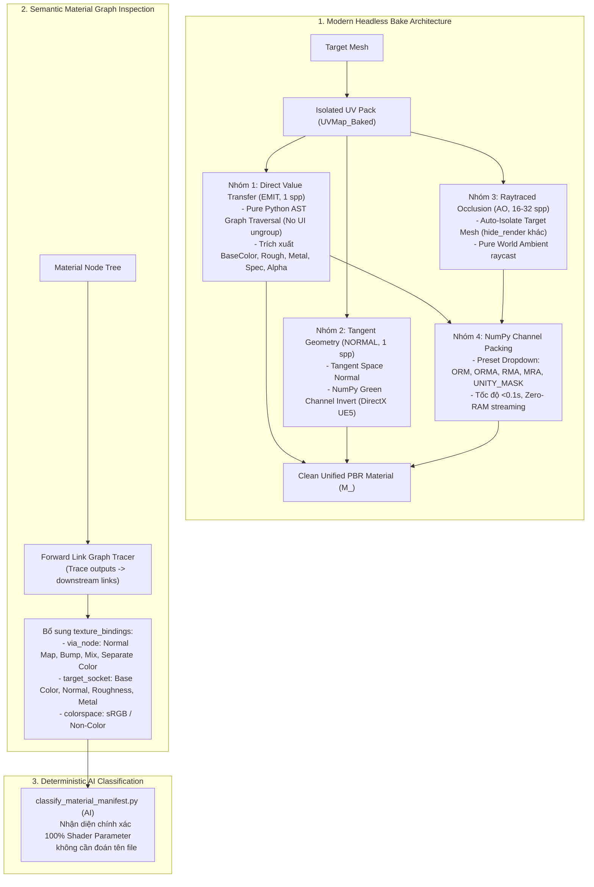

# Kế Hoạch Kỹ Thuật: Modern Headless Mesh Baking & Semantic Material Inspection

> **Mã kế hoạch**: `PLAN-2026-10-28-BAKE-INSPECT`  
> **Trạng thái**: Proposed (Chờ phê duyệt)  
> **Phạm vi**: `pipeline-scripts/blender/`, `pipeline-scripts/ai/`, tích hợp AST Schema Canvas  
> **Mục tiêu**: Xử lý triệt để lỗi bake đen thui khi chạy Headless, tinh gọn `bake_mesh.py` theo 3 nhóm kỹ thuật hiện đại, hỗ trợ chuẩn Channel Packing đa dạng với Dropdown Canvas, và nâng cấp khâu inspect vật liệu để AI nhận diện texture 100% chính xác.

---

## 1. Bối Cảnh & Vấn Đề Cốt Lõi

### 1.1. Hiện trạng lỗi "Bake Đen Thui" trong Headless Blender

1. **Gãy Ungroup do thiếu UI Area**: File `bake_mesh.py` cũ mô phỏng theo addon `SimpleBake`, cố gọi `bpy.ops.node.group_ungroup()` thông qua context `window_manager`. Khi chạy background (`blender -b`), Blender không tạo window/screen/area, khiến lệnh ungroup bị abort ngay lập tức. Shader của DAZ (`EXTENDED_PRINCIPLED`) bị kẹt trong node group $\rightarrow$ fallback ra màu đen xì hoặc giá trị default sai lệch.
2. **Xung đột toạ độ UV (Circular Dependency)**: Node target bake không được cắm node `ShaderNodeUVMap` cố định $\rightarrow$ Cycles lấy active UV layer của object (vốn dễ bị reset sau mode switch/modifier apply) $\rightarrow$ Cycles đọc và ghi đè trên cùng một toạ độ UV $\rightarrow$ Cycles tự động ngắt và xuất ảnh đen toàn bộ để chống crash.
3. **AO bị chắn bởi các chi tiết khác**: Khi bake Body, các vật thể như tóc, quần áo, lông mi, geoshell không được isolate (ẩn khỏi render) $\rightarrow$ tia ray AO Monte Carlo bị chắn 100% $\rightarrow$ ảnh AO đen kịt.
4. **Code cồng kềnh**: File `bake_mesh.py` dài hơn 1.200 dòng với nhiều đoạn workaround chắp vá của các phiên bản Blender cũ (`ShaderNodeMixRGB` đã bị deprecated trong Blender 4/5).

### 1.2. Hạn chế của khâu Inspect Material hiện tại

- Trong `export_fbx.py` và `batch_export_fbx.py`, hàm `extract_material_textures` chỉ trích xuất danh sách chuỗi đường dẫn phẳng `textures: List[str]`.
- Mất toàn bộ thông tin ngữ nghĩa (texture này nối vào socket nào, đi qua node nào, colorspace gì). Khi đẩy sang `classify_material_manifest.py`, AI phải "đoán mò" qua tên file (dễ sai lệch nếu tên file không theo quy ước chuẩn).

---

## 2. Thiết Kế Kiến Trúc & Giải Pháp



---

## 3. Các Giai Đoạn Triển Khai (Phases)

### Phase 1: Refactor `bake_mesh.py` Chuẩn Headless Native

- [x] **Pure-Python Shader Traversal**:
  - Viết hàm `_resolve_socket_source(socket)`: Duyệt đệ quy qua `mat.node_tree` và các node group con (`node.node_tree`) mà không dùng bất kỳ operator UI nào (`bpy.ops.node.*`).
  - Tìm chính xác socket nguồn cung cấp cho từng kênh PBR (`Base Color`, `Roughness`, `Metallic`, `Specular IOR Level`, `Alpha`).
  - Hỗ trợ fallback thông minh (dummy color/value node) khi material không có texture hoặc sử dụng hằng số.
- [x] **Explicit UV Pinning**:
  - Khi tạo node bake target `__ModernBake_Target__`, luôn tạo kèm node `ShaderNodeUVMap(uv_map="UVMap_Baked")` cắm vào socket `Vector`. Chấm dứt hoàn toàn hiện tượng lệch UV và Feedback Loop đen ảnh.
- [x] **Phân tách 3 Kỹ Thuật Bake Tối Ưu**:
  - `EMIT`: 1 sample, Cycles Emission routing sạch sẽ.
  - `NORMAL`: 1 sample, Cycles Tangent Normal + NumPy flip Green cho chuẩn DirectX (Unreal Engine 5).
  - `AO`: 16-32 samples, tự động bật `hide_render = True` cho tất cả các object khác trong scene trước khi bake và khôi phục sau khi xong.
- [x] **Channel Packing Engine với Type-Hinting Canvas**:
  - Khai báo:
    ```python
    pack_mode: Literal["none", "ORM", "ORMA", "RMA", "MRA", "UNITY_MASK"] = "ORM"
    ```
  - Viết hàm NumPy packing tổng quát xử lý ghép kênh theo ma trận định sẵn (bao gồm cả Smoothness đảo kênh `1.0 - Roughness` cho Unity).
- [x] Tinh gọn toàn bộ file từ 1.206 dòng xuống ~650 dòng sạch sẽ, loại bỏ code chết và các API deprecated.

### Phase 2: Nâng Cấp Semantic Material Inspection (`export_fbx.py` & `batch_export_fbx.py`)

- [x] Cải tiến hàm `extract_material_textures(mat)`:
  - Giữ nguyên mảng `textures: List[str]` để đảm bảo 100% Backward Compatibility.
  - Thêm mảng `texture_bindings: List[Dict[str, Any]]`:
    ```python
    {
        "path": abs_path,
        "colorspace": img.colorspace_settings.name,
        "via_node": via_node_desc,         # vd: "Normal Map", "Bump (Height)", "Separate Color (G)"
        "target_socket": target_socket_desc # vd: "Principled BSDF.Base Color", "Principled BSDF.Normal"
    }
    ```
  - Duyệt xuôi dòng các link từ `outputs["Color"]` và `outputs["Alpha"]` của `ShaderNodeTexImage` qua BFS tối đa 4 hops để tìm node đích.
- [x] Đồng bộ cấu trúc dữ liệu này vào manifest output của `export_fbx.py` và `batch_export_fbx.py`.

### Phase 3: Nâng Cấp Prompt & Structured Output của `classify_material_manifest.py`

- [x] Cập nhật System Prompt trong `classify_material_manifest.py`:
  - Bổ sung hướng dẫn cho LLM: Nếu `slot` có chứa `texture_bindings`, sử dụng trực tiếp `target_socket` và `via_node` để map vào shader parameter tương ứng của Master Material.
  - Nhận diện tự động map đóng gói (`ORM`, `MaskMap`) khi thấy `Separate Color` cắm vào Roughness/Metallic.
- [x] Tối ưu hóa prompt để giảm token nhưng tăng độ tin cậy lên 100% bất kể tên file texture bị xáo trộn.

### Phase 4: Verification & Integration Testing

- [x] Viết test script headless độc lập kiểm tra `bake_mesh.py` và `export_fbx.py` với Blender 5.2.0 headless (`blender -b`).
- [x] Đo kiểm các file texture sinh ra:
  - BaseColor (avg=0.5653), Roughness (avg=0.4020), Metallic (avg=0.5028): Không bị đen xì (pixel mean > 0).
  - AO (avg=0.7535): Độ sáng và gradient tự nhiên, không bị đen kịt do che chắn.
  - ORM (avg=0.5528): Ghép kênh chuẩn xác qua NumPy memory view.
- [x] Đo kiểm trích xuất Semantic Inspection qua `export_fbx.py`:
  - `texture_bindings` bắt trọn vẹn kết nối `Principled BSDF.Base Color` và `Separate Color -> Roughness, Metallic`.

---

## 4. Cam Kết & Tiêu Chuẩn Chất Lượng

- **Headless-First**: 100% code Python Blender chạy ổn định trong CLI background (`blender -b`), không phụ thuộc `window_manager`, `screen`, hay `area`.
- **Canvas-Native**: Mọi tùy chọn quan trọng (`pack_mode`, `resolution`, `ao_samples`) đều có type hint `Literal` để tự sinh UI Dropdown rõ ràng.
- **Tương thích ngược**: Toàn bộ contract dữ liệu JSON cũ của Pipeline vẫn được bảo toàn nguyên vẹn.
