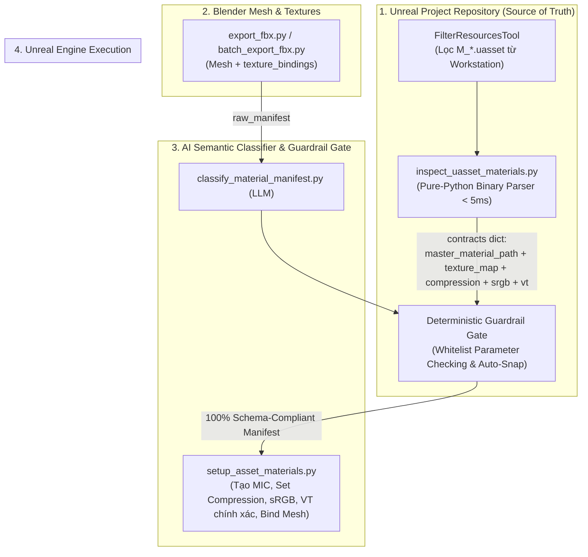

# Kế Hoạch Kỹ Thuật: Pure-Python UAsset Material Inspection & Zero-Config Material Pipeline

**Ngày tạo:** 29/10/2026  
**Trạng thái:** Active  
**Phạm vi:** `pipeline-scripts/unreal/`, `pipeline-scripts/ai/`, Unreal Material Contracts Dataflow

---

## 1. Bối Cảnh & Vấn Đề Kỹ Thuật

Hiện tại, quy trình Fbx-to-Unreal (`setup_asset_materials.py`) yêu cầu người dùng phải cấu hình thủ công Master Material Contracts trong Content Module của Studio (hoặc điền tay vào pin `contracts`):
1. **Rủi ro sai lệch đường dẫn**: Người dùng phải tự gõ chuỗi đường dẫn gói Unreal (`/Game/Characters/.../M_Skin`). Chỉ cần sai một chữ (ví dụ `M_Skin_Simple` thay vì `M_Skin`) là Unreal Engine văng lỗi C++ `LoadAsset failed` và ép Commandlet thoát với Exit Code 1.
2. **Rủi ro lệch tên Parameter**: Người dùng phải tự gõ JSON `texture_map` (ví dụ `Cloth_BaseColor` vs `BaseColorMap`). Nếu không khớp từng chữ với tên trong Shader thì Material Instance Constant (MIC) không nhận texture.
3. **Lệch chuẩn nén & Virtual Texture (VT)**: Unreal Engine phân biệt rạch ròi giữa node Sampler thường (`SAMPLERTYPE_Color`) và Virtual Texture Sampler (`SAMPLERTYPE_VirtualColor`). Hiện tại `setup_asset_materials.py` đang hardcode `vt: True`. Nếu shader dùng Sampler thường mà texture bị ép bật VT (hoặc ngược lại), Unreal Engine sẽ báo lỗi biên dịch Shader (*Sampler type mismatch*).

### Giải pháp cốt lõi
- Xây dựng **Pure-Python UAsset Binary Inspector** (`inspect_uasset_materials.py`): Đọc trực tiếp cấu trúc nhị phân `FPackageFileSummary`, `FName Table`, và `FPropertyTag` của file `.uasset` (UE5 Editor uncooked) trong **dưới 5 mili-giây**, không cần mở Unreal Engine và không cần thư viện ngoài.
- Tự động bóc tách:
  - `master_material_path`: Đường dẫn `/Game/.../M_Name` chuẩn xác 100%.
  - Tên các chân `MaterialExpressionTextureSampleParameter2D`.
  - `SAMPLERTYPE_*` $\rightarrow$ Tự động suy luận chuẩn nén (`TC_DEFAULT`, `TC_NORMALMAP`, `TC_MASKS`, `TC_GRAYSCALE`), kênh màu (`sRGB`), và cờ Virtual Texture (`vt: True/False`).
- Kết nối trực tiếp vào AI Classifier (`classify_material_manifest.py`) kèm **Deterministic Guardrail Gate** để nối 1-1 chính xác tuyệt đối mà người dùng **không phải gõ tay bất kỳ một dòng Contract nào**.

---

## 2. Kiến Trúc Luồng Dữ Liệu (Architecture Dataflow)

---

## 3. Các Giai Đoạn Triển Khai (Phases)

### Phase 1: Xây Dựng `pipeline-scripts/unreal/inspect_uasset_materials.py`
- [x] Xây dựng bộ đọc nhị phân thuần Python (`struct.unpack`):
  - Phân tích `FPackageFileSummary` để lấy Package Path (`/Game/...`), `NameCount`, `NameOffset`.
  - Đọc toàn bộ `FName Table` hỗ trợ cả chuỗi ASCII lẫn UTF-16LE.
  - Quét các khối property tag của `MaterialExpressionTextureSampleParameter2D`:
    - Trích xuất `ParameterName` (`NameProperty`).
    - Trích xuất `SamplerType` (`ByteProperty` / `EnumProperty` dạng `SAMPLERTYPE_*`).
- [x] Xây dựng bộ Mapper chuẩn nén từ `SAMPLERTYPE_*`:
  - `SAMPLERTYPE_VirtualColor` / `SAMPLERTYPE_Color` $\rightarrow$ `compression="TC_DEFAULT"`, `srgb=True`, `vt=(Virtual in name)`, `semantic="BASE_COLOR"`
  - `SAMPLERTYPE_VirtualNormal` / `SAMPLERTYPE_Normal` $\rightarrow$ `compression="TC_NORMALMAP"`, `srgb=False`, `vt=(Virtual in name)`, `semantic="NORMAL"`
  - `SAMPLERTYPE_VirtualMasks` / `SAMPLERTYPE_Masks` $\rightarrow$ `compression="TC_MASKS"`, `srgb=False`, `vt=(Virtual in name)`, `semantic="MASKS"`
  - `SAMPLERTYPE_VirtualLinearColor` / `SAMPLERTYPE_LinearColor` $\rightarrow$ `compression="TC_MASKS"`, `srgb=False`, `vt=(Virtual in name)`, `semantic="MASKS"`
  - `SAMPLERTYPE_VirtualGrayscale` / `SAMPLERTYPE_Grayscale` $\rightarrow$ `compression="TC_GRAYSCALE"`, `srgb=False`, `vt=(Virtual in name)`, `semantic="GRAYSCALE"`
- [x] Bóc tách danh sách Scalar và Vector parameters để ghi nhận đầy đủ context.
- [x] Hàm `main()` hỗ trợ:
  - Nhận `uasset_files: List[str]` (từ Canvas pin nối từ `FilterResources`).
  - Hoặc nhận `folder_path: str` (quét đệ quy thư mục).
  - Trả về dictionary `contracts` đúng chuẩn để cắm trực tiếp vào các downstream nodes.

### Phase 2: Nâng Cấp AI Classifier & Thêm Deterministic Guardrail (`classify_material_manifest.py`)
- [x] Cập nhật System Prompt:
  - Khi nhận `contracts` từ `inspect_uasset_materials.py`, tự động tổng hợp danh sách **Allowed Parameters** cho từng Master Material tag (`Skin`, `Cloth`, `Eye`, `Hair`...).
  - Chỉ thị rõ cho LLM bắt buộc chọn tên parameter từ whitelist này.
- [x] Xây dựng lớp **Deterministic Guardrail Gate** (`enforce_contract_schema`):
  - Nếu AI chọn đúng tên parameter $\rightarrow$ Chấp nhận ngay.
  - Nếu AI chọn tên generic (`BaseColor`, `Normal`, `Roughness`) $\rightarrow$ Tự động snap vào parameter có `semantic` tương ứng trong contract.
  - Loại bỏ các key rác/ảo không thuộc schema.
  - Gắn kèm metadata `preset` (`compression`, `srgb`, `vt`) vào manifest đã phân loại.

### Phase 3: Tối Ưu Hóa `pipeline-scripts/unreal/setup_asset_materials.py`
- [x] Nâng cấp hàm `resolve_texture_preset`:
  - Đọc trực tiếp dictionary preset (`compression`, `srgb`, `vt`) nếu contract cung cấp dạng rich object.
  - Giữ nguyên fallback tra bảng cũ nếu contract chỉ cung cấp chuỗi string (100% backward compatible).
- [x] Cập nhật áp dụng Virtual Texture:
  - Tôn trọng cờ `vt: False`: Không ép bật `virtual_texture_streaming = True` nếu Shader dùng Standard Sampler.
- [x] Đơn giản hóa parameter binding:
  - Gán trực tiếp parameter từ manifest đã qua Guardrail vào MIC mà không cần các bước heuristic đoán mò.

### Phase 4: Kiểm Thử Toàn Diện & Verification
- [x] Chạy test script độc lập kiểm tra `inspect_uasset_materials.py` trên toàn bộ 7 file Master Material thực tế tại `D:\Games\UnrealEngine\Projects\TemplateProject\Content\Characters\Genesis9\Base\Materials\`.
- [x] Kiểm tra tính toàn vẹn của chuỗi dữ liệu: `inspect_uasset_materials.py` $\rightarrow$ `classify_material_manifest.py` $\rightarrow$ `setup_asset_materials.py`.
- [x] Chạy kiểm tra AST schema bằng `python api/lib/analyzers/python_script_analyzer.py` cho script mới để đảm bảo sinh chân pin chuẩn trên Canvas UI.

---

## 4. Tiêu Chuẩn Chất Lượng & Cam Kết
- **Zero Startup Overhead**: Quét nhị phân `.uasset` bằng Python thuần không phụ thuộc Unreal Engine binary (`< 5ms` cho cả thư mục).
- **Single Source of Truth**: Đồng bộ trực tiếp từ file `.uasset` thực tế, không cần nhập liệu thủ công trong Studio.
- **Tương Thích Ngược 100%**: Mọi pipeline cũ truyền contract dạng thủ công hoặc chuỗi string vẫn hoạt động hoàn hảo.

