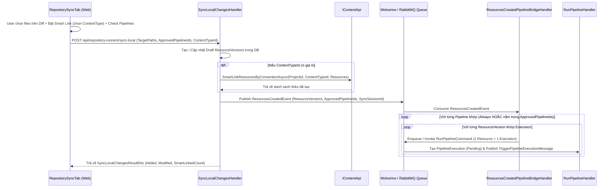

# Kế Hoạch Kỹ Thuật (`BL-032`): Per-Resource Queue Event Emission, Multi-Repository Trigger Scoping, Pre-Sync Trigger Approval UX & Repository Smart Content Link

> **Ngày lập kế hoạch**: 31/10/2026  
> **Mã Backlog**: `BL-032`  
> **Trạng thái**: Đã hoàn thành 100% (Phase 1, Phase 2, Phase 3 Verified & Committed)  
> **Phạm vi**: `Automation.Repository.Contracts`, `Automation.Repository`, `Automation.Content.Contracts`, `Automation.Pipeline`, `web/src/features/pipelines`, `web/src/features/repositories`

---

## 1. Bối Cảnh & Vấn Đề Cốt Lõi (Problem Statement)

Qua quá trình vận hành thực tế luồng **Repository Local Sync $\rightarrow$ Auto-Trigger Pipeline**, hệ thống hiện tại bộc lộ 4 điểm nghẽn kiến trúc và trải nghiệm người dùng:

1. **Phát sự kiện theo cụm (Batch Lump Execution) thay vì Hàng đợi từng Resource (Per-Resource Queue)**:
   - Khi người dùng đồng bộ $N$ tệp tin (tạo mới hoặc cập nhật Draft) trong `SyncLocalChanges`, hệ thống gom tất cả $N$ tệp vào một mảng `Resources[]` và chỉ gọi `RunPipelineCommand` **1 lần duy nhất** cho cả lô.
   - Hệ quả: Nếu 1 tệp trong lô bị lỗi DCC/Blender, toàn bộ lần chạy Pipeline bị đánh dấu Failed; đồng thời người thiết kế Pipeline luôn bị ép phải xử lý mảng `Resources[]` thay vì tư duy đơn giản **1 File = 1 Job độc lập trong Queue** (Wolverine/RabbitMQ xử lý tuần tự hoặc phân tải).
2. **Ràng buộc đơn lẻ `repositoryId` & Bẫy kích hoạt toàn Project khi bỏ trống**:
   - Cấu hình `TriggerConfig` hiện tại chỉ lưu đơn lẻ `repositoryId: Guid?`. Một Pipeline không thể lắng nghe đồng thời nhiều Repository được chỉ định (ví dụ: vừa lắng nghe repo `Raw_Outfits` vừa lắng nghe repo `Raw_Characters`).
   - Nguy hiểm hơn: Khi người dùng chỉ cấu hình `extensions: ["blend"]` mà quên chọn Repository (`repositoryId == null`), `ResourcesCreatedPipelineBridgeHandler` mặc định coi `targetRepoId == null` là **lắng nghe TẤT CẢ Repository trong Project**, dẫn đến việc kích hoạt nhầm ngoài ý muốn.
3. **Thiếu cơ chế `Always` vs `AskBefore` và Giao diện xác nhận trước khi Sync (`RepositorySyncTab`)**:
   - Người dùng cần phân biệt 2 chế độ kích hoạt:
     - **`Always` (Luôn tự động kích hoạt)**: Khi sync tệp khớp điều kiện (Repository + Định dạng file), tự động đẩy thẳng vào hàng đợi chạy Pipeline.
     - **`AskBefore` (Hỏi trước khi Sync)**: Khi vào giao diện `RepositorySyncTab` và chọn các tệp cần đồng bộ, hệ thống hiển thị danh sách các Pipeline đủ điều kiện để người dùng **tích chọn (Checkbox)** những Pipeline nào muốn kích hoạt trong lần Sync này. Với các Pipeline ở chế độ `Always`, giao diện hiển thị ở dạng huy hiệu thông báo tự động chạy (Auto-Trigger Badge) tách biệt rõ ràng với nhóm cần tích chọn.
4. **Thiếu cơ chế Smart Content Link trực tiếp tại Giao diện Sync Repo**:
   - Sau khi các tệp 3D tuân thủ quy ước tên dấu `_` (VD: `Eva_Outfit1_BRZ_Bra.fbx`) được đồng bộ lên từ ổ cứng, người dùng vẫn phải nhặt từng file thủ công sang Content Anchor Tree hoặc phải chạy pipeline riêng. Cần hỗ trợ tùy chọn tự động Smart Link vào cây phân cấp Content Item ngay khi bấm Register (Sync).

---

## 2. Bảng Đối Chiếu Trước & Sau Thực Hiện (Before vs After Matrix)

| Hạng mục Kiến trúc / Luồng dữ liệu | TRƯỚC (`Before`) | SAU (`After` - Chuẩn hóa `BL-032`) |
| :--- | :--- | :--- |
| **1. Cơ chế phát sự kiện & Hàng đợi thực thi (Queueing)** | `ResourcesCreatedPipelineBridgeHandler` gom toàn bộ `matchedVersions` thành 1 mảng `Resources` và gọi `RunPipelineCommand` **1 lần duy nhất** cho cả đợt sync. | **1 Resource = 1 Queue Execution**: Với mỗi `ResourceVersion` khớp điều kiện, hệ thống phát lệnh thực thi độc lập vào hàng đợi Wolverine/RabbitMQ (`RunPipelineCommand` riêng cho từng file, đính kèm `SyncSessionId` để dễ truy vết). |
| **2. Chân Pin đầu ra trên Start Node (`OnResourceCreated`)** | Chỉ cung cấp `Resources` (`Array<Resource>`) và `Workstation` (`Single<Workstation>`). Người dùng bắt buộc phải dùng các công cụ xử lý mảng dù chỉ muốn xử lý 1 file. | Cung cấp chân **`Resource` (`Single<Resource>`)** làm chân chính cho mô hình 1-File-1-Job, đồng thời **giữ nguyên `Resources` (`Array<Resource>` chứa 1 phần tử)** và `Workstation` để tương thích ngược 100% với mọi Pipeline cũ. |
| **3. Phạm vi lắng nghe Repository (`TriggerConfig`)** | Chỉ nhận 1 `repositoryId` đơn lẻ. Nếu để trống (`null`), tự động kích hoạt trên **tất cả** Repository trong Project (dễ gây tai nạn khi chỉ nhập `extensions`). | Hỗ trợ mảng **`repositoryIds: Guid[]`** (đa lựa chọn) kết hợp cờ tường minh **`allowAllRepositories: bool`** (mặc định `false`). Nếu `allowAllRepositories == false` và `repositoryIds` rỗng $\rightarrow$ **Không tự động kích hoạt bừa bãi**. Tự động đọc tương thích ngược trường `repositoryId` cũ. |
| **4. Chế độ kích hoạt (`triggerMode`)** | Không có khái niệm chế độ kích hoạt; mọi Pipeline có `TriggerType = OnResourceCreated` đều tự động chạy ngầm 100%. | Bổ sung **`triggerMode: "Always" \| "AskBefore"`** (mặc định `"Always"` cho các cấu hình cũ, cho phép chọn rõ trên Inspector):<br/>- `Always`: Luôn tự động đưa vào hàng đợi khi Sync.<br/>- `AskBefore`: Chỉ kích hoạt khi người dùng tích chọn xác nhận (`ApprovedPipelineIds`) lúc bấm Sync. |
| **5. Giao diện [`RepositorySyncTab.tsx`](file:///d:/FullStack/Automation/web/src/features/repositories/components/RepositorySyncTab.tsx) Trigger Preview** | Bấm `Register N Files` là đẩy thẳng xuống API, người dùng mù thông tin về việc có Pipeline nào sẽ chạy ngầm phía sau hay không. | Tự động đối chiếu các file đang tích chọn trên bảng Diff với danh sách Pipelines của Project:<br/>- **Nhóm `Always`**: Hiển thị khối/badge thông báo rõ ràng *"Auto-triggered on sync (X pipelines)"* kèm số lượng file khớp.<br/>- **Nhóm `AskBefore`**: Hiển thị danh sách Checkbox trực quan để người dùng tích chọn/bỏ chọn Pipeline muốn chạy trước khi nhấn nút Sync. |
| **6. Cơ chế Smart Content Link tại Sync Repo** | Không có. File sync xong chỉ nằm ở `ResourceItem` thô. Muốn gán Content phải chuyển qua trang Content hoặc chạy Pipeline riêng. | Bổ sung tùy chọn **Smart Link to Content** ngay trên toolbar của Sync Tab: người dùng bật switch và chọn `ContentType` (VD: `Character`). API tự động gọi `IContentApi.SmartLinkResourcesByConventionAsync` để tạo/cập nhật Content Anchor Tree ngay khi sync! |

---

## 3. Thiết Kế Chi Tiết Hợp Đồng Dữ Liệu (`TriggerConfig` & Sync Command)

### 3.1. Chuẩn hóa cấu trúc JSON `TriggerConfig` của Pipeline

```json
{
  "triggerMode": "Always",
  "allowAllRepositories": false,
  "repositoryIds": [
    "0195f3a0-1111-7000-8000-000000000001",
    "0195f3a0-2222-7000-8000-000000000002"
  ],
  "extensions": ["blend", "fbx"]
}
```

**Quy tắc phân giải an toàn (`PipelineTriggerConfigParser`)**:
1. **`triggerMode`**: `"Always"` | `"AskBefore"`. Mặc định là `"Always"` nếu không khai báo.
2. **`allowAllRepositories`**: `bool`. Mặc định là `false`.
3. **`repositoryIds`**: `HashSet<Guid>`.
   - Đọc từ mảng `repositoryIds` (nếu có).
   - **Tương thích ngược (Legacy Fallback)**: Nếu có thuộc tính `repositoryId` (chuỗi Guid đơn lẻ cũ), tự động thêm vào tập `repositoryIds`.
   - **Chặn kích hoạt nhầm toàn Project**: Một Repository `R` được coi là khớp nếu và chỉ nếu:
     - `allowAllRepositories == true`, HOẶC
     - `repositoryIds.Contains(R)`.
     - *(Nếu `allowAllRepositories == false` và `repositoryIds.Count == 0` $\rightarrow$ Không khớp với bất kỳ Repository nào!)*
4. **`extensions`**: `HashSet<string>` (không phân biệt hoa thường, bỏ dấu `.` ở đầu). Nếu mảng rỗng $\rightarrow$ khớp mọi định dạng file trong các Repository đã chọn.

### 3.2. Cấu trúc `SyncLocalChangesCommand` mở rộng

```csharp
public record SyncLocalChangesCommand(
    Guid RepositoryId,
    Guid RunnerId,
    string? Notes,
    List<string> TargetPaths,
    List<string>? RemovedPaths = null,
    List<Guid>? ApprovedPipelineIds = null, // Danh sách Pipeline AskBefore được user duyệt chạy
    Guid? ContentTypeId = null              // Tùy chọn Smart Link tự động vào Content Anchor Tree
);

public record SyncLocalChangesResultDto(
    Guid RepositoryId,
    Guid RunnerId,
    int AddedCount,
    int ModifiedCount,
    int LocationRemoved,
    List<Guid> ResourceVersionIds,
    Dictionary<string, Guid> SyncedResources,
    int SmartLinkedCount = 0               // Số lượng tài nguyên đã được auto-link vào Content
);
```

### 3.3. Sơ đồ luồng tổng thể (Sync $\rightarrow$ Smart Link $\rightarrow$ Per-Resource Queue Execution)



---

## 4. Phân Chia Lộ Trình Thực Thi (Phased Execution Roadmap)

Kế hoạch được chia thành **3 Phase độc lập**, có cổng duyệt và commit riêng sau mỗi Phase:

- **Phase 1 (Backend Core — Contracts, Smart Link Integration, Per-Resource Queue Dispatch, Multi-Repo Evaluator & Unit Tests)**:
  - Cập nhật `SyncLocalChangesCommand` và `ResourcesCreatedEvent` nhận thêm `ApprovedPipelineIds` (`List<Guid>?`), `ContentTypeId` (`Guid?`) và `SyncSessionId` (`Guid?`).
  - Trong `SyncLocalChangesHandler`: sau khi lưu Resource mới/draft, nếu `ContentTypeId.HasValue` thì gọi `IContentApi.SmartLinkResourcesByConventionAsync` để tự động gán vào Content Anchor Tree, trả về `SmartLinkedCount`.
  - Xây dựng `PipelineTriggerConfigParser` hỗ trợ `repositoryIds: Guid[]`, `allowAllRepositories: bool`, `triggerMode: "Always" | "AskBefore"`, và tương thích ngược `repositoryId`.
  - Nâng cấp `PipelineNodeContractResolver` xuất thêm chân `Resource` (`PinCardinality.Single`) trên Start Node bên cạnh `Resources` (`PinCardinality.Array`) và `Workstation`.
  - Nâng cấp `ResourcesCreatedPipelineBridgeHandler`: kiểm tra `triggerMode` + `ApprovedPipelineIds` và **tách vòng lặp đẩy từng `ResourceVersion` thành 1 lệnh thực thi Pipeline riêng biệt (Per-Resource Queue)** với đầy đủ `Resource`, `Resources` (1 phần tử) và `Workstation`.
  - Viết bộ Unit Tests kiểm thử toàn diện các kịch bản (`Always` vs `AskBefore`, multi-repo, empty repo guard, per-resource queue dispatch, smart link call).
- **Phase 2 (Frontend Canvas — Nâng Cấp `PipelineStartNodeInspector.tsx`)**:
  - Cập nhật giao diện cấu hình Trigger trên Start Node Inspector:
    - Chọn **Trigger Execution Mode**: `Always (Auto-Trigger)` vs `Ask Before Sync (Confirm in UI)`.
    - Chọn **Repository Scope**: Toggle `All Repositories in Project` hoặc chọn nhiều Repository (`Multi-Select Checkboxes / Badges` lưu vào `repositoryIds: string[]`), cảnh báo rõ nếu chưa chọn Repository nào.
    - Cập nhật mô tả **Automatic Event Outputs** hiển thị chân `Resource (Single Resource item)`, `Resources (Single-item Array)` và `Workstation`.
- **Phase 3 (Frontend Repository Sync — Preview Pipeline & Smart Content Link Trên `RepositorySyncTab.tsx`)**:
  - Cụm điều khiển **Smart Content Link**:
    - Switch/Checkbox `Smart Link to Content` + Dropdown chọn `ContentType` (lấy từ `useContentTypes(projectId)`).
    - Lưu lựa chọn gần nhất vào `localStorage` theo `repositoryId`.
  - Khu vực **Pipeline Trigger Preview Bar**:
    - Hiển thị nhóm **`Always` Pipelines** bằng huy hiệu thông tin tự động chạy (kèm tên Pipeline và số file khớp).
    - Hiển thị nhóm **`AskBefore` Pipelines** bằng danh sách Checkbox tương tác (mặc định tích sẵn hoặc cho phép người dùng tích/bỏ tích từng Pipeline, kèm số file khớp và đuôi file).
  - Truyền `approvedPipelineIds` và `contentTypeId` vào `syncMutation.mutateAsync` khi người dùng bấm nút `Register N Files`.

---

## 5. Kế Hoạch Chi Tiết Phase 1: Backend Core

### 5.1. Danh sách File Tạo Mới / Sửa Đổi trong Phase 1

1. **[SỬA ĐỔI]** [ResourceCreatedMessage.cs](file:///d:/FullStack/Automation/api/src/Modules/Repository/Automation.Repository.Contracts/ResourceCreatedMessage.cs)
   - Bổ sung tham số tùy chọn `List<Guid>? ApprovedPipelineIds = null` và `Guid? SyncSessionId = null` vào `ResourcesCreatedEvent`.
2. **[SỬA ĐỔI]** [SyncLocalChanges.cs](file:///d:/FullStack/Automation/api/src/Modules/Repository/Automation.Repository/Features/RepositoryRunners/SyncLocalChanges.cs)
   - Bổ sung `List<Guid>? ApprovedPipelineIds = null` và `Guid? ContentTypeId = null` vào `SyncLocalChangesCommand`.
   - Bổ sung `int SmartLinkedCount = 0` vào `SyncLocalChangesResultDto`.
   - Inject `IContentApi? contentApi` vào `SyncLocalChangesHandler`. Nếu `cmd.ContentTypeId.HasValue` và có `createdVersions` $\rightarrow$ gọi `SmartLinkResourcesByConventionAsync`.
   - Khi phát `ResourcesCreatedEvent`, truyền `cmd.ApprovedPipelineIds` và `SyncSessionId: Guid.CreateVersion7()`.
3. **[SỬA ĐỔI]** [IRepositoryApi.cs](file:///d:/FullStack/Automation/api/src/Modules/Repository/Automation.Repository.Contracts/IRepositoryApi.cs) & [RepositoryApi.cs](file:///d:/FullStack/Automation/api/src/Modules/Repository/Automation.Repository/Infrastructure/Services/RepositoryApi.cs)
   - Giữ tương thích chữ ký `SyncLocalChangesAsync` (bổ sung tham số mặc định `ApprovedPipelineIds = null`, `ContentTypeId = null`).
4. **[TẠO MỚI]** [PipelineTriggerConfigParser.cs](file:///d:/FullStack/Automation/api/src/Modules/Pipeline/Automation.Pipeline/Runtime/Features/Execution/EventBridge/PipelineTriggerConfigParser.cs)
   - Định nghĩa enum `PipelineTriggerExecutionMode` (`Always`, `AskBefore`) và record `ParsedPipelineTriggerConfig`:
     - `PipelineTriggerExecutionMode TriggerMode`
     - `bool AllowAllRepositories`
     - `IReadOnlySet<Guid> RepositoryIds`
     - `IReadOnlySet<string> AllowedExtensions`
   - Phương thức tĩnh `Parse(JsonDocument? triggerConfig)` và helper `IsRepositoryMatch(Guid repositoryId)`, `IsExtensionMatch(string? extension, string? relativePath)`.
5. **[SỬA ĐỔI]** [PipelineNodeContractResolver.cs](file:///d:/FullStack/Automation/api/src/Modules/Pipeline/Automation.Pipeline/Contracts/NodeContract/PipelineNodeContractResolver.cs)
   - Tại nhánh `isStartNode` khi `TriggerType is OnResourceCreated or OnResourceVersionUpdated`:
     - Thêm chân đầu ra `Resource` (`PinPrimitiveType.EntityRef`, `PinCardinality.Single`, `StructType = WellKnownStructTypes.Resource`, `Description = "Triggered resource item"`).
     - Giữ chân `Resources` (`PinCardinality.Array`) và `Workstation` (`PinCardinality.Single`) để đảm bảo tương thích ngược.
6. **[SỬA ĐỔI]** [ResourcesCreatedPipelineBridgeHandler.cs](file:///d:/FullStack/Automation/api/src/Modules/Pipeline/Automation.Pipeline/Runtime/Features/Execution/EventBridge/ResourcesCreatedPipelineBridgeHandler.cs)
   - Sử dụng `PipelineTriggerConfigParser.Parse(pipeline.TriggerConfig)`.
   - Kiểm tra `parsed.IsRepositoryMatch(message.RepositoryId)`: nếu `false` $\rightarrow$ bỏ qua.
   - Kiểm tra chế độ kích hoạt:
     - Nếu `parsed.TriggerMode == PipelineTriggerExecutionMode.AskBefore`: kiểm tra `message.ApprovedPipelineIds != null && message.ApprovedPipelineIds.Contains(pipeline.Id)`. Nếu không được tích chọn $\rightarrow$ bỏ qua.
   - Lọc `matchedVersions` theo `parsed.IsExtensionMatch(rv.Extension, rv.RelativePath)`.
   - **Per-Resource Queue Dispatch**:
     - Duyệt `foreach (var rv in matchedVersions)`:
       - Khởi tạo `runtimeInputs` riêng cho từng `rv`:
         - `["Resource"] = $"resource:{rv.ResourceVersionId}"`
         - `["Resources"] = new List<string> { $"resource:{rv.ResourceVersionId}" }`
         - `["Workstation"] = $"workstation:{message.WorkstationId.Value}"` (nếu có)
       - Gọi `await bus.InvokeAsync<Result<PipelineExecutionDto>>(new RunPipelineCommand(pipeline.Id, runtimeInputs, IsEventTrigger: true), ct)` để tạo `PipelineExecution` riêng và đẩy `TriggerPipelineExecutionMessage` vào hàng đợi Wolverine cho từng resource.
7. **[TẠO MỚI]** [ResourcesCreatedPipelineBridgeHandlerTests.cs](file:///d:/FullStack/Automation/api/tests/Automation.Pipeline.Tests/ResourcesCreatedPipelineBridgeHandlerTests.cs)
   - Kiểm thử tự động đầy đủ:
     1. **Per-Resource Queue Dispatch**: Sync 3 files `.blend` $\rightarrow$ sinh ra đúng 3 lần gọi `RunPipelineCommand` độc lập, mỗi lần chứa đúng `Resource` đơn lẻ và `Resources` 1 phần tử.
     2. **Multi-Repository (`repositoryIds`)**: Pipeline cấu hình mảng 2 repo `[RepoA, RepoB]` $\rightarrow$ kích hoạt khi sự kiện đến từ `RepoA` hoặc `RepoB`, bỏ qua khi đến từ `RepoC`.
     3. **Empty Repository Guard (`allowAllRepositories: false`)**: Pipeline chỉ cấu hình `extensions: ["fbx"]` nhưng `repositoryIds: []` và `allowAllRepositories: false` $\rightarrow$ **KHÔNG** kích hoạt.
     4. **Allow All Repositories (`allowAllRepositories: true`)**: Kích hoạt trên mọi Repository trong cùng Project khi khớp định dạng file.
     5. **Trigger Mode `AskBefore` vs `Always`**: Pipeline `Always` luôn chạy; Pipeline `AskBefore` bị chặn khi không nằm trong `ApprovedPipelineIds`, và chạy đúng khi ID có mặt trong `ApprovedPipelineIds`.
     6. **Legacy `repositoryId` Fallback**: Cấu hình JSON cũ có `"repositoryId": "..."` vẫn hoạt động bình thường.

---

## 6. Ranh Giới Đỏ (Redlines) & Tiêu Chí Nghiệm Thu Phase 1

- **Ranh giới đỏ**:
  - Tuyệt đối không phá vỡ các Pipeline hiện hữu đang nối dây từ chân `Start.Resources` hoặc `Start.Workstation`.
  - Không thay đổi schema bảng Database (vì `TriggerConfig` đã là cột `jsonb` linh hoạt trên bảng `pipeline.pipelines`), không cần tạo EF Migration mới.
- **Tiêu chí nghiệm thu Phase 1**:
  - `dotnet build api/Automation.sln` đạt `0 errors`.
  - Toàn bộ unit tests trong `ResourcesCreatedPipelineBridgeHandlerTests` và `NodeContractResolverAndValidatorTests` pass 100%.
  - Commit mã nguồn Phase 1 trước khi chuyển sang Phase 2.

---

## 7. Định Hướng Kế Tiếp: Thương Mại Hóa (Commercial Quota Trial & Subscription Gate)

> **Mục tiêu chiến lược**: Chuyển đổi tư duy từ *"cho miễn phí / trông chờ donate"* sang **"Kinh doanh phần mềm & Bán giải pháp giá trị cao sòng phẳng"**. Bảo vệ chi phí server GCP và sức lao động của tác giả, chống lại hành vi xài chùa / "vắt chanh bỏ vỏ" trong cộng đồng.

Sau khi hoàn thành 3 Phase kỹ thuật cốt lõi của `BL-032`, hệ thống sẽ nghiên cứu triển khai gói cơ chế thương mại hóa:

1. **Quota-Based Free Trial (Thả tép bắt tôm có kiểm soát)**:
   - Không áp dụng Trial theo số ngày (tránh bị cày nát toàn bộ kho đồ trong 3-7 ngày rồi bỏ đi).
   - Áp dụng **Trial theo sản lượng (Usage Quota)**: Cấp tài khoản dùng thử được phép convert tối đa **1 nhân vật + 2 bộ trang phục**.
   - Đủ để creator trải nghiệm độ "ma thuật" (mesh lên Unreal lung linh, vật liệu da AAA, modular outfit tự động gán tags), kích thích mong muốn sở hữu trọn vẹn.
2. **Khóa thiết bị (Hardware Fingerprint / Runner Lock)**:
   - Ghi nhận Hardware ID của `forgity-runner` để đảm bảo mỗi máy trạm chỉ được hưởng hạn mức Free Trial 1 lần duy nhất, chặn đứng việc tạo email ảo xài chùa vĩnh viễn.
3. **Cổng Subscription Gate (Patreon / License Key / Gumroad)**:
   - Muốn mở khóa không giới hạn số lượng tài nguyên hoặc sử dụng các Pipeline độc quyền (Bake ORM AAA, AI Classify, Auto Data Asset): Yêu cầu nhập License Key hoặc liên kết tài khoản Patreon Supporter (\$15 - \$25/tháng).
   - Tự động kiểm tra trạng thái Subscription khi Runner gửi lệnh heartbeat lên Server.

