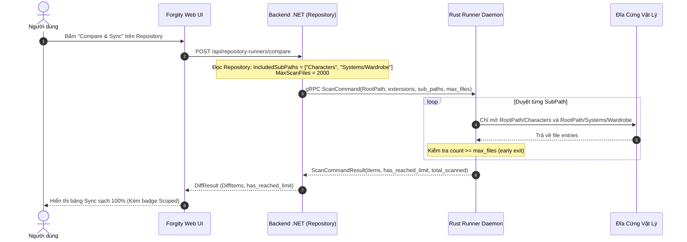

# Kế Hoạch Kỹ Thuật: Scoped Repository Scan & Max File Limit (Lọc Thư Mục Con Từ Gốc & Chặn Trần File)

> **Mã kế hoạch**: `BL-038`  
> **Ngày khởi tạo**: 02/11/2026  
> **Trạng thái**: Resolved (Đã hoàn thành toàn diện 4 Phase)  
> **Ưu tiên**: High  
> **Tài liệu tham chiếu**: [AGENTS.md](file:///d:/FullStack/Automation/.agents/AGENTS.md), [rules/runner.md](file:///d:/FullStack/Automation/.agents/rules/runner.md), [playbooks/runner-runtime.md](file:///d:/FullStack/Automation/.agents/playbooks/runner-runtime.md), [BACKLOG.md](file:///d:/FullStack/Automation/.agents/plans/BACKLOG.md)  
> **Phạm vi tác động**:  
> - `packages/proto/agent.proto` (Hợp đồng gRPC)
> - `runner/src/system/browser.rs`, `runner/src/grpc/client.rs` (Rust Runner Daemon)
> - `api/src/Modules/Runner/` (gRPC Dispatcher & Contracts)
> - `api/src/Modules/Repository/` (Entity, Migration, Compare, Sync)
> - `web/src/features/repositories/` (Dialogs & Sync Tab)

---

## 1. Bối Cảnh & Động Lực (Context & Motivation)

### 1.1. Thực trạng & Nỗi đau
1. **Thiếu vắng tín hiệu Scoped Scan trong toàn bộ hệ thống**:
   - Hiện tại lệnh `ScanCommand` trong Protobuf chỉ nhận duy nhất `directory_path` (RootPath) và `extensions`.
   - Rust Runner khi nhận lệnh sẽ đâm đầu duyệt đệ quy (recursive walk) toàn bộ cây thư mục từ `RootPath`.
2. **Điểm nghẽn khi làm việc với Game Engines (Unreal, Unity)**:
   - Trong dự án Unreal, thư mục `Content/` chứa hàng chục nghìn file (StarterContent, Plugins, Engine Classes, Levels, Audio...).
   - Tài nguyên nghiệp vụ của người dùng lại nằm phân tán ở **nhiều nhánh thư mục con ngang hàng** (ví dụ: `Content/Characters/` và `Content/Systems/Wardrobe/`).
   - Nếu trỏ `RootPath` vào `Content/`: Runner quét hàng chục nghìn file $\rightarrow$ nghẽn mạng gRPC, quá tải RAM và làm rác Database.
   - Nếu trỏ vào `Characters/`: Mất toàn bộ Schemas trong `Systems/Wardrobe/`.

---

## 2. Mục Tiêu Thiết Kế (Design Goals)

1. **Chuẩn Hóa Hợp Đồng gRPC (`agent.proto`)**:
   - Mở rộng `ScanCommand` với `sub_paths: repeated string` và `max_files: int32`.
   - Mở rộng `ScanCommandResult` với `has_reached_limit: bool` và `total_scanned: int32`.
2. **Tối Ưu Tận Gốc Đĩa Cứng Trong Rust Runner (`runner/`)**:
   - Thay vì duyệt từ `directory_path`, nếu `sub_paths` có phần tử, Runner **chỉ mở đúng các thư mục con được chỉ định** trên đĩa vật lý.
   - Bảo toàn `RelativePath` (vẫn tính tương đối so với `directory_path` gốc) để không làm gãy logic hệ thống.
   - Chặn trần `max_files`: Dừng quét ngay lập tức khi đạt trần, chống treo máy và chống tràn bộ nhớ.
3. **Quản Lý Scoped SubPaths Trong Backend .NET (`api/`)**:
   - Lưu trữ `IncludedSubPaths` (danh sách string) và `MaxScanFiles` (int, mặc định 2000) vào thực thể `Repository`.
   - `CompareRepositoryResourcesHandler` tự động nạp cấu hình và truyền sang Runner qua gRPC.
4. **Trải Nghiệm Người Dùng Trực Quan (`web/`)**:
   - Cho phép nhập danh sách thư mục con (ví dụ: `Characters`, `Systems/Wardrobe`) khi Tạo/Sửa Repository.
   - Cảnh báo trực quan trên `RepositorySyncTab` nếu kết quả quét chạm trần `max_files`.

---

## 3. Kiến Trúc Luồng Dữ Liệu (Target Architecture)

---

## 4. Các Giai Đoạn Triển Khai (Phases)

| Phase | Phạm vi | Nhiệm vụ kỹ thuật | Tiêu chí nghiệm thu (Review Gate) |
| :--- | :--- | :--- | :--- |
| **Phase 1** | **Protobuf Contract** | Mở rộng `ScanCommand` và `ScanCommandResult` trong `packages/proto/agent.proto`. Cập nhật build protobuf cho Rust và C#. | `cargo check` trong `runner/` và build .NET nhận diện trường mới không lỗi. |
| **Phase 2** | **Rust Runner Daemon** | Nâng cấp `scan_resources` trong `runner/src/system/browser.rs` và `runner/src/grpc/client.rs`. Thực hiện scoped disk walk và early exit khi chạm `max_files`. | Unit test / smoke test Rust runner quét thử thư mục với sub_paths và max_files thành công. |
| **Phase 3** | **Backend .NET Core** | 1. Thêm `IncludedSubPaths` và `MaxScanFiles` vào entity `Repository`. 2. Tạo EF Core Migration. 3. Cập nhật `IRunnerApi` và `CompareRepositoryResources.cs`. | `dotnet build` thành công, migration áp dụng sạch vào PostgreSQL Docker. |
| **Phase 4** | **Frontend Web & UI** | 1. Cập nhật `CreateRepositoryDialog.tsx` & `EditRepositoryDialog.tsx` thêm input `IncludedSubPaths` & `MaxScanFiles`. 2. Cập nhật `RepositorySyncTab.tsx` hiển thị Scoped badge và cảnh báo reached limit. | Giao diện hiển thị chuẩn, tạo repo Unreal thử nghiệm quét đúng 2 folder `Characters` và `Systems/Wardrobe`. |

---

## 5. Kế Hoạch Kiểm Thử & Nghiệm Thu (Verification Plan)

1. **Kiểm thử Rust Runner**:
   - Gọi scan trên thư mục `Content/` của `TemplateProject` với `sub_paths = ["Characters", "Systems/Wardrobe"]`, `max_files = 100`.
   - Kết quả: Chỉ trả về file trong 2 thư mục này, không có file nào của Starter Content.
2. **Kiểm thử Đồng bộ Toàn Diện (End-to-End)**:
   - Mở giao diện Forgity Studio $\rightarrow$ Tạo Repository trỏ vào `TemplateProject/Content`.
   - Cấu hình `IncludedSubPaths = ["Characters", "Systems/Wardrobe"]`, `Extensions = [".uasset"]`.
   - Bấm Compare: Bảng chỉ hiện đúng các file Master Materials và Schemas.
   - Bấm Sync: Lưu vào DB thành công, không bị nghẽn mạng hay tràn bộ nhớ.
