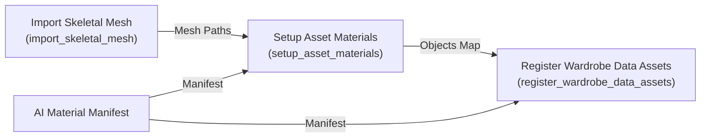
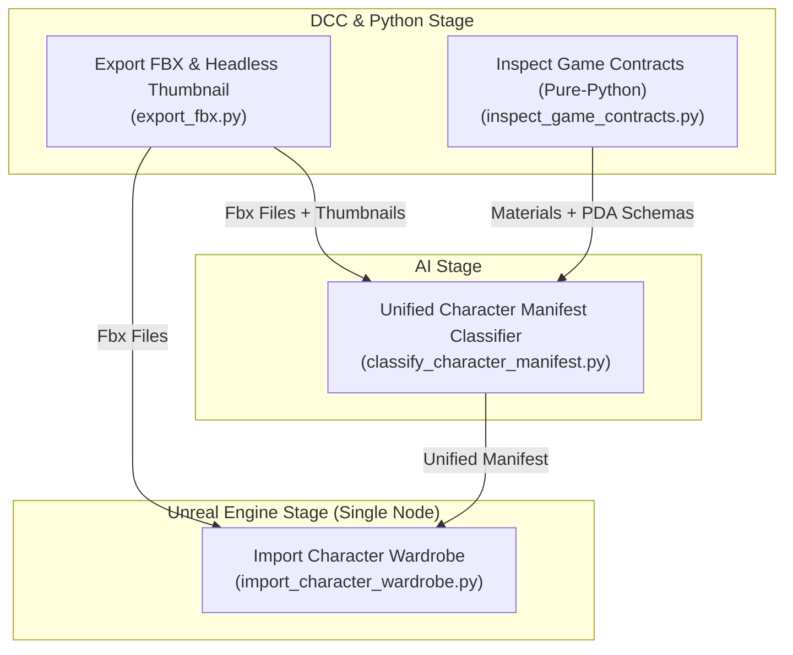

# Kế Hoạch Kỹ Thuật: Hợp Nhất Hợp Đồng Game (Game Contracts), AI Manifest Toàn Diện & All-In-One Unreal Character Ingestion

> **Mã kế hoạch**: `BL-037`  
> **Ngày khởi tạo**: 02/11/2026  
> **Trạng thái**: Resolved (Đã hoàn thành toàn diện 4 Phase)  
> **Ưu tiên**: High  
> **Tài liệu tham chiếu**: [AGENTS.md](file:///d:/FullStack/Automation/.agents/AGENTS.md), [playbooks/pipeline-canvas-sync.md](file:///d:/FullStack/Automation/.agents/playbooks/pipeline-canvas-sync.md), [BACKLOG.md](file:///d:/FullStack/Automation/.agents/plans/BACKLOG.md)  
> **Phạm vi tác động**:  
> - `pipeline-scripts/unreal/inspect_game_contracts.py` (Mới, mở rộng từ `inspect_uasset_materials.py`)
> - `pipeline-scripts/ai/classify_character_manifest.py` (Nâng cấp từ `classify_material_manifest.py`)
> - `pipeline-scripts/unreal/import_character_wardrobe.py` (Mới, thay thế chuỗi 3 node cũ)
> - `pipeline-scripts/unreal/register_wardrobe_data_assets.py` (Giữ backward-compatible hoặc deprecate)

---

## 1. Bối Cảnh & Vấn Đề (Context & Motivation)

### 1.1. Thực trạng kiến trúc hiện tại
Giai đoạn xử lý Unreal Engine trên Pipeline Canvas hiện tại đang bị phân mảnh làm **3 Node tuần tự**:


### 1.2. Những điểm nghẽn & Rủi ro thực tế
1. **Bùng nổ chân pin (Pin Bloat) & Dây nối chằng chịt**:
   - Node `Register Wardrobe Data Assets` có tới 14 chân pin đầu vào/đầu ra (`Manifest`, `Objects Map`, `Mesh Paths`, `Thumbnail Map`, `Tags Ini Path`, `Wardrobe Schema Path`, `Character Schema Path`, `Destination Folder`...).
   - Người dùng rất dễ quên nối dây (Canvas cảnh báo vàng: *Node is isolated with no incoming...*).
2. **Phân tán trách nhiệm (Split-Brain)**:
   - Node AI Classify hiện tại chỉ map textures vào Master Material slots, hoàn toàn "mù" về vai trò nghiệp vụ của mesh (`Body/Skin` hay `Clothing Slot`).
   - Node cuối (`register_wardrobe_data_assets`) lại phải tự regex đoán tên, tự suy luận GameplayTags (`SlotTag`, `ItemTag`), và tự quét tìm Thumbnail trên đĩa.
3. **Vi phạm quy chuẩn đặt tên Unreal (Naming Convention)**:
   - File định nghĩa Schema là `PDA_WardrobeItem`, nhưng instance tạo ra lại bị đặt tên tiền tố `PDA_*` thay vì chuẩn chính thức của Unreal Engine: **`DA_*`** (Data Asset) và **`SKM_*`** (Skeletal Mesh).
4. **Nguy cơ sai lệch GameplayTags (Empty Tags Collision)**:
   - Khi việc gán Tag bị phân tán hoặc fail silently, DataAsset sinh ra với Tag rỗng `{}` dẫn tới xung đột logic trong Game (`ToggleItem` lập tức gọi `RemoveItem`, gây crash component).

---

## 2. Mục Tiêu Thiết Kế (Design Goals)

1. **Pure-Python Game Contracts Inspection (`inspect_game_contracts.py`)**:
   - Mở rộng script đọc nhị phân `.uasset` (tốc độ <5ms không cần mở Unreal Engine).
   - Đọc đồng thời:
     - Master Materials (`M_*`): Trích xuất danh sách Scalar, Vector, Texture Parameters và Metadata Slots.
     - Blueprint DataAsset Schemas (`PDA_*`): Quét và phát hiện các trường dữ liệu kiểu `Text`, `String`, `GameplayTag`, `Object/SoftObjectPath` (`SkeletalMesh`, `Texture2D`).
2. **AI Làm Nhạc Trưởng Toàn Diện (`classify_character_manifest.py`)**:
   - Đưa toàn bộ Game Contracts (Materials + DataAsset Schemas) và danh sách file (FBX, Textures, PNG Thumbnails) vào bối cảnh của LLM.
   - LLM tự động quyết định:
     - `asset_kind`: `"Body"` (Skin/Nude) vs `"Wardrobe"` (Trang phục/Phụ kiện).
     - Quy chuẩn đặt tên: `mesh_name = "SKM_<CleanName>"`, `data_asset_name = "DA_<CleanName>"`.
     - Tự động ghép nối ảnh Thumbnail cùng tên (`<CleanName>.png` hoặc `T_<CleanName>.png`).
     - Tự động sinh `DisplayName` thân thiện với UI người dùng.
     - Gán chính xác `SlotTag` và `ItemTag` theo danh mục hợp lệ trong `DefaultGameplayTags.ini`.
3. **All-In-One Character Ingestion Node (`import_character_wardrobe.py`)**:
   - Gom toàn bộ 3 node rời rạc của Unreal Stage thành **1 Node duy nhất**.
   - Giao diện trên Canvas tối giản tối đa: **Chỉ nhận đúng 2 Pin Input**:
     - `Fbx Files`: Danh sách file FBX cần nhập.
     - `Manifest`: Bản đồ hợp nhất do AI sinh ra.
   - Bên trong Unreal Subprocess:
     - Bước 1: Import Skeletal Mesh với tên chuẩn `SKM_*`.
     - Bước 2: Tạo Material Instance `MI_*` từ Master Material và gán vào Mesh Slots.
     - Bước 3: Tạo DataAsset `DA_*`, gán Mesh, Thumbnail và GameplayTags hợp lệ.

---

## 3. Kiến Trúc Luồng Dữ Liệu Tinh Gọn (Target Architecture)



---

## 4. Đặc Tả Hợp Đồng Dữ Liệu (Unified Manifest Contract)

```json
{
  "character_name": "Eva",
  "character_tag": "Character.Eva",
  "destination_folder": "/Game/Characters/Genesis9/Eva/Outfits",
  "items": [
    {
      "asset_name": "Eva_Outfit1_BrzUsBra",
      "mesh_name": "SKM_Eva_Outfit1_BrzUsBra",
      "data_asset_name": "DA_Eva_Outfit1_BrzUsBra",
      "asset_kind": "Wardrobe",
      "target_schema": "/Game/Systems/Wardrobe/Schemas/PDA_WardrobeItem.PDA_WardrobeItem_C",
      "fbx_file": "D:/Characters/Eva/Eva_Outfit1_BrzUsBra.fbx",
      "thumbnail_file": "D:/Characters/Eva/Eva_Outfit1_BrzUsBra.png",
      "properties": {
        "DisplayName": "Brz Us Bra",
        "SlotTag": "System.Wardrobe.Slots.Inner_Top",
        "ItemTag": "Character.Eva.Outfits.Eva_Outfit1_BRZ_US_Bra",
        "CharacterTag": "Character.Eva"
      },
      "materials": {
        "GNDFabric-2": {
          "material_tag": "Cloth",
          "master_material_path": "/Game/Characters/Materials/M_Cloth",
          "textures": {
            "BaseColorMap": "D:/Textures/Cotton_Base_color_1001.png",
            "NormalMap": "D:/Textures/Cotton_Normal_OpenGL_1001.png",
            "ORMMap": "D:/Textures/Cotton_ORM_1001.png"
          }
        }
      }
    }
  ]
}
```

---

## 5. Lộ Trình Triển Khai Chi Tiết (Implementation Phases)

### Phase 1: Mở Rộng Inspection Hợp Đồng Game (Pure-Python)
- **File**: `pipeline-scripts/unreal/inspect_game_contracts.py` (kế thừa logic binary parser của `inspect_uasset_materials.py`).
- **Nhiệm vụ**:
  1. Hỗ trợ quét thư mục Material (`M_*`) để trích xuất parameters.
  2. Bổ sung scanner cho file Blueprint DataAsset (`PDA_*`):
     - Đọc bảng Name Map và Exports của file `.uasset`.
     - Trích xuất các thuộc tính khai báo (`FProperty` names, kiểu dữ liệu: `FGameplayTag`, `FText`, `FString`, `TSoftObjectPtr`).
  3. Xuất dictionary chuẩn hóa: `{"materials": {...}, "schemas": {"PDA_WardrobeItem": {...}}}`.
- **Tiêu chí nghiệm thu (Gate 1)**: Chạy test độc lập bằng Python thuần, parse thành công schema `PDA_WardrobeItem.uasset` trong < 10ms mà không import Unreal SDK.

### Phase 2: Nâng Cấp AI Character Manifest Classifier
- **File**: `pipeline-scripts/ai/classify_character_manifest.py`
- **Nhiệm vụ**:
  1. Nạp danh sách file FBX, danh sách textures, và danh sách ảnh PNG Thumbnail trong cùng thư mục (tự động ghép đôi cùng tên).
  2. Nạp game contracts từ Phase 1 và danh sách valid GameplayTags từ `DefaultGameplayTags.ini`.
  3. Yêu cầu AI sinh bản JSON Manifest hoàn chỉnh:
     - Gán tiền tố `SKM_` cho skeletal mesh và `DA_` cho data asset.
     - Phân loại `asset_kind` (`Body` vs `Wardrobe`).
     - Tự động map `SlotTag` và `ItemTag` (tuyệt đối không để trống).
     - Map texture slots vào Master Material phù hợp (`M_Skin`, `M_Cloth`, `M_Eye`).
- **Tiêu chí nghiệm thu (Gate 2)**: Chạy thử trên dữ liệu thực tế của nhân vật Eva, output JSON có đầy đủ `DA_*`, `SKM_*`, `SlotTag` và `ItemTag` hợp lệ.

### Phase 3: Xây Dựng All-In-One Node `import_character_wardrobe.py`
- **File**: `pipeline-scripts/unreal/import_character_wardrobe.py`
- **Chữ ký hàm `main()`**:
  ```python
  def main(
      fbx_files: list[str],
      manifest: dict,
      destination_folder: str = "",
      skeleton_path: str = "/Game/Characters/Genesis9/Common/Skeleton/Genesis9_Skeleton.Genesis9_Skeleton",
      **kwargs
  ) -> dict:
  ```
- **Nhiệm vụ**:
  1. **Batch Import Skeletal Meshes**: Duyệt qua từng item trong `manifest["items"]`, import FBX với tên `mesh_name` (`SKM_*`).
  2. **Automated Material Instance Setup**:
     - Tạo `MI_<MeshName>_<SlotName>` từ `master_material_path`.
     - Gán textures và tham số vào Material Instance.
     - Gán `MI` vào đúng vị trí slot của Skeletal Mesh vừa import.
  3. **DataAsset Creation & Property Binding**:
     - Tạo Data Asset instance với tên `data_asset_name` (`DA_*`) sử dụng class từ `target_schema`.
     - Gán tham chiếu Skeletal Mesh (`SkeletalMesh = SKM_*`).
     - Nếu có `thumbnail_file`: Tự động import PNG thành Texture2D (hoặc Texture UI) và gán vào thuộc tính Thumbnail.
     - Gán các struct GameplayTag (`SlotTag`, `ItemTag`, `CharacterTag`) bằng `unreal.GameplayTagsManager`.
     - Gán các trường Text (`DisplayName`).
     - Lưu toàn bộ package (`unreal.EditorAssetLibrary.save_loaded_asset`).
- **Tiêu chí nghiệm thu (Gate 3)**: Chạy headless bằng `UnrealEditor-Cmd.exe`, sinh ra trọn bộ asset `SKM_*`, `MI_*`, `DA_*` với tags đầy đủ chỉ bằng 1 lệnh duy nhất.

### Phase 4: Đồng Bộ Hóa Pipeline Canvas & Dọn Dẹp
- **Nhiệm vụ**:
  1. Đăng ký script `import_character_wardrobe.py` vào hệ thống thông qua `NativePythonScriptAnalyzer`.
  2. Cập nhật template mẫu đồ thị Pipeline trong Forgity Studio: thay thế cụm 3 node cũ bằng 1 node duy nhất.
  3. Cập nhật Playbook: [pipeline-canvas-sync.md](file:///d:/FullStack/Automation/.agents/playbooks/pipeline-canvas-sync.md).

---

## 6. Kế Hoạch Kiểm Thử & An Toàn (Testing & Verification)

1. **Unit Test Python AST Analyzer**:
   - Đảm bảo C# Backend parse được chữ ký `import_character_wardrobe.py`, nhận diện đúng 2 pin chính `fbx_files` và `manifest`.
2. **Headless Unreal Test**:
   - Chạy lệnh CLI:
     ```powershell
     & "C:\Program Files\Epic Games\UE_5.8\Engine\Binaries\Win64\UnrealEditor-Cmd.exe" "D:\Games\UnrealEngine\Projects\TemplateProject\TemplateProject.uproject" -run=pythonscript -script="pipeline-scripts/unreal/import_character_wardrobe.py" ...
     ```
   - Kiểm tra log Unreal: Không còn cảnh báo `Ignoring PrimaryAssetType`, không văng lỗi `May not destroy component`.
3. **In-Game Playtest Verification**:
   - Mở Unreal Editor, nhấn Play.
   - Mở Menu Wardrobe, click chọn trang phục: Item được mặc tức thì, mesh xuất hiện trên nhân vật, không bị add rồi xóa ngay lập tức.
