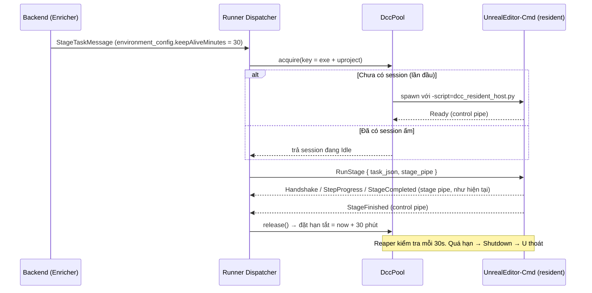

# BL-040: Giữ tiến trình DCC chạy sẵn (Keep-Alive) — bắt đầu với Unreal

> **Mã công việc**: `BL-040`
> **Trạng thái**: `Pending` *(Kế hoạch đã chỉnh lại ngày 05/11/2026, chờ duyệt)*
> **Ngày tạo**: 03/11/2026 · **Cập nhật**: 05/11/2026
> **Phạm vi**: `runner/` (Rust), `api/` (Runner + Pipeline Enricher), `web/` (Runner Executor UI)

---

## 1. Mục tiêu

Sau lần chạy Stage Unreal đầu tiên, Runner **giữ lại tiến trình `UnrealEditor-Cmd`** trong một khoảng thời gian do người dùng cấu hình (ví dụ 30 phút). Các Stage Unreal tiếp theo cùng `.uproject` sẽ được giao thẳng cho tiến trình này, bỏ qua 15–45s khởi động engine. Hết thời gian chờ mà không có Stage mới thì tiến trình tự tắt.

**Ba nguyên tắc của bản kế hoạch này:**

1. **Không thêm message gRPC mới.** `agent.proto` giữ nguyên. Việc quản lý (xem/tắt session) đi qua `ExecuteCommand` theo convention `forgity dcc ...`, giống cách `GetRunnerEnv` đang gọi `forgity env list --json`.
2. **Không đổi contract RabbitMQ.** Cấu hình keep-alive đi qua `environment_config` (vốn là map tự do) của `StageTaskMessage`, được Enricher điền từ Settings của Unreal executor.
3. **Không sửa logic `stage_runner_guest.py`** (theo `rules/runner.md`). Thêm một script mỏng `dcc_resident_host.py` gọi lại `main()` của guest nhiều lần.

### Ngoài phạm vi (để sau)

- Retry hoặc tự khởi động lại khi tiến trình ấm bị crash (bản này chỉ loại session hỏng; Stage tiếp theo sẽ khởi động nguội).
- Health ping định kỳ, giới hạn RAM/VRAM, tự restart khi rò bộ nhớ.
- Keep-alive cho Blender/Python (Blender khởi động nhanh, chưa cần).
- Unreal Remote Control HTTP, nhiều session ấm song song trên một Runner.

---

## 2. Hiện trạng liên quan

| Thành phần | Hiện trạng | Đường dẫn |
| :--- | :--- | :--- |
| Spawn Unreal | Mỗi Stage spawn `UnrealEditor-Cmd <uproject> -run=pythonscript -script=stage_runner_guest.py`, chạy xong thì thoát | [unreal.rs](file:///d:/FullStack/Automation/runner/src/core/executors/unreal.rs#L57-L89) |
| Vòng đời Stage | Job Object riêng cho từng Stage, Named Pipe riêng cho từng Stage, kết thúc khi process thoát | [dispatcher.rs](file:///d:/FullStack/Automation/runner/src/core/dispatcher.rs#L258-L494) |
| Guest đọc cấu hình | `main()` đọc `FORGITY_IPC_PIPE`, `FORGITY_TASK_JSON` từ `os.environ` ngay khi được gọi, nên có thể gọi lại nhiều lần với env khác | [stage_runner_guest.py](file:///d:/FullStack/Automation/runner/scripts/stage_runner_guest.py#L272-L297) |
| ExecuteCommand | Runner spawn `program args`; `program = "forgity"` trỏ về chính binary runner | [client.rs](file:///d:/FullStack/Automation/runner/src/grpc/client.rs#L391-L483) |
| Cấu hình Unreal | `Settings.registeredProjects` của executor → `UnrealEnvironmentEnricher` → `environment_config.fullPathProject` | [UnrealEnvironmentEnricher.cs](file:///d:/FullStack/Automation/api/src/Modules/Pipeline/Automation.Pipeline/Runtime/Orchestrator/Enrichers/UnrealEnvironmentEnricher.cs), [ExecutorExtensions.tsx](file:///d:/FullStack/Automation/web/src/features/runners/components/ExecutorExtensions.tsx) |
| Song song | RabbitMQ `prefetch=1`: mỗi Runner chỉ chạy một Stage tại một thời điểm, nên không có tranh chấp session | [rabbitmq.rs](file:///d:/FullStack/Automation/runner/src/queue/rabbitmq.rs#L46-L52) |

---

## 3. Luồng tổng quan



Phần xử lý event của Stage (`StepProgress`, `FetchAssetRequest`, `StageCompleted`, gửi RabbitMQ) **giữ nguyên**. Chỗ thay đổi duy nhất trong dispatcher là bước "spawn subprocess và chờ thoát" được thay bằng "lấy session và chờ `StageFinished`".

---

## 4. Thiết kế chi tiết

### 4.1. Contract cấu hình (không đổi proto)

- **Settings của Unreal executor** (JSON có sẵn trong `RunnerExecutorConfig.Settings`) giữ tương thích ngược với `registeredProjects` và bổ sung cấu hình thời gian giữ ấm (`keepAliveMinutes`, mặc định `30` khi bật hoặc cấu hình riêng theo từng project):
  ```json
  {
    "registeredProjects": {
      "proj-guid-1": "D:/Game/Eva.uproject"
    },
    "projectKeepAliveMinutes": {
      "proj-guid-1": 30
    },
    "keepAliveMinutes": 30
  }
  ```
  `0` hoặc không cấu hình nghĩa là tắt keep-alive (chạy xong thoát ngay như hiện tại). Giới hạn `0–240` phút.
- **`UnrealEnvironmentEnricher`**: khi enrich cho `projectId`, ưu tiên đọc `projectKeepAliveMinutes[projectId]`, nếu không có thì fallback sang `keepAliveMinutes` chung của executor, rồi ghi vào `envConfig["keepAliveMinutes"]`.
- **Runner**: đọc `task.environment_config["keepAliveMinutes"]`. Giá trị lấy theo từng Stage, nên đổi cấu hình trên UI sẽ có hiệu lực từ Stage kế tiếp mà không cần restart Runner.

### 4.2. Khóa session

`key = sha256(lower(exe_path) + "|" + lower(canonical(uproject)))`, lấy 12 ký tự đầu.

- Mỗi executor giữ **tối đa 1 session ấm**. Nếu Stage mới dùng `.uproject` khác thì tắt session cũ trước, rồi khởi động session mới.
- Stage không có `.uproject` (chế độ commandlet độc lập) thì luôn chạy nguội.

### 4.3. `runner/src/process/dcc_pool.rs` (mới)

```rust
pub struct DccSession {
    key: String, executor: String, project_path: Option<String>,
    pid: u32, job_object: Arc<JobObject>,       // Job Object riêng của session, không phải của Stage
    control: Arc<ControlPipe>,                  // \\.\pipe\forgity_dcc_{key}
    started_at: Instant, last_used_at: Instant,
    keep_alive: Duration, state: SessionState,  // Starting | Idle | Busy
}

impl DccPool {
    async fn acquire(&self, task, exe, executor) -> Result<Lease>; // dùng lại hoặc spawn
    async fn release(&self, lease, healthy: bool);                 // healthy=false → evict
    async fn stop(&self, key) -> bool;
    async fn stop_all(&self) -> usize;
    async fn list(&self) -> Vec<DccSessionInfo>;                    // phục vụ `forgity dcc list`
}
```

- **Reaper**: `tokio::interval(30s)`. Session `Idle` có `now - last_used_at > keep_alive` → gửi `Shutdown`, chờ tối đa 20s rồi `job_object.terminate()`.
- **Theo dõi process**: một task chờ process thoát. Khi process thoát bất thường thì đánh dấu session chết và báo cho lease đang `Busy` (nếu có).
- **Snapshot**: mỗi khi trạng thái đổi, ghi `{data_dir}/dcc-sessions.json` để lệnh CLI chạy từ terminal đọc được (chỉ đọc).
- **Runner tắt hoặc update**: Job Object có `KILL_ON_JOB_CLOSE` nên tự dọn sạch tiến trình con, không cần xử lý thêm.

### 4.4. Kênh điều khiển session (IPC nội bộ Runner ↔ DCC, không phải gRPC)

Thêm vào [ipc/protocol.rs](file:///d:/FullStack/Automation/runner/src/ipc/protocol.rs) hai enum riêng, không đụng tới `GuestToHostMessage`/`HostToGuestMessage`:

| Hướng | Message | Ý nghĩa |
| :--- | :--- | :--- |
| Host → Resident | `RunStage { stage_execution_id, task_json_path, stage_pipe }` | Giao Stage mới |
| Host → Resident | `Shutdown` | Thoát vòng lặp, commandlet kết thúc |
| Resident → Host | `Ready { pid, dcc_version }` | Engine đã nạp xong, sẵn sàng nhận việc |
| Resident → Host | `StageFinished { stage_execution_id, exit_code }` | Guest `main()` đã trả về |

Mỗi Stage vẫn dùng pipe riêng `PipeServer::new(&stage_id)` như hiện tại.

### 4.5. `runner/scripts/dcc_resident_host.py` (mới, nhúng vào binary như guest)

```text
connect FORGITY_DCC_CONTROL_PIPE → gửi Ready
loop:
    msg = read()
    Shutdown → break
    RunStage →
        os.environ[FORGITY_IPC_PIPE] = msg.stage_pipe
        os.environ[FORGITY_TASK_JSON] = msg.task_json_path
        xóa sys.modules["step_module_*"]      # script node sửa xong là có hiệu lực ngay
        (Unreal) quét lại asset registry cho /Game  # bắt kịp file mới trên đĩa
        importlib.reload(guest) ; guest.main()  # bắt SystemExit → lấy exit_code
        gửi StageFinished
```

### 4.6. Thay đổi trong `DccExecutor` và `StageDispatcher`

- Trait [executors/mod.rs](file:///d:/FullStack/Automation/runner/src/core/executors/mod.rs) thêm 2 hàm có mặc định:
  - `fn supports_keep_alive(&self) -> bool { false }`
  - `fn build_resident_args(&self, task, ctx) -> Result<Vec<String>>`
  
  Chỉ `UnrealExecutor` cài đặt: giống `build_args` hiện tại, chỉ đổi `-script=` sang `dcc_resident_host.py`.
- Trong `dispatch_stage` bước 9:
  - `keepAliveMinutes == 0` hoặc executor không hỗ trợ → **giữ nguyên nhánh cold hiện tại**.
  - Ngược lại → `pool.acquire()`, gửi `RunStage`, thay `proc_handle` bằng một future hoàn tất khi nhận `StageFinished` hoặc khi session chết. Future này trả về cùng kiểu `{ exit_code, success }`, nên phần `select!` phía sau không phải sửa logic.
  - **Cancel**: `ActiveStageManager` đăng ký Job Object của session. Hủy Stage sẽ tắt session (chấp nhận Stage sau phải khởi động nguội).
  - **Log**: stdout của tiến trình ấm ghi vào `logs/dcc_{key}.log`. Mỗi `RunStage` ghi dòng phân cách `=== Stage {id} ===` để dễ tra.

### 4.7. Quản lý qua `ExecuteCommand` (convention `forgity dcc`)

Pool nằm trong bộ nhớ daemon, nên spawn một tiến trình `forgity` mới sẽ không thấy được nó. Vì vậy trong [client.rs](file:///d:/FullStack/Automation/runner/src/grpc/client.rs#L391) thêm một quy ước:

> Nếu `program ∈ {"", "forgity", "forgity-runner"}` **và** `args[0] == "dcc"` → xử lý ngay trong daemon (không spawn), trả JSON qua `stdout` của `ExecuteCommandResult`.

| Lệnh | Kết quả stdout |
| :--- | :--- |
| `dcc list --json` | `[{ key, executor, projectPath, pid, state, startedAt, lastUsedAt, keepAliveMinutes, expiresAt }]` |
| `dcc stop <key> --json` | `{ stopped: 1 }` |
| `dcc stop --all --json` | `{ stopped: n }` |

Từ terminal, `forgity dcc list` đọc `dcc-sessions.json` (chỉ đọc). `forgity dcc stop` chạy từ terminal tạm thời chỉ in hướng dẫn dùng UI, để sau.

### 4.8. Backend (`api/`)

- `UnrealEnvironmentEnricher`: chuyển `keepAliveMinutes` vào `envConfig` (mục 4.1).
- Module Runner thêm 2 slice theo mẫu [GetRunnerEnv.cs](file:///d:/FullStack/Automation/api/src/Modules/Runner/Automation.Runner/Features/Runners/GetRunnerEnv.cs), không có bảng DB mới:
  - `GET  /api/runners/{id}/dcc-sessions` → `SendExecuteCommandAsync(id, "forgity", ["dcc","list","--json"])`
  - `POST /api/runners/{id}/dcc-sessions/stop` body `{ key?: string, all?: bool }`

### 4.9. Frontend (`web/`) — Gọn ngay trong `UnrealExecutorExtension`

- Ngay trên mỗi thẻ project đã link `.uproject` trong [`UnrealExecutorExtension`](file:///d:/FullStack/Automation/web/src/features/runners/components/ExecutorExtensions.tsx):
  - Thêm selector nhỏ gọn **Stay Alive**: `Off` / `15m` / `30m` / `60m` / `120m` (lưu vào `settings.projectKeepAliveMinutes[project.id]`, mặc định gợi ý `30m`).
  - Nếu tiến trình của `.uproject` đó đang chạy ấm trên Runner (khớp `projectPath` từ `GET /api/runners/{id}/dcc-sessions`), hiển thị badge trạng thái trực tiếp trên thẻ project (ví dụ: `Warm • PID 14208 • 24m left` hoặc `Busy`) kèm nút **Stop** ngay bên cạnh để tắt tiến trình tức thì khi cần.
- Hook `useRunnerDccSessions(runnerId)` tự động poll nhẹ (mỗi 15s khi đang mở cấu hình Runner online) và mutation `useStopRunnerDccSession`. Sinh client bằng Orval sau khi xong Backend.

---

## 5. Lộ trình triển khai (mỗi Phase có Review Gate)

### Phase 1 — Runner: pool + resident host + dispatcher (Hoàn thành)
- [x] `ipc/protocol.rs`: thêm enum control (`HostToResidentMessage`, `ResidentToHostMessage`); `DccControlPipe` tại `runner/src/ipc/control_pipe.rs`.
- [x] `process/dcc_pool.rs`: `DccPool` (`acquire / release / stop / stop_all / list`), background reaper 30s, snapshot `dcc-sessions.json`.
- [x] `scripts/dcc_resident_host.py` + `ensure_resident_script()` nhúng sẵn vào runner binary.
- [x] `DccExecutor::supports_keep_alive` và `build_resident_args`; `UnrealExecutor` cài đặt.
- [x] `dispatcher.rs`: thêm nhánh warm song hành với nhánh cold, bảo toàn nguyên bản guest events và fail-safe.
- [x] CLI `forgity-runner dcc list/stop` và bắt convention `forgity dcc ...` in-memory trong `grpc/client.rs`.
- [x] Build binary `forgity-runner.exe` thành công và toàn bộ 14 unit tests pass.

### Phase 2 — Backend: Enricher & DCC Sessions Endpoints (Hoàn thành)
- [x] `UnrealEnvironmentEnricher.cs`: trích xuất `projectKeepAliveMinutes` và gán `keepAliveMinutes` vào `envConfig`.
- [x] DTOs `RunnerDccDtos.cs` trong `Automation.Runner.Contracts`.
- [x] Slices `GetRunnerDccSessions.cs` & `StopRunnerDccSession.cs` trong `Automation.Runner`.
- [x] Biên dịch toàn bộ .NET solution với 0 Errors.

### Phase 3 — Frontend: Config UI & Warm Session Status (Hoàn thành)
- [x] Sinh code Orval client (`useGetRunnerDccSessions`, `useStopRunnerDccSession`).
- [x] Hook `useRunnerDccSessions.ts` với polling 15s và mutation dừng session.
- [x] `UnrealExecutorExtension.tsx`: bổ sung selector **Stay Alive** (`Off / 15m / 30m / 60m / 120m`), badge trạng thái tiến trình ấm (`Warm • PID • time left` / `Busy`) và nút **Stop** trực tiếp trên từng project.
- [x] Kiểm tra TypeScript pass 100% không lỗi.

---

## 6. Rủi ro và cách xử lý

| Rủi ro | Xử lý trong bản này |
| :--- | :--- |
| Script node bị cache trong `sys.modules` | Resident host xóa `step_module_*` và reload guest trước mỗi Stage |
| Asset mới trên đĩa chưa hiện trong Asset Registry | Quét lại `/Game` trước mỗi Stage |
| Đổi plugin / `.uproject` / C++ cần restart engine | Người dùng bấm **Stop** trên UI; ghi rõ trong playbook |
| Trạng thái editor sót lại giữa các Stage (level đang mở, asset dirty) | Guest chỉ thao tác qua script như hiện tại; nếu gặp lỗi thì Stop session. Cơ chế reset tự động để sau |
| Tiến trình ấm crash giữa chừng | Stage hiện tại báo Failed, session bị loại, Stage sau khởi động nguội (không retry) |
| Chiếm RAM/VRAM khi rảnh | Mặc định `Off`; có hạn tắt; có nút Stop |

---

## 7. Kế hoạch kiểm thử

- [ ] **Cold → Warm**: Stage Unreal lần 1 (~25s) xong thì `UnrealEditor-Cmd.exe` vẫn còn; `dcc list` thấy session `Idle`.
- [ ] **Chạy ấm**: Stage lần 2 cùng project hoàn tất < 5s; `logs/dcc_{key}.log` có 2 dòng phân cách Stage.
- [ ] **Sửa script**: sửa script node giữa 2 lần chạy, lần 2 phải chạy code mới.
- [ ] **Hết hạn**: đặt 1 phút, không chạy gì → process tự thoát, `dcc list` rỗng.
- [ ] **Đổi project**: Stage với `.uproject` khác → session cũ tắt, session mới khởi động.
- [ ] **Cancel**: hủy Stage đang chạy ấm → tiến trình bị tắt, không còn process mồ côi.
- [ ] **Keep-alive Off**: hành vi giống hệt hiện tại (kiểm tra hồi quy).
- [ ] **Stop từ UI**: nút Stop / Stop all tắt đúng session.
