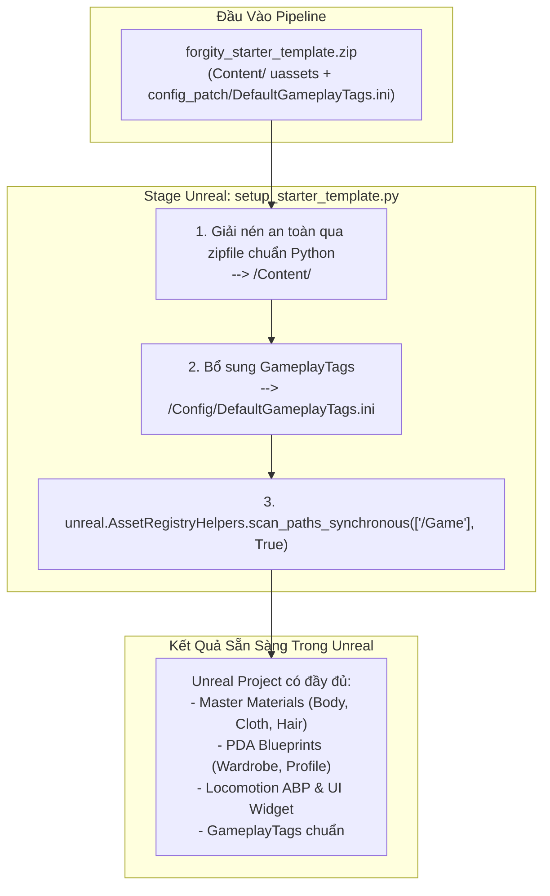

# BL-046: 1-Click Starter Template Setup & In-Engine Asset Ingestion

> **Mã công việc**: `BL-046`
> **Trạng thái**: `Pending` *(Kế hoạch kỹ thuật đề xuất ngày 08/11/2026)*
> **Ngày tạo**: 08/11/2026
> **Phạm vi**: 
> - `pipeline-scripts/unreal/`: Kịch bản `setup_starter_template.py` (giải nén Content/ uasset, cập nhật `DefaultGameplayTags.ini`, quét Asset Registry).
> - `api/` & `runner/`: Mở rộng hỗ trợ MIME/Type Pin cho tệp nén (`.zip`, `.archive`).
> - `packages/starter-template/`: Gói nén mẫu `forgity_starter_template.zip` (Master Materials, PDA Blueprints, ABP Locomotion, Wardrobe UI Widget).
> **Tham chiếu liên quan**: [BL-044 (Unified Project Migrations Hub)](file:///d:/FullStack/Automation/.agents/plans/2026-11-05-bl-044-unified-project-migrations-and-package-transfer-hub.md)

---

## 1. Tầm Nhìn & Mục Tiêu

Để giảm thiểu tối đa rào cản thử nghiệm (Onboarding Friction) cho người dùng mới và tester (đặc biệt từ F95zone / Reddit), người dùng không cần phải tự cấu hình một dự án Unreal phức tạp hay tải source project hàng chục GB:
1. **1-Click Starter Template Ingestion**: Cung cấp kịch bản Python chạy trực tiếp trong Unreal (`setup_starter_template.py`) nhận đầu vào là một file `.zip` chứa cấu trúc chuẩn xuất phát từ thư mục `Content/`.
2. **Bảo Toàn Liên Kết `.uasset` Tuyệt Đối**: Bằng cách giữ nguyên cấu trúc thư mục logic đứng từ `Content/` (`/Game/Characters/Genesis9/...`), các asset Master Material, Animation Blueprint, UI Widget và Data Asset liên kết với nhau 100% không bị lỗi Missing Asset hay Redirector.
3. **Tự Động Đăng Ký GameplayTags**: Đọc file `config_patch/DefaultGameplayTags.ini` từ file zip và tự động append vào `Config/DefaultGameplayTags.ini` của project nếu chưa có.
4. **Tiền Đề Vững Chắc Cho BL-044**: Đặt nền móng về cơ chế giải nén và xử lý tệp nén trước khi tích hợp vào phân hệ toàn diện **BL-044 (Unified Project Migrations & Package Transfer Hub)**.

---

## 2. Kiến Trúc Luồng Thực Thi (Mental Model)



---

## 3. Thiết Kế Chi Tiết

### 3.1. Cấu Trúc Gói Nén `forgity_starter_template.zip`
```text
forgity_starter_template.zip
├── Content/
│   └── Characters/
│       └── Genesis9/
│           ├── MasterMaterials/     <-- M_Master_Body, M_Master_Cloth, M_Master_Hair
│           ├── Core/                <-- PDA_WardrobeItem, PDA_CharacterProfile, Structs
│           ├── Locomotion/          <-- ABP_Genesis9, BlendSpaces, Run/Walk Anims
│           └── UI/                  <-- WBP_WardrobeCustomizer (In-game UI)
└── config_patch/
    └── DefaultGameplayTags.ini      <-- Tag definitions (Character.*, System.Wardrobe.Slots.*)
```

### 3.2. Script `pipeline-scripts/unreal/setup_starter_template.py`
- Sử dụng thư viện chuẩn `zipfile`, `os`, `shutil` và `unreal`.
- Tự động phát hiện `<project_root>` qua `unreal.Paths.project_dir()`.
- Chống path traversal (Zip Slip vulnerability) khi giải nén.
- Báo cáo chi tiết: Số lượng asset đã cài đặt, số tag mới được bổ sung.

### 3.3. Hỗ Trợ Dynamic Pin / File Type `.zip`
- Đảm bảo các Pin đầu vào chấp nhận đuôi mở rộng `.zip` và MIME type `application/zip` mà không bị validator từ chối.

---

## 4. Kế Hoạch Nghiệm Thu (Verification Plan)

1. **Unit Test Python**:
   - Viết test mô phỏng giải nén file zip mẫu với cấu trúc `Content/` và `config_patch/DefaultGameplayTags.ini`.
   - Kiểm tra chống ghi đè tùy chọn và tính toàn vẹn của file sinh ra.
2. **Kiểm Thử Thực Tế Trong Unreal (Dry-Run / Live)**:
   - Tạo 1 project Unreal Engine 5 rỗng hoàn toàn.
   - Chạy `setup_starter_template.py` với gói zip mẫu.
   - Mở Unreal Content Browser: Xác nhận các folder, Master Materials và Data Asset Schemas hiển thị đầy đủ, không có lỗi reference đỏ.
