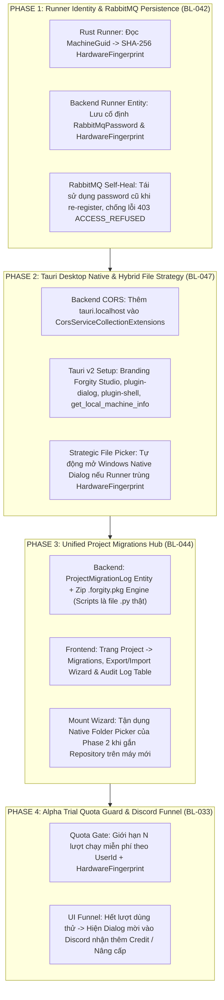

# BL-047: Master Roadmap — Tauri Desktop Native App, Hybrid File Browser Strategy & Runner Identity

> **Mã công việc**: `BL-047` (Kết nối đồng bộ với `BL-042`, `BL-044`, `BL-033`)
> **Trạng thái**: `Pending` *(Kế hoạch lộ trình tổng thể ngày 09/11/2026)*
> **Ngày tạo**: 09/11/2026
> **Phạm vi**:
> - `runner/` (Rust Daemon: `HardwareFingerprint` / `MachineGuid`, Credential Persistence)
> - `api/` (Backend: `Runner` Entity, CORS `tauri.localhost`, Cookie `SameSite=None`, Migrations Engine, Quota Guard)
> - `web/` & `web/src-tauri/` (Tauri v2 Desktop App, `@tauri-apps/plugin-dialog`, `@tauri-apps/plugin-shell`, `useFilePickerStrategy`)
> **Tham chiếu liên quan**:
> - [BL-042: Runner Credential Persistence, Broker IAM & Billing Quota Lifecycle](file:///d:/FullStack/Automation/.agents/plans/BACKLOG.md)
> - [BL-044: Unified Project Migrations & Package Transfer Hub](file:///d:/FullStack/Automation/.agents/plans/2026-11-05-bl-044-unified-project-migrations-and-package-transfer-hub.md)
> - [BL-046: 1-Click Starter Template Setup & In-Engine Asset Ingestion](file:///d:/FullStack/Automation/.agents/plans/2026-11-08-bl-046-1-click-starter-template-setup-in-engine-asset-ingestion.md)
> - [BL-033: Commercial Quota Trial & Device Fingerprint Gate](file:///d:/FullStack/Automation/.agents/plans/BACKLOG.md)

---

## 1. Bối Cảnh & Tầm Nhìn Kiến Trúc ("Cloud-Orchestrated Local Execution")

Để phát hành **Forgity Studio** cho cộng đồng Solo Developers (trên F95zone, Reddit, YouTube) với trải nghiệm mượt mà như một phần mềm Desktop gốc (Native App) nhưng vẫn giữ toàn quyền kiểm soát điều phối, chống bẻ khóa (Anti-Crack) và quản lý Quota trên Server:

1. **Zero Port-Forwarding / Outbound-Only**:
   - Server không bao giờ cần biết IP động của máy người dùng.
   - `forgity-runner.exe` chủ động kết nối gRPC hai chiều và AMQP (RabbitMQ) lên Server bằng định danh `RunnerId` + `RabbitMqPassword` cố định.
   - Giao diện Tauri Desktop gọi REST API / SignalR lên Server qua HTTPS.
2. **CORS & Cookie Đã Sẵn Sàng Cho Tauri**:
   - Trong [Login.cs](file:///d:/FullStack/Automation/api/src/Modules/Identity/Automation.Identity/Features/Auth/Login.cs#L46-L53), `refreshToken` Cookie đã được cấu hình sẵn `HttpOnly = true, Secure = true, SameSite = SameSiteMode.None` (và `AccessToken` đi qua Bearer Header).
   - Trong [CorsServiceCollectionExtensions.cs](file:///d:/FullStack/Automation/api/src/SharedKernel/Automation.SharedKernel/Extensions/Security/CorsServiceCollectionExtensions.cs#L29-L49), chỉ cần thêm `tauri.localhost` (cùng `.AllowCredentials()` đã có sẵn) là Tauri WebView2 trên mọi máy Windows đều gửi/nhận Cookie và gọi API hợp lệ 100%.
3. **Loại Bỏ Trải Nghiệm "Cringe" Khi Duyệt File (Hybrid File Browser Strategy)**:
   - Tách bạch rõ **Thao tác Upload/Download gói dữ liệu độc lập** (không dính tới Runner) và **Thao tác chọn đường dẫn vật lý trên máy chạy DCC** (`AttachRunnerForm`, `ExecutorExtensions`, `RunnerEnginesTab`).
   - Khi mở bằng Tauri Desktop và đối chiếu `Runner.HardwareFingerprint == LocalMachineFingerprint`, hệ thống bật thẳng **Windows Explorer Gốc (`@tauri-apps/plugin-dialog`)** trong 0ms thay vì mở modal duyệt file từ xa qua gRPC.

---

## 2. Sơ Đồ Tổng Quan Lộ Trình 4 Giai Đoạn (Master Sequence)



---

## 3. Thiết Kế Chi Tiết Từng Giai Đoạn

### PHASE 1: Củng Cố Định Danh Runner & RabbitMQ Credentials (`BL-042`)

#### 1.1. Phía Rust Runner (`runner/`)
- Tạo hàm thu thập định danh phần cứng máy trạm (`compute_hardware_fingerprint()`):
  - Trên Windows: Đọc `MachineGuid` từ Registry `HKEY_LOCAL_MACHINE\SOFTWARE\Microsoft\Cryptography` (hoặc fallback sang hostname + OS info), băm SHA-256 ra chuỗi định danh 64 ký tự.
- Gửi `hardware_fingerprint` trong:
  - Lệnh đăng ký HTTP/CLI (`RegisterRunnerWithToken`).
  - Bản tin Handshake gRPC (`AgentMessage`).
- Tách bạch vị trí lưu `runner.toml`:
  - Khi chạy bản cài đặt Desktop/Production: Lưu tại `%LOCALAPPDATA%\Forgity\runner.toml` để không bao giờ xung đột với file cấu hình dev trong repo.

#### 1.2. Phía Backend (`api/src/Modules/Runner/`)
- **Cập nhật Entity `Runner`** ([Runner.cs](file:///d:/FullStack/Automation/api/src/Modules/Runner/Automation.Runner/Domain/Entities/Runner.cs)):
  - Thêm `public string? HardwareFingerprint { get; set; }`
  - Thêm `public string? RabbitMqPassword { get; set; }`
  - Tạo EF Core Migration cập nhật bảng `Runners`.
- **Sửa `RegisterRunnerWithTokenHandler`**:
  - Nếu Runner đã có `RabbitMqPassword` trong DB, **giữ nguyên mật khẩu đó** và đồng bộ lại lên RabbitMQ Broker (`EnsureUserAndPermissionsAsync`), trả về mật khẩu cũ cho Runner.
  - Chỉ sinh mật khẩu mới khi Runner đăng ký lần đầu tiên hoặc khi người dùng bấm nút "Reset Credentials" chủ động.
  - Trị dứt điểm lỗi `403 ACCESS_REFUSED` khi container RabbitMQ khởi động lại hoặc khi Runner pairing lại.
- **Mở rộng `RunnerDto`**:
  - Trả trường `HardwareFingerprint` về cho Frontend để phục vụ so khớp ở Phase 2.

---

### PHASE 2: Tauri Desktop App & Chiến Thuật Giao Tiếp Hệ Thống (`BL-047`)

#### 2.1. Cấu hình CORS & Cookie cho Tauri (`api/`)
- Trong [CorsServiceCollectionExtensions.cs](file:///d:/FullStack/Automation/api/src/SharedKernel/Automation.SharedKernel/Extensions/Security/CorsServiceCollectionExtensions.cs):
  ```csharp
  if (host.Equals("localhost", StringComparison.OrdinalIgnoreCase) ||
      host.Equals("127.0.0.1", StringComparison.OrdinalIgnoreCase) ||
      host.Equals("tauri.localhost", StringComparison.OrdinalIgnoreCase) ||
      host.EndsWith(".tauri.localhost", StringComparison.OrdinalIgnoreCase) ||
      host.EndsWith(".pages.dev", StringComparison.OrdinalIgnoreCase) ||
      host.Equals("pages.dev", StringComparison.OrdinalIgnoreCase))
  {
      return true;
  }
  ```
- Trong [tauri.conf.json](file:///d:/FullStack/Automation/web/src-tauri/tauri.conf.json):
  - Bật `useHttpsScheme: true` cho Windows WebView2 để Origin là `https://tauri.localhost`, đảm bảo Cookie `Secure = true; SameSite = None` từ [Login.cs](file:///d:/FullStack/Automation/api/src/Modules/Identity/Automation.Identity/Features/Auth/Login.cs) hoạt động hoàn hảo 100% trên mọi trình duyệt nhúng.

#### 2.2. Nâng cấp Tauri Native Core (`web/src-tauri/`)
- Cập nhật `tauri.conf.json`:
  - `productName`: `"Forgity Studio"`
  - `identifier`: `"studio.forgity.desktop"`
  - Kích thước cửa sổ: `1440x900` (min `1024x720`).
- Cài đặt plugins:
  - `tauri-plugin-dialog` (Mở hộp thoại chọn File / Folder gốc của Windows).
  - `tauri-plugin-shell` (Mở thư mục trong Explorer, kiểm tra/khởi chạy `forgity-runner.exe`).
- Viết Tauri Rust Command `get_local_machine_info()` trong `web/src-tauri/src/lib.rs`:
  - Dùng chung thuật toán đọc `MachineGuid` -> SHA-256 `hardware_fingerprint` y hệt như `forgity-runner`.
  - Trả về `{ isDesktop: true, hardwareFingerprint: "...", hostname: "..." }`.

#### 2.3. Xây dựng `useFilePickerStrategy` (`web/src/`)
- Tạo adapter chiến thuật tại `web/src/lib/platform/filePickerStrategy.ts`:
  - Kiểm tra: `isLocalRunner(runner)`: `isTauri() && runner.hardwareFingerprint === localMachineInfo.hardwareFingerprint`.
  - **Hàm `pickFileOrFolder(options)`**:
    - Nếu `isLocalRunner(runner) == true`: Gọi thẳng `@tauri-apps/plugin-dialog` (`open({ directory: mode === 'folder', filters: ... })`) ➔ Trả về đường dẫn ngay lập tức, **không mở modal `RemoteFileBrowserDialog`**.
    - Nếu `isLocalRunner(runner) == false` (đang chạy trên Web hoặc điều khiển máy trạm từ xa): Mở `RemoteFileBrowserDialog` như hiện tại.
- Áp dụng tại 3 điểm duy nhất:
  1. [ExecutorExtensions.tsx](file:///d:/FullStack/Automation/web/src/features/runners/components/ExecutorExtensions.tsx) (Chọn `.uproject` cho Unreal).
  2. [RunnerEnginesTab.tsx](file:///d:/FullStack/Automation/web/src/features/runners/components/RunnerEnginesTab.tsx) (Chọn `.exe` cho Blender/Unreal/Python).
  3. [AttachRunnerForm.tsx](file:///d:/FullStack/Automation/web/src/features/repositories/components/AttachRunnerForm.tsx) (Chọn thư mục gốc khi Mount Repository).

---

### PHASE 3: Unified Project Migrations & Package Transfer Hub (`BL-044`)

*(Thực hiện sau khi Phase 1 & 2 hoàn tất, kế thừa toàn bộ thiết kế tại [2026-11-05-bl-044-unified-project-migrations-and-package-transfer-hub.md](file:///d:/FullStack/Automation/.agents/plans/2026-11-05-bl-044-unified-project-migrations-and-package-transfer-hub.md))*
- **Backend**:
  - Tạo Entity `ProjectMigrationLog` lưu lịch sử kiểm toán Export/Import.
  - Xây dựng bộ đóng gói `.forgity.pkg` (Zip Archive): Tách toàn bộ Python scripts trong Pipeline ra thành các file `.py` thật nằm trong thư mục `scripts/` của gói Zip thay vì nhét chuỗi string dài trong JSON.
- **Frontend**:
  - Trang `Studio -> Project -> Migrations` với bảng lịch sử Audit Log và nút tải lại gói cũ.
  - Wizard Export/Import đa danh mục (Pipelines, Content Anchors, Repositories).
  - **Mount Wizard sau khi Import**: Khi người dùng tải gói `.forgity.pkg` mẫu của bạn về import vào máy họ, bước gắn đường dẫn ổ cứng cho Repository sẽ tự động dùng luôn **Windows Explorer Gốc** của Phase 2!

---

### PHASE 4: Cổng Quota Dùng Thử & Điều Hướng Discord (`BL-033`)

- **Backend**:
  - Kiểm tra số lượt chạy miễn phí dựa trên cả `UserId` và `Runner.HardwareFingerprint` (chống tạo nhiều tài khoản clone trên cùng 1 máy tính).
  - Mặc định cấp sẵn hạn mức dùng thử (ví dụ: 5 hoặc 10 lượt chạy pipeline thành công).
- **Frontend**:
  - Hiển thị số lượt dùng thử còn lại trên thanh trạng thái / nút Run.
  - Khi chạm ngưỡng `0 credits`: Hiện Dialog thông báo thân thiện mời tham gia **Discord của Forgity Studio** để nhận thêm lượt test miễn phí hoặc nâng cấp gói thương mại.

---

## 4. Kế Hoạch Kiểm Thử & Nghiệm Thu (Verification Plan)

1. **Phase 1 (Runner Identity & RabbitMQ)**:
   - `cargo test --manifest-path runner/Cargo.toml` kiểm tra hàm sinh `hardware_fingerprint` ổn định.
   - Unit test C# cho `RegisterRunnerWithTokenHandler`: Đăng ký lại cùng 1 Runner phải trả về đúng `RabbitMqPassword` cũ và cập nhật `HardwareFingerprint`.
2. **Phase 2 (Tauri Desktop & File Picker Strategy)**:
   - `cargo check --manifest-path web/src-tauri/Cargo.toml` & `pnpm tsc` trên `web/`.
   - Unit test cho `filePickerStrategy`: Kiểm tra nhánh chọn Native Dialog khi `hardwareFingerprint` trùng khớp vs nhánh Remote Dialog khi khác máy hoặc chạy trên trình duyệt.
3. **Phase 3 (Migrations Hub)**:
   - Integration test C# xuất gói `.forgity.pkg` (Zip), kiểm tra bên trong Zip có các file `.py` độc lập và `manifest.json`, sau đó import ngược lại vào Project mới không mất dữ liệu.
4. **Phase 4 (Quota Gate)**:
   - Unit test chặn chạy (`402 Payment Required` / Domain Error) khi hết lượt dùng thử trên cùng một `HardwareFingerprint`.
