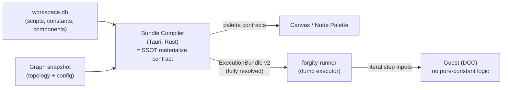

# BL-056: Contract-Driven Pure Node Execution & Workspace-Free Runner

> **Mã công việc**: `BL-056`  
> **Trạng thái**: `Pending` *(Đang lập kế hoạch – chờ User duyệt)*  
> **Ngày tạo**: 15/11/2026  
> **Phạm vi**: Tauri (`app/src-tauri`) / Runner (`runner/`) / Canvas (`app/src`)  
> **Liên quan**: ADR-004 (Unified Node Contract Resolver), ADR-007 (Local SQLite Index), ADR-008 (Runner-Only Execution Engine), `rules/general.md` §9 (Dumb Executor)

---

## 1. Tóm Tắt Mục Tiêu

Hai nguyên tắc cần được thực thi triệt để:

1. **Hình dáng do Contract quyết định, Graph chỉ chứa đường đi + giá trị runtime.** Runner và Guest không bao giờ phải đoán pin output, kiểu `Single`/`Array`, hay `disk_path`/`virtual_path`.
2. **Runner không phụ thuộc dữ liệu workspace.** Runner chỉ biết `ExecutionBundle`. Mọi tra cứu `workspace.db`, expand `$VAR`, materialize contract đều xảy ra **trước khi** bundle được gửi đi (ở tầng Bundle Compiler trong Tauri).

---

## 2. Hiện Trạng & Điểm Đứt Gãy

Sự cố gốc (15/11/2026): `Constant (Unreal)` trả `{}` trong `fbx_to_unreal` → `Inspect Game Contracts` thiếu `material_paths`. Nguyên nhân là `execute_pure_step` trong `stage_runner_guest.py` chỉ xử lý `str`, bỏ qua `list`. Đã vá tạm, nhưng lỗi này là **triệu chứng** của việc logic constant bị nhân bản ra 5 nơi:

| # | Nơi | Việc đang làm | Vấn đề |
|---|-----|---------------|--------|
| 1 | [constantPaletteGenerator.ts](file:///d:/FullStack/Automation/app/src/features/pipelines/utils/constantPaletteGenerator.ts) | Sinh contract pin (`value` hoặc `disk_path`+`virtual_path`, cardinality) | Contract chỉ sống trên UI, **không đi vào bundle** |
| 2 | [local_execution.rs `build_execution_bundle`](file:///d:/FullStack/Automation/app/src-tauri/src/commands/local_execution.rs#L185-L224) | Đổ `{ key: raw_value }` + hack `<key>::unreal_path` | Mất `scope`, `dataType`, danh sách pin; tự split chuỗi `,`/`\n` |
| 3 | [workspace_resolver.rs `resolve_constant`](file:///d:/FullStack/Automation/runner/src/core/workspace_resolver.rs#L176-L230) | Đọc trực tiếp `workspace.db`, cũng tự split `Array` | Nhân bản logic của #2; Runner chạm dữ liệu workspace |
| 4 | [component_orchestrator.rs `populate_constant_inputs`](file:///d:/FullStack/Automation/runner/src/core/component_orchestrator.rs#L643-L662) + [pure_nodes.rs](file:///d:/FullStack/Automation/runner/src/core/pure_nodes.rs#L84-L129) | Đoán pin: `value`→`disk_path`→fallback `virtual_path` | Heuristic, vi phạm §9 |
| 5 | [stage_runner_guest.py `execute_pure_step`](file:///d:/FullStack/Automation/runner/scripts/stage_runner_guest.py#L106-L154) | Đánh giá lại constant trong DCC | Bản sao thứ 3 của logic render; đã gây lỗi `{}` |

Ngoài ra:
- `ResourceResolver::resolve_constant` + `expand_constants_in_inputs` khiến Runner **tra cứu theo key lúc chạy**, nghĩa là Runner vẫn cần biết "workspace có những constant nào".
- Lệnh dev `forgity-runner run-local --workspace` ([run_local.rs#L66-L110](file:///d:/FullStack/Automation/runner/src/cli/run_local.rs#L66-L110)) và `local_engine_tests.rs` dùng `WorkspaceResolver`, nên có hai đường thực thi khác nhau.
- **Lỗi data model**: `unrealPath` luôn là 1 chuỗi, kể cả khi `dataType = Array`. Ví dụ `PDA_PATHS` có `value` 2 phần tử nhưng `unrealPath` chỉ có 1, nên `virtual_path` đang trả về **sai** (`"/Game/Systems/Wardrobe/Schemas/PDA_WardrobeItem"`, thiếu `PDA_CharacterProfile`).

> Tin tốt: đường chạy chính từ UI (`run_local_pipeline` → `run-bundle --stdin`) **đã không mở `workspace.db`** trong Runner. Phần việc còn lại là làm bundle **đầy đủ**, để Runner thôi phải tra cứu hoặc đoán.

---

## 3. Kiến Trúc Đích



### Trước & Sau

| Hạng mục | TRƯỚC | SAU |
|---|---|---|
| Nguồn contract của Constant | TS (`constantPaletteGenerator.ts`) cho UI; Rust tự đoán khi chạy | **1 module Rust `node_contracts`** trong Tauri sinh contract cho cả Palette lẫn Bundle |
| `ExecutionBundle.constants` | `HashMap<String, Value>` thô + key giả `X::unreal_path` | `HashMap<String, ResolvedConstantSpec>` gồm `outputs: {pin_id: Value}` đã đúng kiểu, `templateVars: [..]` |
| Expand `$VAR` | Runner (`expand_constants_in_inputs`) lúc chạy | Compiler expand lúc build bundle, cho cả node inputs của root lẫn component lồng nhau |
| Pure Constant trong Runner | `populate_constant_inputs` + `render_constant_value` đoán pin | Lấy nguyên `spec.outputs` rồi render `{var}` từ input đã nối dây. Không còn nhánh fallback |
| Constant trong Unified DCC Stage | Gửi xuống Guest dưới dạng `step_type: pure`, Guest đánh giá lại | Host đánh giá xong, giá trị được bơm thẳng vào `inputs` của step hạ nguồn dưới dạng literal. Guest bỏ nhánh `local:constant:` |
| `ResourceResolver` trait | `resolve_script`, `resolve_component`, `resolve_constant` | Bỏ `resolve_constant`. Chỉ còn tra cứu O(1) trong bundle |
| `WorkspaceResolver` / `run-local` | Đường thực thi thứ 2 đọc SQLite | Xoá. Dev flow: Tauri xuất bundle JSON → `forgity-runner run-bundle --file` |
| Kiểu `unrealPath` | Luôn `string` | Cùng kiểu với `value` (`string[]` khi `Array`), có validate cùng độ dài |
| Thiếu dữ liệu | Runner fallback âm thầm | Compiler **fail-fast** trước khi spawn Runner (vd. constant không tồn tại, Array lệch độ dài) |

---

## 4. Đặc Tả Hợp Đồng (Bundle v2)

```jsonc
{
  "bundleVersion": 2,
  "runId": "local_...",
  "pipelineKind": "component",
  "rootPipeline": { /* DagPipelineDocument, inputs đã expand $VAR */ },
  "components": { "<slug>": { /* đã expand $VAR */ } },
  "scripts": { "<key>": { "fullPath": "...", "executor": "unreal", "requirements": [], "defaultInputs": {} } },
  "constants": {
    "MATERIAL_PATHS": {
      "outputs": {
        "disk_path":    ["/Game/Characters/Genesis9/Base/Materials"],
        "virtual_path": ["/Game/Characters/Genesis9/Base/Materials"]
      },
      "templateVars": []
    },
    "CHAR_DEST": {
      "outputs": { "value": "D:/Out/{character_name}" },
      "templateVars": ["character_name"]
    }
  },
  "runtimeInputs": {}
}
```

Runner (`pure_nodes.rs`), áp dụng cho node `local:constant:<KEY>`:
- `spec = bundle.constants[KEY]`, không có thì **lỗi** (không fallback).
- `outputs = spec.outputs`, sau đó với mỗi `var ∈ spec.templateVars` thì thay `{var}`/`${var}` bằng input đã nối dây (đệ quy qua `Array`).
- Nếu thiếu input bắt buộc cho `templateVars` thì báo lỗi rõ ràng.

---

## 5. Lộ Trình Theo Phase

### Phase 0: Sửa Data Model Constant (tiền đề) — `Done`
- [x] `unrealPath` mang cùng kiểu với `value` (serialize `Array`/`String` vào cột `unreal_path` trong `workspace_db.rs`). Validate `len(unrealPath) == len(value)` khi `scope == "Unreal"` và `dataType == "Array"`.
- [x] Cập nhật UI form Constants ([workspaceConfig.ts](file:///d:/FullStack/Automation/app/src/features/pipelines/types/workspaceConfig.ts), [useLocalConstantsQuery.ts](file:///d:/FullStack/Automation/app/src/features/pipelines/hooks/workspace/useLocalConstantsQuery.ts), [UnrealContentVaultWorkspace.tsx](file:///d:/FullStack/Automation/app/src/features/pipelines/components/workspace/UnrealContentVaultWorkspace.tsx)), hiển thị node/inspector ([ConstantNodeView.tsx](file:///d:/FullStack/Automation/app/src/features/pipelines/components/canvas/nodes/views/ConstantNodeView.tsx), [NodeConfigInspector.tsx](file:///d:/FullStack/Automation/app/src/features/pipelines/components/canvas/NodeConfigInspector.tsx)), và `local_execution.rs`.
- [x] Migrate dữ liệu cũ (`PDA_PATHS`, `MATERIAL_PATHS`) trong `workspace.db` & `contracts.yaml`, kèm auto-recovery khi load chuỗi legacy bị cắt cụt.
- **Nghiệm thu**: `PDA_PATHS.virtual_path` trả đủ 2 phần tử.

### Phase 1: Bundle Compiler + Constant Contract SSOT — `Done`
- [x] Tạo [node_contracts.rs](file:///d:/FullStack/Automation/app/src-tauri/src/commands/node_contracts.rs): `materialize_constants()`, `build_constant_palette_items()`, `compile_constant_specs()`, expand `$VAR` đệ quy + cycle guard.
- [x] `build_execution_bundle` trong [local_execution.rs](file:///d:/FullStack/Automation/app/src-tauri/src/commands/local_execution.rs) dùng `node_contracts`, phát `bundleVersion: 2`, xoá hack `::unreal_path` và đoạn split chuỗi.
- [x] Expose Tauri command `load_constant_palette` và chuyển [useLocalConstantsQuery.ts](file:///d:/FullStack/Automation/app/src/features/pipelines/hooks/workspace/useLocalConstantsQuery.ts) + [LocalWorkspacePage.tsx](file:///d:/FullStack/Automation/app/src/features/pipelines/pages/LocalWorkspacePage.tsx) sang dùng contract từ Rust; xoá `constantPaletteGenerator.ts` và `resolveConstantsMap`.
- [x] Runner: `ExecutionBundle.constants: HashMap<String, ResolvedConstantSpec>`, `execute_constant_node` trong [pure_nodes.rs](file:///d:/FullStack/Automation/runner/src/core/pure_nodes.rs), xoá `populate_constant_inputs` khỏi [component_orchestrator.rs](file:///d:/FullStack/Automation/runner/src/core/component_orchestrator.rs).
- **Nghiệm thu**: `cargo test` (runner + app), `pnpm tsc`. Chạy `fbx_to_unreal` qua được `Inspect Game Contracts` với đầu vào đúng.

### Phase 2: Runner Không Phụ Thuộc Workspace
- [ ] Compiler expand `$VAR` trong inputs của mọi node (root + components). Xoá `expand_constants_in_inputs` khỏi Runner.
- [ ] Bỏ `resolve_constant` khỏi `ResourceResolver`.
- [ ] Xoá `WorkspaceResolver` và lệnh `run-local`. Thêm Tauri command `export_execution_bundle` (ghi `.forgity/bundles/<run_id>.json`) để dev chạy `forgity-runner run-bundle --file`.
- [ ] Chuyển `local_engine_tests.rs` sang bundle fixtures JSON (không tạo SQLite giả).
- [ ] Runner từ chối bundle `bundleVersion < 2` với thông báo rõ ràng.
- **Nghiệm thu**: `rg "workspace.db|WorkspaceResolver" runner/src` trả về rỗng (trừ comment lịch sử); toàn bộ test pass.

### Phase 3: Guest Thuần Cơ Học
- [ ] Trong `try_execute_unified_dcc_stage`: pure node nào có mọi input là literal/start thì Host đánh giá ngay, rồi bơm giá trị vào `inputs` của step hạ nguồn thay vì tạo `StepInputMapping`.
- [ ] Xoá nhánh `local:constant:` trong `stage_runner_guest.py`. Chỉ giữ Make/Break/Joint cho trường hợp phụ thuộc output DCC lúc chạy (Break dùng tên pin theo contract, bỏ chuỗi đoán `struct_in → input → target → first`).
- **Nghiệm thu**: guest log không còn `Pure step 'Constant: ...'`; `fbx_to_unreal` + `daz_to_blender` chạy end-to-end.

### Phase 4: Tài liệu
- [ ] ADR-010 "Bundle Compiler & Workspace-Free Runner".
- [ ] Cập nhật `playbooks/pipeline-engine.md`, `playbooks/runner-runtime.md`, `docs/backend/PIPELINE_PIN_SYSTEM.md`, AGENTS.md index.

---

## 6. Ranh Giới Đỏ (Redlines)

- Runner **không** được mở `workspace.db`, không đọc `.forgity/`, không suy luận từ `current_dir` để tìm dữ liệu nghiệp vụ.
- Không thêm fallback, đoán tên pin hay split chuỗi trong Runner/Guest. Thiếu dữ liệu thì sửa Compiler/Contract.
- Graph/YAML **không** lưu output contract (giữ ADR-007: YAML portable, gọn).
- Script `.py` vẫn được đọc từ `fullPath` trên đĩa (ADR-006 Direct Disk). Việc đóng gói nội dung script/hash cho Cloud **ngoài phạm vi** BL này.
- `StorageManager` (`runner_state.db`, cache) là dữ liệu **của Runner**, không phải dữ liệu workspace, nên giữ nguyên.

---

## 7. Quyết Định Đã Chốt

1. **Nơi đặt SSOT contract Constant**: **Chốt Ý A** — chuyển sang Rust trong `app/src-tauri` (`node_contracts`), dùng chung cho cả Palette (UI) và ExecutionBundle (Runtime/CLI).
2. **`unrealPath` cho Array**: **Chốt 7.2 Ý 1** — `unrealPath` hỗ trợ Array thật cùng độ dài với `value`, giữ nguyên 2 pin `Disk Path` / `Virtual Path` trên scope `Unreal`.
3. **Lệnh `run-local` & `WorkspaceResolver`**: **Chốt 7.3** — xoá hẳn, thay bằng `export_execution_bundle` từ Tauri -> `forgity-runner run-bundle --file`.

---

## 8. Kế Hoạch Kiểm Thử

- Unit (Runner): constant `Single`/`Array`/`Number`/`Bool`; template `{var}` trong `Array`; thiếu spec thì lỗi; thiếu template input thì lỗi.
- Unit (Tauri): `materialize_constant` cho scope `Unreal`/`Disk`, `$VAR` đệ quy, phát hiện vòng lặp, Array lệch độ dài thì lỗi.
- Integration: bundle fixture `fbx_to_unreal` qua `run-bundle --file` với dispatcher giả, assert `inputs.material_paths` của step Unreal.
- Manual: Run Draft `fbx_to_unreal` và `daz_to_blender` trên Local Mode.
