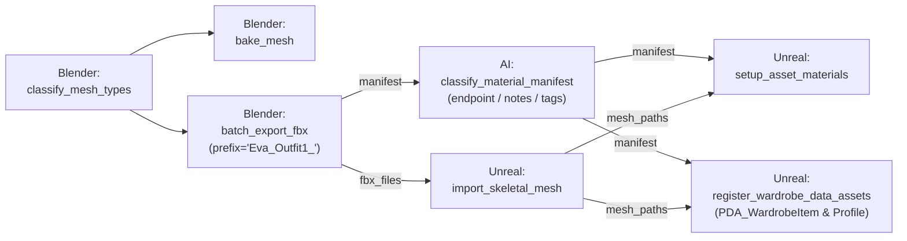

# Kế Hoạch Kỹ Thuật: Chuẩn Hóa Luồng Xuất Modular Outfit, Nâng Cấp AI Classify & Đăng Ký Unreal Data Assets

- **Ngày khởi tạo**: 30/10/2026
- **Trạng thái**: Đã hoàn thành 100% (Completed) - 31/10/2026
- **Mục tiêu**: Chuẩn hóa luồng sản xuất Modular Cloth từ Blender $\rightarrow$ AI Semantic Ingestion $\rightarrow$ Unreal Engine 5 theo kiến trúc **PrimaryDataAsset + GameplayTags**, bảo toàn tên asset gốc, hỗ trợ Local LLM và prompt injection notes trên Canvas, dọn đường cho **Cây Điểm Neo (Anchor Tree)**.

---

## 1. Bối Cảnh & Vấn Đề Cần Giải Quyết

Trong quá trình thử nghiệm thực tế với nhân vật `Eva` và trang phục `Eva_Outfit1` (Bra, Panties, Hair):
1. **Xuất FBX (`batch_export_fbx.py`)**:
   - Thư mục xuất hiện tại đang tạo thư mục con không cần thiết hoặc lưu tách rời với `.blend`, khiến textures bị đè lộn xộn nếu có nhiều outfits.
   - Naming hiện tại dính chữ (`Eva_Outfit1Inner_Top.fbx`), làm mất hoàn toàn tên asset gốc (`BRZ_US_Bra`, `Iridessa_Hair`).
   - `manifest` bị ghi đè trường `cloth_type` bằng `stem_name`, làm đứt gãy luồng metadata xuống downstream.
2. **AI Semantic Classifier (`classify_material_manifest.py`)**:
   - Chưa phơi chân pin `endpoint` ra chữ ký `main()`, gây khó khăn khi người dùng muốn chạy Local LLM (Ollama `http://localhost:11434/v1`, LM Studio, vLLM).
   - Chưa có chân pin `notes` để người dùng tiêm ghi chú đặc biệt vào System/User Prompt (ví dụ: chú thích đồ lót, chất liệu xuyên thấu...).
   - Chưa cho phép AI nhìn thấy danh sách **GameplayTags** (hoặc cấu trúc slot tags mong muốn), khiến AI phải tự đoán mò tên tag thay vì bám sát quy chuẩn của dự án.
3. **Đăng Ký DataAsset trong Unreal (`register_wardrobe_data_assets.py`)**:
   - Cần thay thế hoàn toàn node DataTable cũ (`register_appearance_datatable.py`) bằng node chuyên biệt tạo/cập nhật `PDA_WardrobeItem` và `PDA_CharacterProfile`.
   - Tự động gắn kết `CharacterTag`, `SlotTag`, `ItemTag`, `ItemMesh` và tự động cập nhật danh sách tag vào `DefaultGameplayTags.ini`.
4. **Vấn đề Cây Điểm Neo & Đảo Ngược Phụ Thuộc (Content Anchor Tree - `BL-031`)**:
   - Đã ghi nhận vào `BACKLOG.md` mục **`BL-031`**: Chuyển từ mô hình cứng `ResourceItem.ContentId` sang mô hình Content sở hữu `ContentLinks` theo Cây Điểm Neo (`root/body`, `outfits/outfit1`, `animations/combat`).
   - Quy ước đặt tên `{Prefix}_{CleanAssetName}.fbx` ở Phase 1 hôm nay chính là chuẩn đầu vào để sau này bộ phân giải (Convention Parser) tự động phân rã token tạo cây mà không cần cấu hình thủ công.
   - Khả năng **Migration 2 chiều (Bidirectional Migration)** đã được xác nhận: từ `Resource.ContentId` cũ sang `ContentLinks` mới (Zero Data Loss) và có thể rollback an toàn bất cứ lúc nào.

---

## 2. Kế Hoạch Triển Khai Chi Tiết (Execution Roadmap)

### Phase 1: Tái cấu trúc `batch_export_fbx.py` (Blender)
- **Vị trí thư mục xuất**:
  - Mặc định xuất các file `.fbx` nằm ngay cùng cấp thư mục với file `.blend` đang mở (ví dụ: `Characters/Eva/outfits/Eva_Outfit1/Eva_Outfit1.blend` $\rightarrow$ xuất FBX ngay tại đây).
- **Quy ước đặt tên ngắn gọn & sạch**:
  - Hàm làm sạch tên gốc: Bỏ các hậu tố rác của Blender và DAZ (`Mesh`, `Genesis 9`, `G9`, `Shape`, `.001`...).
    - `"BRZ US Bra Mesh"` $\rightarrow$ `BRZ_US_Bra`
    - `"Iridessa Hair Genesis 9"` $\rightarrow$ `Iridessa_Hair`
  - Đặt tên file: `{Prefix}_{CleanAssetName}.fbx` (ví dụ: `Eva_Outfit1_BRZ_US_Bra.fbx`).
- **Bảo toàn Metadata trong Manifest**:
  - Lưu rõ ràng:
    - `"asset_name"`: Tên ngắn gọn chuẩn hóa.
    - `"source_object_name"`: Tên object gốc trong scene.
    - `"cloth_type"`: Giữ nguyên slot phân loại từ đầu vào (vd: `Inner_Top`, `Inner_Bottom`, `Hair`), không bị ghi đè.
    - `"file_path"`: Full path tuyệt đối của file FBX.
    - `"slot_count"` & `"slots"`: Giữ nguyên trích xuất slot textures và `texture_bindings` ngữ nghĩa.

### Phase 2: Nâng cấp `classify_material_manifest.py` (AI Classifier)
- **Mở rộng tham số hàm `main()`** (được tự động bóc tách thành pin trên Canvas nhờ `NativePythonScriptAnalyzer`):
  ```python
  def main(
      raw_manifest: Union[Dict[str, Any], str],
      contracts: Optional[Dict[str, Any]] = None,
      tags: Optional[Union[List[str], str]] = None,  # Danh sách GameplayTags hợp lệ
      provider: str = "groq",
      model: str = "llama-3.3-70b-versatile",
      endpoint: str = "",                           # URL tùy chỉnh cho Local LLM (Ollama, LM Studio)
      notes: str = "",                              # Ghi chú đặc biệt / Prompt Injection từ người dùng
      **kwargs
  ) -> Dict[str, Any]:
  ```
- **Hỗ trợ Local LLM**:
  - Nếu `provider == "ollama"` hoặc `endpoint` chứa `11434` / `localhost`: Khởi tạo `OpenAI(base_url=endpoint, api_key="ollama")`.
- **Tiêm Ngữ Cảnh GameplayTags & Notes vào Prompt**:
  - Đưa danh sách các slot tags vào System Prompt để AI căn chỉnh `material_tag` khớp 100%.
  - Chèn mục `SPECIAL USER INSTRUCTIONS / CONTEXT:` vào User Prompt khi có `notes`.
- **Cập nhật hướng dẫn tên theo chuẩn mới**:
  - Hướng dẫn AI hiểu quy ước `{Prefix}_{CleanAssetName}` để nhận diện đúng vai trò trang phục.

### Phase 3: Viết mới `register_wardrobe_data_assets.py` (Unreal Engine)
- **Vị trí**: `pipeline-scripts/unreal/register_wardrobe_data_assets.py`.
- **Mục tiêu**: Thay thế `register_appearance_datatable.py`, làm việc trực tiếp với schema `PDA_CharacterProfile` và `PDA_WardrobeItem`.
- **Chữ ký hàm `main()`**:
  ```python
  def main(
      manifest: Union[Dict[str, Any], str],
      character_tag: str = "Character.Eva",
      destination_folder: str = "/Game/Characters/Genesis9/Eva/Outfits",
      character_profile_path: str = "/Game/Characters/Genesis9/Eva/DA_Eva_Profile",
      tags_ini_path: str = "",
      **kwargs
  ) -> Dict[str, Any]:
  ```
- **Cơ chế hoạt động**:
  1. **Tự động đồng bộ GameplayTags**:
     - Kiểm tra và tự chèn các tag mới vào `Config/DefaultGameplayTags.ini` nếu chưa có (`Character.Eva`, `System.Wardrobe.Slots.*`, `Character.Eva.Outfits.*`).
  2. **Tạo/Cập nhật `PDA_WardrobeItem`**:
     - Tạo asset kế thừa từ class `PDA_WardrobeItem` tại `destination_folder`.
     - Gán các thuộc tính: `CharacterTag`, `SlotTag`, `ItemTag`, `ItemMesh`.
  3. **Cập nhật `PDA_CharacterProfile`**:
     - Gán `BodyMesh` nếu có, tự động nạp `ItemTag` vào mảng `IntialItems`.
  4. **Dry-Run Mode**: Hỗ trợ chạy giả lập khi test ngoài môi trường Unreal Engine.

---

## 3. Bản Đồ Nối Dây Dự Kiến Trên Canvas (Pipeline Flow)



---

## 4. Kế Hoạch Kiểm Thử & Nghiệm Thu (Verification Plan)

1. **Kiểm tra cú pháp & AST Analysis**:
   - Chạy `python api/lib/analyzers/python_script_analyzer.py` trên cả 3 file:
     - `pipeline-scripts/blender/batch_export_fbx.py`
     - `pipeline-scripts/ai/classify_material_manifest.py`
     - `pipeline-scripts/unreal/register_wardrobe_data_assets.py`
   - Xác nhận tất cả inputs/outputs/pins phân giải sạch đẹp, không lỗi.
2. **Kiểm thử trên dữ liệu thực tế**:
   - Chạy headless Blender test xuất outfit từ `D:\Games\Projects\MyGame\Characters\Eva\outfits\Eva_Outfit1\Eva_Outfit1.blend`.
   - Xác nhận file FBX xuất ra cùng cấp thư mục với tên sạch `Eva_Outfit1_BRZ_US_Bra.fbx`.
   - Xác nhận AI phân loại nhận được notes và tags đúng định dạng.
   - Kiểm tra dry-run / Unreal runner sinh đúng file DataAsset với GameplayTags.
3. **Cập nhật tài liệu**:
   - Ghi nhận vào `.agents/playbooks/character-bake-and-unreal-shading.md`.

---

## 5. Kết Quả Nghiệm Thu Thực Tế (Final Verification Results)

1. **Phase 1 (Blender FBX Export)**:
   - File `pipeline-scripts/blender/batch_export_fbx.py` xuất khẩu cùng cấp thư mục với file `.blend`, đặt tên chuẩn `{Prefix}_{CleanAssetName}.fbx`.
   - Đã kiểm thử trực tiếp trên Blender 5.2 Headless xuất khẩu 3 items của `Eva_Outfit1.blend` (`Eva_Outfit1_BRZ_US_Bra.fbx`, `Eva_Outfit1_BRZ_US_Panties.fbx`, `Eva_Outfit1_Iridessa_Hair.fbx`) và bảo toàn 100% metadata manifest.
2. **Phase 2 (AI Semantic Classifiers)**:
   - `pipeline-scripts/ai/classify_mesh_types.py` & `classify_material_manifest.py` tiếp nhận `endpoint` (alias hoặc URL Local LLM), `tags_ini_path`, và `notes`.
   - Đã kiểm thử live với Groq API: phân loại mesh và vật liệu chỉ mất 1.4-1.6s, khớp chính xác GameplayTags (`System.Wardrobe.Slots.*`).
3. **Phase 3 (Unreal Data Asset Registration)**:
   - File `pipeline-scripts/unreal/register_wardrobe_data_assets.py` thay thế hoàn toàn DataTable cũ.
   - Hỗ trợ gán và liên kết `PDA_WardrobeItem` (`CharacterTag`, `SlotTag`, `ItemTag`, `ItemMesh`) và nạp `PDA_CharacterProfile.IntialItems`.
   - Đã kiểm thử thực tế đồng bộ 5 GameplayTags mới trực tiếp vào `D:\Games\UnrealEngine\Projects\TemplateProject\Config\DefaultGameplayTags.ini` với cơ chế bảo đảm idempotent 100%.
4. **AST Sidecar Check**:
   - Toàn bộ 4 scripts đều pass `python_script_analyzer.py` với **0 cảnh báo (0 warnings)**.
5. **Tài liệu & Playbook**:
   - Đã cập nhật chi tiết mục 7 vào `.agents/playbooks/character-bake-and-unreal-shading.md`.

