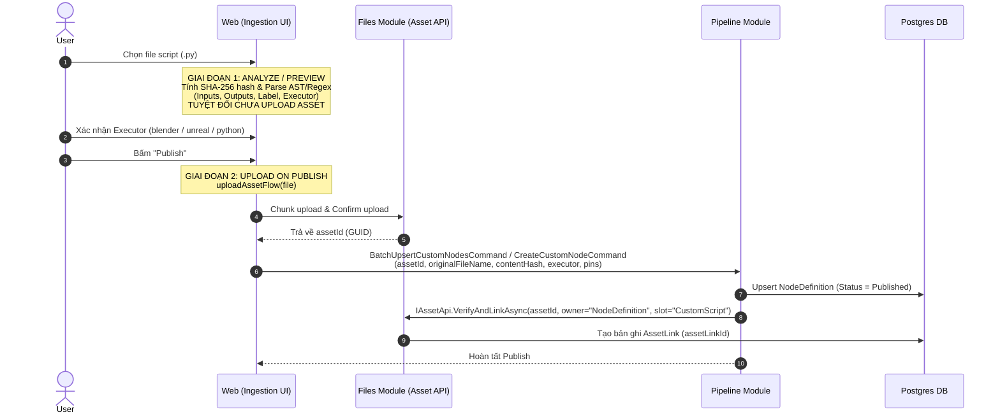

# Pipeline Playbook: Custom Nodes & Canvas Graph Sync

## Mental model: definition → instance → resolve → validate

> Cập nhật 23/10/2026. Phần **hiện tại** bên dưới mô tả checkpoint sau khi hoàn tất **Phase B + R1 + R2**. Phần **định hướng (R3/R4)** liên kết với [Node Resolution & Validation Lifecycle](../plans/2026-10-22-node-resolution-and-validation-lifecycle.md).

### Luồng resolve hiện tại (Sau R1 + R2)

1. Palette cung cấp definition dùng chung và pins ban đầu khi tạo node. Khi tải graph, dùng pins backend trả về cho từng instance; refetch palette không thay thế các pins này.
2. Với các node Struct (`BreakStruct`, `MakeStruct`, `CastToStruct`), trạng thái khởi tạo chưa chọn `StructType` (`Not selected`) chỉ có input `StructType` (hoặc `[Source, StructType]` và `[IsValid]` với `CastToStruct`) và hiển thị cảnh báo `"Select a Struct Type in Inspector"`. Khi người dùng đổi `StructType` sang loại khác, `applyNodeConfigUpdate` tự động xóa các giá trị cấu hình phụ thuộc (`Target` hoặc các field của struct cũ) và dọn dây nối vào `Target` để không bao giờ giữ nhầm ID/connection của loại cũ.
3. Mỗi dynamic tool trên Backend khai báo `Capabilities.SchemaConfigKeys` (ví dụ `["StructType"]`, `["Template"]`, `["DynamicPins"]`, `["Path"]`, `["VariableName"]`). `PipelineNodeRouter` truyền `projectId` (từ `usePipelineFormScope`) và `schemaConfigKeys` vào `useNodePinResolver`.
4. `useNodePinResolver` chỉ tính `schemaSignature` trên các khóa trong `SchemaConfigKeys` và áp dụng **Debounce 300ms** kèm `AbortController` (`signal`). Việc chỉnh sửa các giá trị dữ liệu runtime (`Target`, `Item_1`, biến `{folder}`...) không làm đổi `schemaSignature` nên **không phát sinh request `/resolve-pins` dư thừa**.
5. Khi nhận kết quả từ `/resolve-pins`, hook dùng `arePinListsEqual` để so sánh toàn diện schema (`id`, `label`, `kind`, `primitiveType`, `cardinality`, `structType`, `isRequired`, `defaultValue`, `metadata`) — nhận diện chính xác cả khi một pin giữ nguyên `id` (như `Target` hoặc `Result`) nhưng đổi `structType` hoặc `cardinality`. Việc dọn orphan edges tách biệt rõ hai tập `validInputPinIds` (`edge.target === id`) và `validOutputPinIds` (`edge.source === id`).

### Định hướng tiếp theo — R3 & R4 (chưa triển khai)

**Resolve trả lời “node có những chân nào”; validation trả lời “graph còn thiếu hoặc sai điều gì”.** Hai việc dùng cùng định nghĩa backend nhưng có đầu vào khác nhau: resolve cần config/context; validation còn cần edges, parameters và dependencies của project.

```text
Definition backend → khởi tạo instance
Đổi cấu hình ảnh hưởng schema (SchemaConfigKeys) → debounce 300ms → backend resolve → cập nhật instance pins
Đổi dữ liệu input → cập nhật config instance (không gọi resolve)
Snapshot graph + connections + project context → backend validate → diagnostics trên Canvas
```

- Validation backend kiểm tra thiếu config, pin bắt buộc chưa có nguồn, kết nối sai type và dependency thiếu. Pin đã nối dây hoặc lấy giá trị từ parameter hợp lệ không bị kết luận thiếu chỉ vì config rỗng. Không gọi thực thi tool để kiểm tra.
- Diagnostics dự kiến có code, severity, message và vị trí node/pin/edge. Canvas hiển thị cảnh báo trên view hiện có; không tạo một loại node thay thế. Chưa kiểm tra/đang kiểm tra/kết quả cũ phải phân biệt với hợp lệ; không lưu cờ `isValid` như dữ liệu gốc.
- `ValidatePipeline` hiện đọc graph đã lưu và gọi planner, trả `IsValid`, `CycleNodeIds`, `UnresolvedPins`. Muốn cảnh báo đúng draft đang sửa cần thiết kế validation trên snapshot tương ứng; không gắn kết quả DB cũ lên draft mới như đã được kiểm tra.
- Import cần remap rồi validate trong project đích; không tin trạng thái hợp lệ ở project nguồn. Export template có thể chưa đủ dữ liệu chạy; chính sách chặn Run/Export/Save cần chốt riêng. Không tự xóa pins/config/edges để che lỗi.

### Mental Model: Hợp Đồng Trung Gian (`ResolvedNodeContract`), `Config` vs `Metadata` & Định Danh Node

> Xem chi tiết kiến trúc tại [2026-10-23-contracts-validation-buildtime-runtime-architecture.md](../plans/2026-10-23-contracts-validation-buildtime-runtime-architecture.md).

1. **Bước Chuẩn Hóa Từ Node Thô DB Sang Hợp Đồng Đầy Đủ (`ResolvedNodeContract`)**:
   - Bản ghi `PipelineNode` trong Database chỉ lưu dữ liệu thô (`Id`, `RefId`, `Kind`, `Config`, `Metadata`).
   - Thay vì để Build-Time (`PipelineGraphDtoBuilder`), Runtime (`ExecStepFactory`) và Export (`ExportPipelineBundle`) tự viết `switch-case` rời rạc để đoán nghĩa của Node, hệ thống sử dụng **`INodeContractResolver`** kèm **`NodeContractResolutionContext`** (nạp sẵn 1 lần `Parameters`, `CustomDefinitions`, `SubPipelines` để chống $N+1$ query).
   - Kết quả trả ra là một Map `IReadOnlyDictionary<Guid, ResolvedNodeContract>` nắm giữ toàn bộ các Node trong đồ thị kèm hợp đồng đã phân giải đầy đủ (`Inputs`, `Outputs` đã chạy qua `ResolvePins`, `StructType`, `Executor`, `IsPure`, `IsDefinitionMissing`). Cả **Build-Time**, **Validation**, và **Runtime** đều tra cứu $O(1)$ từ Map này.
2. **Ranh Giới Giữa `Config` và `Metadata` Trên `PipelineNode`**:
   - **`Config` (`ConfigValues` — Dữ liệu & Hợp đồng)**: Lưu giá trị đầu vào của các chân Input Pin (khi không nối dây) và các khóa cấu hình Schema (`SchemaConfigKeys` như `StructType`, `Template`, `DynamicPins`). `Config` trực tiếp quyết định hình dáng `Inputs`/`Outputs` động khi resolve và giá trị thực thi khi chạy.
   - **`Metadata` (UI & Vỏ bọc Stage)**: Lưu thuộc tính hiển thị trên Canvas (ví dụ: tên hiển thị tùy chỉnh của instance node `customLabel`, trạng thái thu gọn, màu sắc) và thông tin cấu hình khung **Stage Container** (`name`, `executorKey`, `targetRunnerId`).
3. **Hai Tầng Định Danh Node (`Label` Hiển Thị vs `RefId` / `DefinitionLabel` Gốc)**:
   - Mỗi Node trên Canvas có:
     - **Định danh khuôn mẫu (`RefId` / `DefinitionLabel`)**: Cho biết Node thuộc loại Tool/Script/SubPipeline nào (ví dụ `BreakStruct`, `FormatString`, hoặc `Key` của Custom Node / Pipeline). Luôn giữ nguyên để hiển thị ở dòng phụ (subtitle/badge) dưới tên node.
     - **Tên hiển thị của Instance (`Label`)**: Mặc định lấy từ `DefinitionLabel`, nhưng khi người dùng đổi tên riêng cho node trên Canvas (lưu trong `Metadata["label"]`), `Label` sẽ mang tên tùy chỉnh đó trong khi bên dưới vẫn giữ nguyên `RefId` / `DefinitionLabel`.

## Node definitions và instance pins — hiện tại, cập nhật 23/10/2026

- GetNodePalette trả đầy đủ định nghĩa built-in/custom/subpipeline trong project kèm `Capabilities` (`ViewVariant`, `InspectorMode`, `PinAddMode`, `ProtectedPinIds`, `SchemaConfigKeys`); `isVisibleInPalette` quyết định có hiện trên menu. Menu lọc executor ở client, hidden tool vẫn render được trên graph cũ.
- useNodePalette cache theo project, staleTime Infinity, không refetch khi focus. Mutation definition và thay đổi parameters subpipeline invalidate cache. Query graph/definitions bắt đầu song song; chỉ mount Canvas draft khi cả hai đã có dữ liệu, lỗi definitions có Retry.
- NodeDefinitionsProvider tra theo source/kind + refId (custom hỗ trợ key hoặc ID). Router, Inspector và Collection đọc trực tiếp definition; không sao chép capabilities/isDynamic vào node data. Refetch cập nhật context mà không remount/reset draft.
- Graph chứa config và resolved inputs/outputs của từng instance; Graph DTO không có Capabilities/IsDynamic. Palette pins chỉ khởi tạo node mới. Backend resolve config khi đọc graph hoặc gọi resolve-pins; view render instance pins.
- PipelineNodeRouter chọn Start/Return/FlowControl theo kind, các node khác theo viewVariant. FormatString dùng Standard và vẫn resolve. Collection chỉ bổ sung nút theo capabilities/protectedPinIds (không còn ngoại lệ tên pin `"Separator"`). Missing Definition giữ config/pins/edges, không gọi resolver.
- Inspector dựa hoàn toàn vào `definition.capabilities.inspectorMode === "StructSelector"` (không còn fallback theo tên tool) và ẩn pin `StructType` trùng lặp trong danh sách inputs thông thường. Đã xóa toàn bộ hàm chết `getStructPins` và hook thừa `useDynamicPins`.
- Kiểm chứng: backend 181 pass/4 skipped; frontend definition/resolver helper tests 6 pass; typecheck/build pass. Các phần autosave bên dưới mô tả lịch sử 600ms; cấu hình hiện tại là 1000ms.

> **Phạm vi:** Tài liệu hướng dẫn và kỹ thuật mô tả cốt lõi cách vận hành cho:
> 1. Vòng đời Custom Script & Node Ingestion (Phân tích, Upload, Executor, Publish).
> 2. Cấu trúc Đồ thị Pipeline Canvas (Nodes, Edges, Containers/Stages, Parameters).
> 3. Cơ chế Đồng bộ Đồ thị (Autosave Debounce 600ms, Sync toàn đồ thị, File Parameter Pin).
>
> **Quy tắc bắt buộc:** Agent phải đọc tài liệu này trước khi chỉnh sửa bất kỳ tính năng nào liên quan đến Canvas hoặc Node Definition. Sau khi chỉnh sửa code, phải cập nhật lại tài liệu này.

---

## 1. Vòng Đời Custom Node & Script Ingestion

Custom Node là các node tùy biến được thực thi bởi script Python trên Worker (chạy trong môi trường Blender, Unreal Engine hoặc Python độc lập).



### 1.1. Nguyên tắc Upload Script (Upload on Publish)
- **Analyze không tạo rác:** Khi người dùng chọn file hoặc kéo thả batch script, Frontend chỉ đọc nội dung local, tính `contentHash` (SHA-256) và phân tích schema (Inputs, Outputs, Label, Docstrings). **Tuyệt đối không upload file lên Files module ở bước này** để tránh sinh asset rác khi người dùng hủy bỏ hoặc chỉ xem trước.
- **Xác định Executor:**
  - `blender`: Dành cho các script xử lý 3D, mesh, bake, import/export FBX, texture trong Blender headless.
  - `unreal`: Dành cho script tự động hóa Unreal Engine Python API.
  - `python`: Script Python tiêu chuẩn không phụ thuộc phần mềm DCC bên ngoài.
- **Upload khi Publish:** Chỉ khi người dùng bấm nút **Publish** (hoặc Batch Publish), hàm `uploadAssetFlow(file)` mới được kích hoạt để upload binary lên Files module, lấy về `assetId`.
- **Liên kết Asset Link:** Backend sau khi tạo/cập nhật `NodeDefinition` sẽ gọi `IAssetApi.VerifyAndLinkAsync` để gắn file script với `NodeDefinition.Id` tại slot `PipelineAssetSlots.CustomScript`.

---

## 2. Cấu Trúc Đồ Thị Pipeline Canvas (Graph Mental Model)

Một Pipeline thuộc về một `ProjectId` cụ thể, chứa cấu hình Parameters toàn cục và toàn bộ mạng lưới đồ thị trực quan (Graph).

```
Pipeline (Id, ProjectId, Name, Parameters, TriggerConfig)
├── Parameters (JSONB): [ { Key, Kind: Input | Variable | Output, Type, DefaultValue } ]
├── PipelineNodes (Bản ghi DB)
│   ├── Id (GUID)
│   ├── RefId: Tool Key ("make-map") HOẶC Custom Node Key ("bake-mesh")
│   ├── Kind: Standard | Container | SubPipeline
│   ├── ParentId: Trỏ đến Container Node (nếu nằm trong Container)
│   ├── Position: { X, Y } (tọa độ trên React Flow Canvas)
│   ├── Config: { pinKey: literalValue | { assetLinkId: GUID } }
│   └── Metadata: { size, label, executor, color... }
└── PipelineEdges (Bản ghi DB)
    ├── SourcePipelineNodeId + SourcePin
    └── TargetPipelineNodeId + TargetPin
```

### 2.1. Phân loại Nodes (`PipelineNodeKind`)
1. **`Standard` (Custom hoặc Tool Node):**
   - Node thực hiện một chức năng cụ thể.
   - Nhận diện định nghĩa qua `RefId`:
     - Nếu `RefId` khớp với một `ITool` trong hệ thống C# -> Chạy bằng C# Tool Resolver (ví dụ: `make-map`, `format-string`, `get-resource-relative-paths`).
     - Nếu `RefId` khớp với một `NodeDefinition` trong DB -> Chạy bằng Worker Script Resolver (ví dụ: `bake-mesh`, `apply-baked-textures`).
2. **`Container` (Stage Grouping):**
   - Node đóng vai trò là "Vỏ bọc phân đoạn thực thi" (Execution Stage).
   - Các node nằm bên trong container sẽ có `ParentId = containerNode.Id`.
   - Toàn bộ node con trong cùng một Container sẽ cùng chia sẻ một **Executor** (ví dụ: một Container có metadata `executor = "blender"`).
   - Khi chạy, Engine gom toàn bộ bước của container này thành một `StageTaskMessage` gửi sang Worker để chạy liên tục trong **cùng một phiên phần mềm**, không phải tắt/mở Blender nhiều lần.
3. **`SubPipeline`:**
   - Node lồng một Pipeline khác vào đồ thị hiện tại.

### 2.2. Dây nối (`PipelineEdge`)
- Nối từ Output Pin của node nguồn (`SourcePipelineNodeId`, `SourcePin`) sang Input Pin của node đích (`TargetPipelineNodeId`, `TargetPin`).
- Engine sử dụng danh sách Edges để xây dựng đồ thị có hướng không chu trình (DAG) và truyền kết quả đầu ra làm đầu vào cho node kế tiếp.

---

## 3. Cơ Chế Đồng Bộ Đồ Thị Canvas (Graph Sync Mechanics)

Hệ thống Canvas sử dụng kiến trúc **Full Graph Sync** kết hợp **Debounce Autosave**, hoàn toàn không sử dụng các endpoint granular thêm/sửa/xóa lẻ tẻ.

```mermaid
graph TD
    A[User thao tác trên Canvas: Kéo node / Nối dây / Nhập Form Config] --> B[usePipelineDraftState: Cập nhật Local State & Mark isDirty]
    B --> C{Debounce 600ms}
    C -->|Hết 600ms không có thao tác mới| D[Gọi API duy nhất: SavePipelineGraph]
    D --> E[POST /api/pipelines/{id}/graph]
    E --> F[Backend: Đối chiếu Nodes & Edges cũ / mới]
    F --> G[Xử lý File Pin: Draft assetId -> AssetLink]
    G --> H[Lưu DB trong 1 Transaction]
    H --> I[Trả về Hydrated PipelineGraphDto]
    I --> J[Frontend cập nhật configValues & fileAssets]
```

### 3.1. Autosave Debounce 600ms
- Hook `usePipelineDraftState.ts` theo dõi các biến động trên đồ thị.
- Khi có thay đổi, cờ `isDirty` bật lên. Sau 600ms ngừng thao tác, request `saveMutation.mutateAsync` được kích hoạt.
- Trong lúc đang gửi request (`isSaving = true`), các thao tác tiếp theo được hoãn để tránh race-condition lưu đè dữ liệu cũ.

### 3.2. Endpoint Duy Nhất: `SavePipelineGraph`
- **Route:** `POST /api/pipelines/{pipelineId:guid}/graph`
- **Payload:** Chứa toàn bộ danh sách `Nodes`, `Edges`, và `Parameters` hiện tại của đồ thị.
- **Backend xử lý:**
  1. Kiểm tra validation chu trình (Cycle Detection).
  2. Tìm các Nodes và Edges đã bị người dùng xóa khỏi Canvas để xóa khỏi Database.
  3. Upsert các Nodes và Edges mới hoặc có thay đổi tọa độ, config, metadata.
  4. Chuẩn hóa và liên kết File Pins (xem mục 3.3).
  5. Commit toàn bộ vào DB trong một Transaction duy nhất.

### 3.3. Quy ước Dữ liệu File Parameter Pin (File Pins Lifecycle)

File được truyền vào Input Pin của Node (ví dụ file FBX, preset, script mẫu) tuân theo quy ước 2 trạng thái:

1. **Trạng thái Chưa lưu (Draft tại Frontend):**
   - Khi người dùng chọn file trên `AssetPinUpload` / `FormPinAssetUpload`, file được upload lên Files module và UI lưu tạm trong config của node dưới dạng:
     ```json
     {
       "mesh_file": {
         "assetId": "3fa85f64-5717-4562-b3fc-2c963f66afa6",
         "originalName": "character_model.fbx"
       }
     }
     ```
2. **Trạng thái Đã lưu (Persisted trong Database):**
   - Khi request `SavePipelineGraph` gửi lên backend, backend phát hiện input pin này có kiểu File và đang chứa `assetId`.
   - Backend liên kết `assetId` với `PipelineNode` thông qua `IAssetApi.VerifyAndLinkAsync` và chuẩn hóa giá trị trong `Config` lưu vào DB thành:
     ```json
     {
       "mesh_file": {
         "assetLinkId": "8ca21f11-2891-4190-b112-9c963f66bbb2"
       }
     }
     ```
3. **Hiển thị trên Canvas (Hydration):**
   - Khi load đồ thị qua `GetPipelineGraph` hoặc sau khi `SavePipelineGraph` thành công, DTO trả về kèm `FileAssets` chứa metadata hiển thị (`originalName`, `sizeBytes`, `status: "Available"`).
   - UI hiển thị đúng tên file và icon trạng thái mà không cần lưu trùng lặp tên file vào cột Config của Database.
4. **Cơ chế Tự Động Clone / Re-Link Khi Import Hoặc Nhân Bản Node (`ResolveOrCloneLinkAsync`):**
   - Khi một pipeline được Import từ Package Bundle, hoặc khi người dùng Duplicate/Copy-paste một Node có gắn File Pin trên Canvas: Node mới nhận ID mới (`targetId`), nhưng `configValues` ban đầu có thể mang theo `assetLinkId` cũ từ node nguồn.
   - `SavePipelineGraph` và `ImportPipelinePackage` sử dụng `IAssetApi.ResolveOrCloneLinkAsync`:
     - Nếu `assetLinkId` đã thuộc về đúng node mới: Tái sử dụng link hiện tại.
     - Nếu `assetLinkId` thuộc về node khác (khác Owner): Hệ thống tự động sinh một `AssetLink` mới gắn với `targetId` và cùng trỏ tới file binary `AssetId` gốc.
     - Tuyệt đối không làm sập Auto-save với lỗi 500 hay báo `Asset link was not found for specified owner and slot`.

---

## 4. Tóm Tắt Quy Tắc Cho Agent Khi Chạm Vào Pipeline Canvas
1. **Không tạo lại Granular Endpoints:** Không bao giờ tạo lại các endpoint như `AddPipelineNode`, `DeletePipelineEdge`. Mọi thay đổi đồ thị đều đi qua `SavePipelineGraph`.
2. **Không upload file khi chưa Publish:** Trong trang Ingestion Script, tuyệt đối không gọi API upload binary khi người dùng chỉ mới chọn file phân tích.
3. **Giữ nguyên định dạng File Pin:** Phân biệt rõ Draft `{ assetId, originalName }` ở UI và Persisted `{ assetLinkId }` ở Backend DB.
4. **Luôn sử dụng `ResolveOrCloneLinkAsync`:** Khi xử lý `assetLinkId` trên node config, luôn dùng `ResolveOrCloneLinkAsync` để tự động bảo đảm tính sở hữu link cho node mới mà không gây đứt gãy đồ thị.
