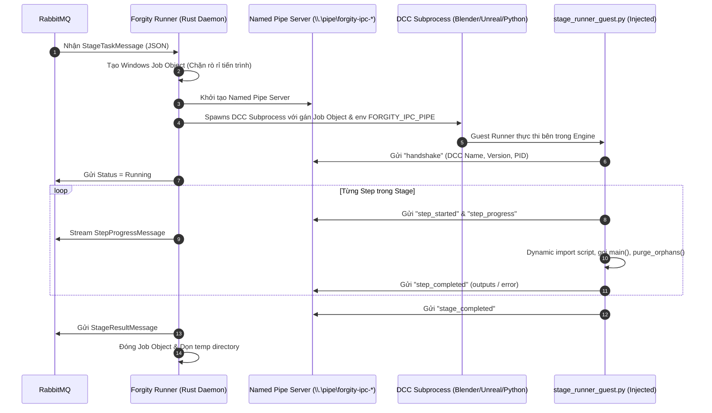

# Runner Playbook: Native Rust Runner Runtime, IPC, Job Object & Storage Engine

> **Phạm vi:** Tài liệu hướng dẫn kỹ thuật cốt lõi cho **Native Rust Runner Daemon** (`runner/`, binary `forgity-runner.exe`):
> 1. Vòng đời tiến trình Host Rust Daemon & Quản lý DCC Subprocess qua **Windows Job Object**.
> 2. Giao thức IPC hai chiều qua **Windows Named Pipe** (`\\.\pipe\forgity-ipc-{stage_id}`).
> 3. Tự động tiêm Single Guest Runner đa hình (`runner/scripts/stage_runner_guest.py`).
> 4. Cấu trúc lưu trữ Runtime Storage (`cache/`, `temp/`, `logs/`, `.storage.lock`).
> 5. Cơ chế dọn rác bộ nhớ & đệm (`forgity-runner clean`).
>
> **Quy tắc bắt buộc:** Agent phải đọc tài liệu này trước khi chỉnh sửa bất kỳ module nào trong `runner/`. Sau khi thay đổi code, phải cập nhật lại tài liệu này.

---

## 1. Bản Đồ Kiến Trúc Host Rust Daemon & Subprocess IPC

Hệ thống điều phối thực thi chạy hoàn toàn trên binary Native Rust hiệu năng cao (`forgity-runner.exe`):



---

## 2. Windows Job Object: Bảo Đảm Zero Process Leak

Khác với Python subprocess truyền thống (khi bị crash hoặc cancel dễ bỏ lại `blender.exe` chạy ngầm chiếm 100% CPU), Rust Runner sử dụng API Win32 **Windows Job Object** ([`runner/src/process/job_object.rs`](file:///d:/FullStack/Automation/runner/src/process/job_object.rs)):

- Cấu hình cờ `JOB_OBJECT_LIMIT_KILL_ON_JOB_CLOSE`.
- Mọi tiến trình con hoặc cháu chắt sinh ra từ DCC đều bị gán vào Job Object này.
- Khi người dùng bấm **Cancel Run** trên Canvas hoặc khi daemon thoát: Rust đóng handle Job Object ➔ Hệ điều hành Windows lập tức thu hồi và tiêu diệt sạch toàn bộ cây tiến trình con trong 0ms.

---

## 3. Cấu Trúc Runtime Storage (`runner/cache/`, `temp/`, `logs/`)

Storage của Runner được quản lý tập trung và an toàn:

```
runner/ (hoặc %LOCALAPPDATA%/Forgity/runner/)
├── .storage.lock                  # Mutex lock chống tranh chấp IO đa tiến trình
├── cache/
│   ├── assets/                    # File nhị phân tải từ S3 (CAS theo SHA-256)
│   ├── scripts/                   # Script Python tải từ Studio (theo SHA-256)
│   └── python-packages/           # (Phase 5) Virtual isolated packages theo hash
├── temp/
│   └── {stage_execution_id}/      # Thư mục tạm cô lập cho từng phiên stage (task.json)
└── logs/
    └── runner_{date}.log          # Nhật ký vận hành Rust Runner
```

---

## 4. Quản Trị Bộ Nhớ Đệm & Quét Dọn (`forgity-runner clean`)

Runner cung cấp công cụ dọn rác chuyên nghiệp:

1. **Lệnh Bảo Trì (Maintenance)**:
   ```bash
   forgity-runner clean
   ```
   - Xóa sạch toàn bộ các thư mục tạm trong `temp/`.
   - Purge toàn bộ log cũ hơn 7 ngày trong `logs/`.

2. **Lệnh Thanh Trừng Toàn Diện (Full Purge)**:
   ```bash
   forgity-runner clean --all
   ```
   - Xóa toàn bộ file cache trong `cache/assets/`, `cache/scripts/` và `cache/python-packages/`.

---

## 5. Danh Mục Script Nghiệp Vụ (`pipeline-scripts/`)

Các script nghiệp vụ DCC được lưu trữ phẳng theo từng Executor tại `pipeline-scripts/`:
- `pipeline-scripts/blender/`: Script thao tác scene, UV, vật liệu, bake, FBX export, inspect mesh.
- `pipeline-scripts/unreal/`: Script import skeletal mesh, tạo vật liệu, datatables.
- `pipeline-scripts/daz/`: Script phân tích phả hệ Daz Studio (`daz_inspector.py`).
- `pipeline-scripts/ai/`: Script phân tích vai trò `classify_mesh_types.py`, `classify_material_manifest.py`.
- `pipeline-scripts/presets/`: Preset chuyển giao DCC.
