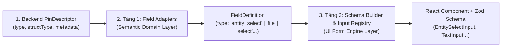

# Sổ Tay Design Patterns & Kiến Trúc Thực Chiến (Applied Design Patterns Catalog)

> Tài liệu này tổng hợp các Design Patterns thực tế đã và đang được áp dụng trong Monorepo **Automation Studio** (đặc biệt là phân hệ Canvas Pipeline và Form Engine). Mỗi pattern đều đi kèm: **Bối cảnh thực tế (Problem)**, **Cách giải quyết (Solution)**, **Code minh họa trực tiếp từ dự án**, và **Lợi ích kiến trúc mang lại**.

---

## Mục Lục

1. [Facade Pattern](#1-facade-pattern)
2. [Strategy Pattern & Adapter Pattern (Field Adapter Registry)](#2-strategy-pattern--adapter-pattern)
3. [Registry Pattern (Auto-Discovery & Pluggable Registry)](#3-registry-pattern)
4. [Composite / Domain Component Composition Pattern](#4-domain-component-composition-pattern)
5. [Single Source of Truth & Pure Function Boundary](#5-single-source-of-truth--pure-function-boundary)

---

## 1. Facade Pattern

### 💡 Khái niệm & Bối cảnh

Khi một hệ thống con (subsystem) phát triển ngày càng phức tạp với nhiều lớp xử lý, class, module con, client (nơi gọi) không nên phụ thuộc trực tiếp vào từng chi tiết lắt léo đó. **Facade Pattern** cung cấp một giao diện đơn giản, thống nhất (high-level interface) để che giấu độ phức tạp bên trong.

### 🛠️ Áp dụng trong dự án: `pinToFieldDefinition.ts`

- **Trước khi áp dụng**: File [pinToFieldDefinition.ts](file:///d:/FullStack/Automation/web/src/features/pipelines/form-scope/pinToFieldDefinition.ts) dài 465 dòng, ôm đồm: phân tích JSON metadata, chuẩn hóa string type, 11 rules lồng nhau, kiểm tra substring `.includes()`.
- **Sau khi áp dụng Facade**:
  Client (`RunPipelineModal`, `NodeConfigInspector`) chỉ cần gọi một hàm duy nhất:
  ```ts
  const fieldDef = pinToFieldDefinition(pin, configValues);
  ```
  Bên dưới, Facade tự động phối hợp `buildPinFieldContext` và duyệt hệ thống `FIELD_ADAPTERS` mà client bên ngoài không cần bận tâm:

```ts
// web/src/features/pipelines/form-scope/pinToFieldDefinition.ts
export function pinToFieldDefinition(
  pin: PinDefinition,
  configValues: Record<string, any> = {},
  overrides?: { name?: string; label?: string },
): FieldDefinition<any> {
  // 1. Phối hợp builder chuẩn hóa context
  const ctx = buildPinFieldContext(pin, configValues);

  // 2. Phối hợp Strategy/Adapter để tạo field
  const matchedAdapter =
    FIELD_ADAPTERS.find((a) => a.match(ctx)) ?? primitiveAdapter;
  const fieldDef = matchedAdapter.create(ctx);

  fieldDef.properties = {
    ...fieldDef.properties,
    required: pin.isRequired === true,
  };

  if (overrides?.name) fieldDef.name = overrides.name;
  if (overrides?.label) fieldDef.label = overrides.label;

  return fieldDef;
}
```

- **Lợi ích**:
  - `pinToFieldDefinition.ts` giảm từ **465 dòng xuống 54 dòng**.
  - Các nơi gọi (Callers) không bị breaking changes khi ta tái cấu trúc toàn bộ các adapter bên dưới.

---

## 2. Strategy Pattern & Adapter Pattern

### 💡 Khái niệm & Bối cảnh

- **Adapter Pattern**: Biến đổi giao diện của một đối tượng này thành giao diện mà đối tượng khác mong muốn (chuyển đổi Pin từ backend thành Field của React Hook Form).
- **Strategy Pattern**: Định nghĩa một tập hợp các thuật toán/hành vi độc lập, đóng gói từng thuật toán vào các class/object riêng biệt có cùng interface (`match` và `create`), giúp chúng có thể thay thế cho nhau tại runtime.

### 🛠️ Áp dụng trong dự án: `field-adapters/`

Mỗi loại Pin có logic biến đổi thành Form Control riêng:

1. `metadataHintAdapter.ts`: Xử lý metadata UI (`tag-tree-select`, `select` có options).
2. `variableRefAdapter.ts`: Xử lý struct `Variable`.
3. `entityRefAdapter.ts`: Xử lý các entity liên kết (`Runner`, `Repository`, `Resource`, `ContentType`, `ContentItem`).
4. `collectionAdapter.ts`: Xử lý `Map` (`key-value`) và `Array` (`tags`).
5. `assetAdapter.ts`: Xử lý upload tệp binary (`pin:assetUpload`).
6. `primitiveAdapter.ts`: Fallback cho kiểu nguyên thủy (`boolean`, `number`, `path`, `string`).

#### Giao diện chung (Strategy Contract):

```ts
// web/src/features/pipelines/form-scope/field-adapters/types.ts
export interface FieldAdapter {
  id: string;
  match(ctx: PinFieldContext): boolean;
  create(ctx: PinFieldContext): FieldDefinition<any>;
}
```

#### Ví dụ một Strategy độc lập:

```ts
// web/src/features/pipelines/form-scope/field-adapters/variableRefAdapter.ts
export const variableRefAdapter: FieldAdapter = {
  id: "variableRef",
  match: (ctx: PinFieldContext) => ctx.structType === "Variable",
  create: (ctx: PinFieldContext) => ({
    name: ctx.pinId,
    label: ctx.label,
    type: "pin:variableSelect",
    defaultValue: ctx.pin.defaultValue ?? "",
    properties: {},
  }),
};
```

- **Lợi ích**:
  - Tuân thủ nguyên lý **Open/Closed Principle (SOLID)**: Khi cần hỗ trợ một loại Control mới (ví dụ Color Picker, Code Editor), ta chỉ việc tạo thêm một adapter mới và thêm vào mảng `FIELD_ADAPTERS`, không cần sửa hay đụng vào code của các adapter cũ.
  - Mỗi adapter chỉ dài **20–40 dòng**, cực kỳ dễ viết Unit Test độc lập.

---

## 3. Registry Pattern

### 💡 Khái niệm & Bối cảnh

Trong hệ thống dynamic form hoặc pipeline engine, danh sách các loại linh kiện (Fields, Tools, Nodes) không cố định mà mở rộng liên tục. **Registry Pattern** tạo một cuốn "danh bạ trung tâm" (Registry) cho phép các thành phần tự đăng ký (register) và tra cứu (lookup) theo khóa định danh (`type` hoặc `key`).

### 🛠️ Áp dụng trong dự án:

1. **Dynamic Field Controls Registry (`web/src/lib/field-registry.ts`)**:
   - Các components như `FormPinRunnerSelect`, `FormPinRepositorySelect`, `FormPinEntitySelect` sử dụng `registerField({ type: "pin:runnerSelect", component: ... })`.
   - Kết hợp với TypeScript **Module Augmentation** để có type-safe autocomplete khi viết schema form.
2. **Node Strategy Registry (`PipelineNodeRouter.tsx`)**:
   - Thay vì switch-case hàng chục dòng, router tra cứu View component theo `viewVariant`:
   ```tsx
   const views: Record<string, ComponentType<NodeProps>> = {
     Standard: StandardToolNodeView,
     Collection: CollectionNodeView,
     Struct: StructNodeView,
   };
   const View = views[view] ?? StandardToolNodeView;
   return <View {...props} />;
   ```

---

## 4. Domain Component Composition Pattern

### 💡 Khái niệm & Bối cảnh

Các file component React hoặc Hook thường có xu hướng biến thành "God Component" (dài 500–1000 dòng) khi ôm đồm:

- Vừa quản lý luồng chọn dữ liệu đa bước (Step 1 $\rightarrow$ Step 2).
- Vừa render checklist, search input, select all.
- Vừa xử lý combobox đơn cho 5-6 loại entity khác.

**Kỹ thuật Chia nhỏ**: Tách nhỏ theo ranh giới **Domain Responsibility** (Trách nhiệm miền nghiệp vụ).

### 🛠️ Áp dụng trong dự án: `EntityPinSelect.tsx` & `ResourceWorkstationSelect.tsx`

- **Trước**: [EntityPinSelect.tsx](file:///d:/FullStack/Automation/web/src/features/pipelines/components/canvas/EntityPinSelect.tsx) dài **411 dòng**, gọi đồng thời 6 query hooks (`useRepositories`, `useProjectWorkstations`, `useGetRepositoryResources`, `useRunners`, `useTags`, `useContentTypes`). Khi người dùng chọn `Runner`, cả 5 query kia vẫn chạy ngầm hoặc code bị rối bời.
- **Sau khi tách**:
  1. [ResourceWorkstationSelect.tsx](file:///d:/FullStack/Automation/web/src/features/pipelines/components/canvas/ResourceWorkstationSelect.tsx) (**226 dòng**): Chuyên trách bộ chọn 2 bước phức tạp của `Resource` (chọn Workstation Root $\rightarrow$ chọn file trong checklist). Chỉ kích hoạt hook của Workstation & Resource.
  2. [EntityPinSelect.tsx](file:///d:/FullStack/Automation/web/src/features/pipelines/components/canvas/EntityPinSelect.tsx) (**172 dòng**): Điều phối mỏng, so khớp trực tiếp `structType` PascalCase (`Resource`, `Repository`, `Runner`, `ContentType`, `ContentItem`, `Tag`) và ủy quyền `Resource` cho component chuyên trách.

---

## 5. Single Source of Truth & Pure Function Boundary

### 💡 Khái niệm & Bối cảnh

Khi mã nguồn có logic chuyển đổi kiểu (như `normalizePinType`), nếu để logic này dính chặt vào các thư viện bên ngoài (như React Query hooks hoặc Orval generated API clients), các module thuần túy (Pure functions, Unit tests chạy trên Node.js) sẽ bị phụ thuộc dây chuyền và không thể chạy độc lập.

### 🛠️ Áp dụng trong dự án: `normalizePinType.ts`

- Tách hàm thuần túy `normalizePinType(rawType)` ra một file riêng [normalizePinType.ts](file:///d:/FullStack/Automation/web/src/features/pipelines/form-scope/field-adapters/normalizePinType.ts) không phụ thuộc vào `@/gen/*`.
- Nhờ đó, bài test [web/tests/pinToFieldDefinition.test.mts](file:///d:/FullStack/Automation/web/tests/pinToFieldDefinition.test.mts) có thể chạy siêu tốc trực tiếp bằng `node --test` (chỉ mất ~200ms) mà không cần bundle hay mock API client.

---

## 6. Two-Tier Architecture: Semantic Adapters vs UI Control Registry

### 💡 Khái niệm & Bối cảnh

Một câu hỏi thường gặp: *"Tại sao có cả `field-adapters/` (trong Pipeline) lẫn `input-registry.ts` + `schema-builder.ts` (trong `components/form/engine/`)? Chúng có trùng lặp không?"*

Câu trả lời là **không trùng lặp** — chúng thuộc **2 tầng trừu tượng khác nhau** và nối tiếp nhau theo mô hình 2 tầng (Two-Tier Pipeline):



### 🔍 Bảng So Sánh Trách Nhiệm 2 Tầng

| Tiêu chí | Tầng 1: `field-adapters/` (`pinToFieldDefinition`) | Tầng 2: `input-registry.ts` & `schema-builder.ts` |
| :--- | :--- | :--- |
| **Phạm vi sử dụng** | Đặc thù cho miền **Pipeline Node Pins** (`web/src/features/pipelines/form-scope/`). | Dùng chung **Toàn ứng dụng** (`web/src/components/form/engine/`). |
| **Đầu vào (Input)** | `PinDescriptorDto` từ Backend (`type: "entity"`, `structType: "Resource"`, `metadata: "textarea"`, `configValues`). | `FieldDefinition` chuẩn hóa (`type: "entity_select"`, `required: true`, `options: [...]`). |
| **Nhiệm vụ chính** | Giải nghĩa **Ngữ nghĩa miền Pipeline** (Domain Semantics): Pin này có đang nối dây (`isConnected`) không? Là `Variable` hay `Entity` hay `Array<T>`? Đang chạy trên `Runner` nào? | Giải nghĩa **Kỹ thuật Form UI**: Ánh xạ `field.type` sang **React Component** tương ứng (qua `import.meta.glob` Auto-Scan) và sinh **Zod Validation Rule** (`z.string().min(1)`). |
| **Đầu ra (Output)** | `FieldDefinition` trung gian (đã làm phẳng mọi khái niệm Pin). | Giao diện Form hoàn chỉnh (`DynamicForm`) kèm cơ chế bắt lỗi React Hook Form. |
| **Pattern sử dụng** | **Chain of Responsibility + Adapter + Facade** (biến đổi `PinDescriptor` $\rightarrow$ `FieldDefinition`). | **Auto-Scan Plugin Registry** (`input-registry.ts`) + **Builder Pattern** (`schema-builder.ts`). |

